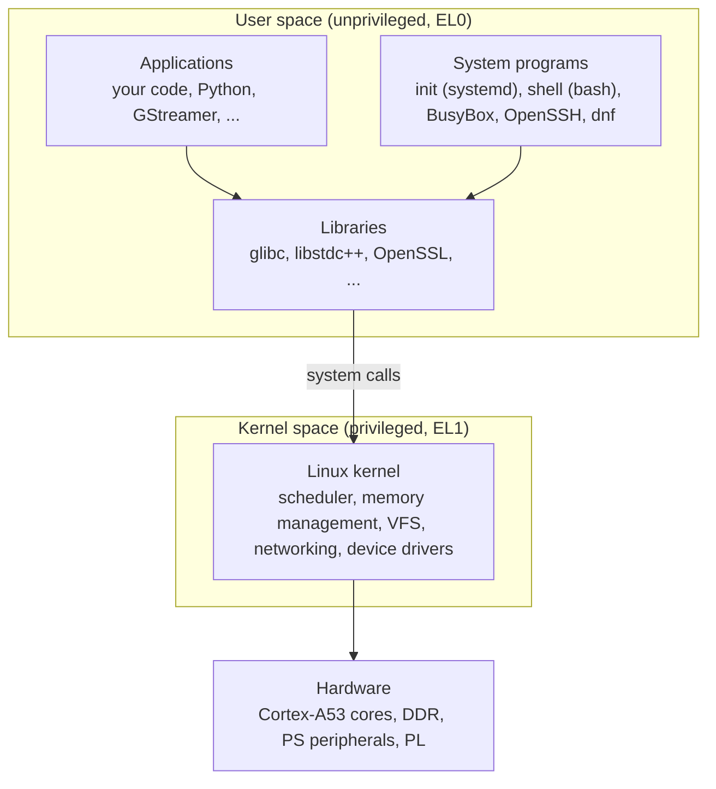

# What Is Linux?

> **Applies to:** PetaLinux 2024.1 · Zynq UltraScale+ MPSoC · any Linux host

**[01 · Linux Fundamentals](README.md)** · Part I: Foundations

## In short

- Strictly speaking, **Linux is only the kernel**. What runs on a board is an **operating system**: the kernel plus a C library and user-space programs. A **distribution** is a curated, versioned and maintained collection of all of that.
- The kernel follows a fixed rhythm: a mainline release roughly every 9 to 10 weeks, short-lived stable updates, and a few **longterm (LTS)** branches maintained for years. Vendor kernels such as AMD's `linux-xlnx` are built on LTS branches.
- Licenses matter from the first prototype. The kernel is GPL-2.0-only, and shipping a product means you must be able to provide the corresponding source code of every GPL component in it.
- A ZynqMP design usually runs Linux, an RTOS and bare-metal code **at the same time**, on different processors. Choosing what runs where is a design decision.

## Concepts

### Kernel, operating system and distribution



- **Kernel.** The only program that runs in the privileged CPU mode (EL1 on Arm64). It schedules processes, manages memory, implements filesystems and the network stack, and drives the hardware. It has no shell, no login prompt and no `ls`. Programs reach it only through **system calls**.
- **Operating system.** The kernel plus the user space that makes it usable: a C library, an init system, a shell and utilities. On desktop systems most of these come from the GNU project, which is why the whole system is sometimes called *GNU/Linux*. Embedded systems often replace the GNU utilities with **BusyBox** ([chapter 15](../15-root-filesystem-and-init/07-busybox.md)).
- **Distribution.** A project or company that chooses component versions, builds them, configures them to work together, packages them and keeps shipping security fixes for years. Debian, Ubuntu and Fedora are distributions. So is **PetaLinux**: a distribution that AMD builds with the Yocto Project.

> [!TIP]
> When someone says "we run Linux 6.6", ask "which distribution?". When someone says "we run PetaLinux 2024.1", you already know the kernel (6.6.10), the C library (glibc 2.36) and the build system (Yocto 4.1). The rest of this section shows how to read that off a running system.

### Reading the layers off a running system

The target of the [reference setup](../CONTRIBUTING.md#reference-setup) is the prebuilt ZCU106 2024.1 image. Here is what each layer reports.

The kernel:

```console
target$ uname -a
Linux xilinx-zcu106-20241 6.6.10-xilinx-v2024.1-g3af4295e00ef #1 SMP Sat Apr 27 05:22:24 UTC 2024 aarch64 GNU/Linux
target$ cat /proc/version
Linux version 6.6.10-xilinx-v2024.1-g3af4295e00ef (oe-user@oe-host) (aarch64-xilinx-linux-gcc (GCC) 12.2.0, GNU ld (GNU Binutils) 2.39.0.20220819) #1 SMP Sat Apr 27 05:22:24 UTC 2024
```

| Part of the string | Meaning |
| --- | --- |
| `6.6.10` | Upstream version: the 6.6 longterm series, 10th stable update |
| `-xilinx-v2024.1` | Local version suffix. The recipe derives it from its file name (`LINUX_VERSION_EXTENSION` in `linux-xlnx.inc`), and it must match `CONFIG_LOCALVERSION` in the kernel configuration |
| `-g3af4295e00ef` | `g` + the abbreviated Git commit the kernel was built from. It matches `SRCREV = "3af4295e00efdced3e8c6973606a7de55f6bf7dc"` in `meta-xilinx@rel-v2024.1:meta-xilinx-core/recipes-kernel/linux/linux-xlnx_2024.1.bb` |
| `#1 SMP` | Build counter (normally 1, because Yocto builds in a fresh tree) and a multiprocessor (SMP) kernel |
| `oe-user@oe-host` | Fixed values (`KBUILD_BUILD_USER`, `KBUILD_BUILD_HOST` in `poky/meta/classes-recipe/linux-kernel-base.bbclass`) used instead of the real build user and host, so that builds are reproducible |
| `aarch64-xilinx-linux-gcc (GCC) 12.2.0` | The cross compiler that built the kernel |
| `aarch64` | 64-bit Arm (Armv8-A) |

The distribution and the C library:

```console
target$ cat /etc/os-release
ID=petalinux
NAME="PetaLinux"
VERSION="2024.1+release-S05201002 (langdale)"
VERSION_ID=2024.1-release-s05201002
PRETTY_NAME="PetaLinux 2024.1+release-S05201002 (langdale)"
DISTRO_CODENAME="langdale"
target$ /lib/libc.so.6 | head -1
GNU C Library (GNU libc) stable release version 2.36.
```

`langdale` is the codename of Yocto Project 4.1, the release PetaLinux 2024.1 is built on ([chapter 04](../04-yocto-project/01-yocto-openembedded-bitbake.md)). Running `libc.so.6` as a program is a glibc feature: it prints its own version.

Compare with the Ubuntu 22.04 host of the reference setup:

```console
$ uname -r
6.8.0-138-generic
$ ldd --version | head -1
ldd (Ubuntu GLIBC 2.35-0ubuntu3.15) 2.35
```

The same kernel project and the same C library project produce very different systems. The host runs Ubuntu's 6.8 kernel and glibc 2.35, while the target runs AMD's 6.6 kernel and glibc 2.36. A program built against glibc 2.36 may refuse to start on a system that only has 2.35 ([02 · Cross-Compilation and Toolchains](../02-embedded-linux-concepts/02-cross-compilation-and-toolchains.md)).

### How the kernel is developed and versioned

Linus Torvalds announced the kernel in 1991. It has been GPL-licensed since 1992 and is now developed by thousands of contributors through subsystem maintainers. Releases follow a fixed process:

1. **Mainline.** After each release, a two-week *merge window* accepts new features, followed by weekly release candidates (`-rc1`, `-rc2`, ...). A new mainline version (6.6, 6.7, ...) appears roughly every 9 to 10 weeks.
2. **Stable.** Bug fixes from mainline are backported to the latest release as `6.6.1`, `6.6.2`, ... Most stable series end shortly after the next mainline version is out.
3. **Longterm (LTS).** One release per year is maintained for several years. These are the kernels products are built on.

Longterm kernels listed on kernel.org at the time of writing (October 2026):

| Series | Released | Projected end of life |
| --- | --- | --- |
| 6.18 | 2025-11-30 | December 2028 |
| 6.12 | 2024-11-17 | December 2028 |
| **6.6** (PetaLinux 2024.x) | 2023-10-29 | December 2027 |
| 6.1 (PetaLinux 2023.x) | 2022-12-11 | December 2027 |
| 5.15 | 2021-10-31 | December 2026 |
| 5.10 | 2020-12-13 | December 2026 |

> [!NOTE]
> Projected end-of-life dates change; kernel.org has extended several of them in the past. Check [kernel.org/category/releases.html](https://www.kernel.org/category/releases.html) when you plan a product.

**Vendor kernels** sit on top of this. AMD's [`linux-xlnx`](https://github.com/Xilinx/linux-xlnx) rebases its ZynqMP, Versal and PL IP drivers onto an LTS series (branch `xlnx_rebase_v6.6_LTS` for 2024.1) and freezes a commit per tool release. The kernel.org documentation puts it simply: if `uname -r` shows anything after the dash, you are running a distribution or vendor kernel, and support comes from that vendor ([chapter 13](../13-linux-kernel/02-linux-xlnx-and-kernel-versions.md)).

### Licensing basics

Every component on the target carries a license. The RPM database records it for each package:

```console
target$ rpm -q --qf '%-24{NAME} %{LICENSE}\n' kernel-image-image-6.6.10-xilinx-v2024.1-g3af4295e00ef libc6 busybox bash systemd openssh-sshd libgpiod2
kernel-image-image-6.6.10-xilinx-v2024.1-g3af4295e00ef GPL-2.0-only
libc6                    GPL-2.0-only & LGPL-2.1-only
busybox                  GPL-2.0-only & bzip2-1.0.4
bash                     GPL-3.0-or-later
systemd                  GPL-2.0-only & LGPL-2.1-only
openssh-sshd             BSD-2-Clause & BSD-3-Clause & ISC & MIT
libgpiod2                LGPL-2.1-or-later
```

What this means in practice:

- **GPL (copyleft).** If you distribute a device that contains GPL software, you must also provide the corresponding source code of that software, including your modifications, under the same license. This covers the kernel, BusyBox and bash in the list above.
- **The kernel's user-space boundary.** The kernel's license (`COPYING` in the kernel source) includes a note saying that programs which only use the kernel through system calls are **not** derived works. Your proprietary application can run on Linux. A kernel **module**, however, links against the kernel, and many kernel APIs are exported only to GPL-compatible modules (`EXPORT_SYMBOL_GPL`).
- **LGPL.** Libraries such as glibc and libgpiod can be used by proprietary programs, as long as the user can replace the library (dynamic linking is the usual way to satisfy this).
- **Permissive licenses** (BSD, MIT, ISC), such as OpenSSH's, only require keeping copyright notices.
- **GPLv3** (bash here) adds requirements around installation information for consumer devices. Some companies exclude GPLv3 components from products for that reason. Yocto can enforce such a policy with `INCOMPATIBLE_LICENSE`.

> [!IMPORTANT]
> This is not legal advice. Yocto can generate license manifests and source archives for compliance; [chapter 23](../23-storage-updates-and-production/07-licensing-and-compliance.md) covers the workflow.

## On ZynqMP

### Where Linux runs, and what runs next to it

Linux needs an MMU, plenty of RAM and tolerance for non-deterministic latency. A ZynqMP device has several processors with very different properties, so most designs combine three kinds of software:

| Software model | Typical ZynqMP processor | Strengths | Weaknesses |
| --- | --- | --- | --- |
| **Linux** | APU: 4x Cortex-A53 | Drivers, networking, filesystems, security updates, huge ecosystem, multi-core | Boot time in seconds, latency not guaranteed without tuning, large footprint |
| **RTOS** (FreeRTOS, Zephyr, ...) | RPU: 2x Cortex-R5F | Deterministic latency, small footprint, fast start | Few drivers, small ecosystem, you own more of the code |
| **Bare metal** | PMU (MicroBlaze), RPU, CSU | Full control, minimal overhead | No scheduler, no isolation, everything is hand-written |

The boot chain itself is a mix. On the reference target:

- The PMU firmware is bare-metal code on the PMU's MicroBlaze. It prints `PMU Firmware 2024.1` on the console and keeps running for the whole life of the system ([chapter 09](../09-pmu-firmware/README.md)).
- TF-A and U-Boot are bare-metal programs on the Cortex-A53 ([chapters 10](../10-trusted-firmware-a/README.md) and [11](../11-u-boot/README.md)).
- Only after that does Linux start on the four A53 cores.

The RPU is free for an RTOS or bare-metal firmware that Linux can load and talk to ([chapter 21](../21-rpu-and-openamp/README.md)).

### Choosing between Linux, an RTOS and bare metal

Put a function on Linux when it needs networking, filesystems, USB, displays, complex protocols, field updates or a large software ecosystem. Move it to the RPU, or into the PL, when it needs a hard deadline (microseconds, guaranteed), must keep working while Linux reboots, or has functional-safety requirements. [Chapter 13](../13-linux-kernel/06-real-time-linux.md) shows how far PREEMPT_RT can push Linux before that becomes necessary.

## Pitfalls

- **Confusing the kernel version with the distribution version.** "Linux 6.6" and "PetaLinux 2024.1" answer different questions. Bug reports and support requests need both, plus the exact commit (`g3af4295e00ef`).
- **Assuming the vendor kernel is mainline.** A fix that landed upstream in 6.6.30 is not necessarily in `6.6.10-xilinx-v2024.1`. Check the vendor tree.
- **Treating license compliance as a release-day task.** A GPLv3 component or a missing source archive is much harder to remove late in a project.

## References

- kernel.org, [Releases](https://www.kernel.org/category/releases.html) (longterm table and release process), retrieved October 2026
- `linux-xlnx@xilinx-v2024.1:COPYING` and `LICENSES/exceptions/Linux-syscall-note`
- `meta-xilinx@rel-v2024.1:meta-xilinx-core/recipes-kernel/linux/linux-xlnx_2024.1.bb` (`LINUX_VERSION`, `KBRANCH`, `SRCREV`) and `linux-xlnx.inc` (`LINUX_VERSION_EXTENSION`)
- `poky` (Yocto 4.1.4): `meta/classes-recipe/linux-kernel-base.bbclass` (`KBUILD_BUILD_USER`, `KBUILD_BUILD_HOST`)
- Captured on the reference setup: `uname -a`, `/proc/version`, `/etc/os-release`, `rpm -q` license query on the ZCU106 2024.1 prebuilt image

---

<sub>[Chapter index](README.md) · [Linux Distributions and Linux-Based Operating Systems](02-linux-distributions.md) →</sub>
