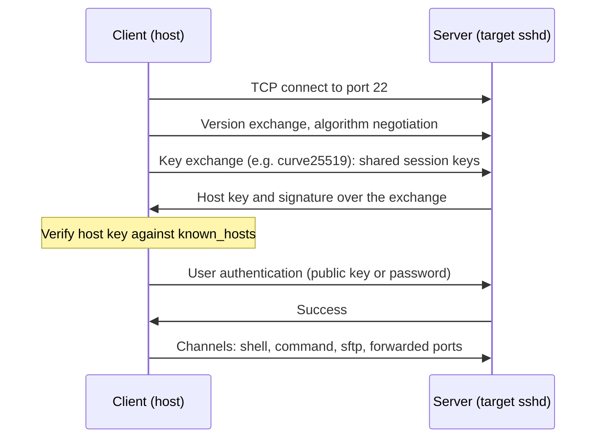

# SSH: Secure Shell

> **Applies to:** PetaLinux 2024.1 · Zynq UltraScale+ MPSoC · OpenSSH 8.9 (host) and 9.0 (target)

**[01 · Linux Fundamentals](README.md)** · Part I: Foundations

## In short

- SSH gives you an **encrypted, authenticated** shell, file transfer and port forwarding over one TCP connection (port 22). It is the main way to work on a networked target.
- The client verifies the **server's host key** on every connection. The first time, *you* are the verification: compare the fingerprint with the one printed on the target.
- Use **key-based authentication** (`ssh-keygen`, `ssh-copy-id`) and a `~/.ssh/config` entry per board. It is both more convenient and more secure than passwords.
- `scp`, `sftp` and `rsync` move files. `-L`, `-R` and `-D` forward ports. `-J` hops through a jump host.
- PetaLinux 2024.1 images use **OpenSSH** or **Dropbear**. The reference image uses OpenSSH, started per connection by systemd socket activation.

## Concepts

### How an SSH connection is set up



1. **Key exchange.** Client and server agree on session keys that nobody on the network can compute. From here on, everything is encrypted and integrity-protected.
2. **Server authentication.** The server proves that it holds the private part of its **host key**. The client compares the public host key with its `~/.ssh/known_hosts` file. This is what protects you against a man-in-the-middle.
3. **User authentication.** You prove who you are, with a password or, better, with a private key whose public part is in the server's `~/.ssh/authorized_keys`.
4. **Channels.** Several streams share the connection: interactive shells, commands, SFTP, forwarded ports.

[Chapter 27](../27-linux-and-network-security/02-ssh-in-depth-and-hardening.md) goes deeper into the protocol and into hardening the server.

### The reference setup

The target runs in QEMU, and QEMU forwards host port `2222` to the target's port `22`. Every example therefore connects to `127.0.0.1` port `2222`. On a real board, use the board's IP address and the default port 22 instead.

| | Host | Target |
| --- | --- | --- |
| Software | `OpenSSH_8.9p1 Ubuntu-3ubuntu0.17, OpenSSL 3.0.2 15 Mar 2022` | OpenSSH 9.0p1 (`openssh-sshd`) |
| Address used | | `127.0.0.1:2222` (QEMU), or `<board-ip>:22` |
| User | | `petalinux` |

## Hands-on

### First connection and host key verification

```console
$ ssh -p 2222 petalinux@127.0.0.1 uname -a
The authenticity of host '[127.0.0.1]:2222 ([127.0.0.1]:2222)' can't be established.
ED25519 key fingerprint is SHA256:eda8vnpmCsSz5FrJ6Dr2tXdJYxYG7kA5pEjcXtli0rI.
This key is not known by any other names
Are you sure you want to continue connecting (yes/no/[fingerprint])? yes
Warning: Permanently added '[127.0.0.1]:2222' (ED25519) to the list of known hosts.
petalinux@127.0.0.1's password:
Linux xilinx-zcu106-20241 6.6.10-xilinx-v2024.1-g3af4295e00ef #1 SMP Sat Apr 27 05:22:24 UTC 2024 aarch64 GNU/Linux
```

Before typing `yes`, check the fingerprint against the one the target itself reports, for example over the serial console:

```console
target$ ssh-keygen -lf /etc/ssh/ssh_host_ed25519_key.pub
256 SHA256:eda8vnpmCsSz5FrJ6Dr2tXdJYxYG7kA5pEjcXtli0rI root@xilinx-zcu106-20241 (ED25519)
```

They match, so the key now stored in `known_hosts` really belongs to the target. You can look it up later:

```console
$ ssh-keygen -F '[127.0.0.1]:2222' -l
# Host [127.0.0.1]:2222 found: line 1
[127.0.0.1]:2222 ED25519 SHA256:eda8vnpmCsSz5FrJ6Dr2tXdJYxYG7kA5pEjcXtli0rI
```

**When the host key changes.** The target generates its host keys on the first boot (the `sshdgenkeys.service` unit). Flash a new image and the board gets new keys, so the next connection fails loudly:

```console
$ ssh zcu106-qemu true
@@@@@@@@@@@@@@@@@@@@@@@@@@@@@@@@@@@@@@@@@@@@@@@@@@@@@@@@@@@
@    WARNING: REMOTE HOST IDENTIFICATION HAS CHANGED!     @
@@@@@@@@@@@@@@@@@@@@@@@@@@@@@@@@@@@@@@@@@@@@@@@@@@@@@@@@@@@
IT IS POSSIBLE THAT SOMEONE IS DOING SOMETHING NASTY!
Someone could be eavesdropping on you right now (man-in-the-middle attack)!
It is also possible that a host key has just been changed.
The fingerprint for the ED25519 key sent by the remote host is
SHA256:eda8vnpmCsSz5FrJ6Dr2tXdJYxYG7kA5pEjcXtli0rI.
Please contact your system administrator.
...
Offending ED25519 key in ~/.ssh/known_hosts:1
  remove with:
  ssh-keygen -f "~/.ssh/known_hosts" -R "[127.0.0.1]:2222"
Host key for [127.0.0.1]:2222 has changed and you have requested strict checking.
Host key verification failed.
$ ssh-keygen -R '[127.0.0.1]:2222'
# Host [127.0.0.1]:2222 found: line 1
known_hosts updated.
Original contents retained as known_hosts.old
```

If you just reflashed the board, removing the old entry is the right fix. If you did not, stop and find out why the key changed.

> [!TIP]
> Regenerated host keys after every reflash are annoying in the lab and weak in production. A product should get its host key once, during manufacturing, and keep it across updates. [Chapter 27](../27-linux-and-network-security/02-ssh-in-depth-and-hardening.md) discusses provisioning.

### Key-based authentication

Generate a key pair on the host. Ed25519 keys are short, fast and secure. OpenSSH 9.5 and later generate them by default; on Ubuntu 22.04's OpenSSH 8.9, ask for them with `-t ed25519`:

```console
$ ssh-keygen -t ed25519 -C dev@workstation -f ~/.ssh/id_ed25519 -N ''
Generating public/private ed25519 key pair.
Your identification has been saved in ~/.ssh/id_ed25519
Your public key has been saved in ~/.ssh/id_ed25519.pub
The key fingerprint is:
SHA256:aGiSVw/0ME1ijfO+ksPSPR3PXwaFopxJwHvMhdABegE dev@workstation
The key's randomart image is:
+--[ED25519 256]--+
|      EB*+.o     |
|     oo*+oo .  . |
|      +oo+... . .|
|   . o =oo++ . . |
|  o + o.S.=   .  |
|   + .  . .    . |
|     o o o +    o|
|    . * + . o  o |
|     . o .   ..  |
+----[SHA256]-----+
```

`-N ''` creates a key **without a passphrase**, which is acceptable for a throw-away lab key only. For your real key, set a passphrase and let `ssh-agent` remember it for the session.

Install the public key on the target, then check that login works without a password:

```console
$ ssh-copy-id -i ~/.ssh/id_ed25519.pub -p 2222 petalinux@127.0.0.1
/usr/bin/ssh-copy-id: INFO: Source of key(s) to be installed: "~/.ssh/id_ed25519.pub"
/usr/bin/ssh-copy-id: INFO: attempting to log in with the new key(s), to filter out any that are already installed
/usr/bin/ssh-copy-id: INFO: 1 key(s) remain to be installed -- if you are prompted now it is to install the new keys
petalinux@127.0.0.1's password:

Number of key(s) added: 1
...
$ ssh -i ~/.ssh/id_ed25519 -o BatchMode=yes -p 2222 petalinux@127.0.0.1 'ls -la ~/.ssh; cut -c1-60 ~/.ssh/authorized_keys'
total 12
drwx------    2 petalinu petalinu      4096 Oct 15 12:08 .
drwxr-xr-x    3 petalinu petalinu      4096 Oct 15 12:08 ..
-rw-------    1 petalinu petalinu        97 Oct 15 12:08 authorized_keys
ssh-ed25519 AAAAC3NzaC1lZDI1NTE5AAAAIEdDHNE0RKJrLaz+NDxxqxdZ
```

- `BatchMode=yes` makes ssh fail instead of asking for a password. Use it in scripts, so that a broken key setup shows up as an error and not as a hang.
- `sshd` ignores `authorized_keys` if `~/.ssh` or the file is writable by others. `ssh-copy-id` sets the right modes (`700` and `600`). If you copy the file by hand, set them yourself.
- `ssh-copy-id` needs one successful password login. When that is not possible (no password set, or password logins disabled in `sshd_config`), put the public key into the image instead ([chapter 15](../15-root-filesystem-and-init/09-users-and-login.md)).

### A config entry per board

Typing ports, users and keys gets old quickly. `~/.ssh/config` stores them under a short name:

```text
Host zcu106-qemu
    HostName 127.0.0.1
    Port 2222
    User petalinux
    IdentityFile ~/.ssh/id_ed25519
    IdentitiesOnly yes
```

```console
$ ssh zcu106-qemu 'uptime; exit 3'; echo "exit status: $?"
 12:08:16 up 12 min,  load average: 0.33, 0.34, 0.28
exit status: 3
$ ssh -G zcu106-qemu | grep -E '^(hostname|port|user|identityfile) '
user petalinux
hostname 127.0.0.1
port 2222
identityfile ~/.ssh/id_ed25519
```

- A remote command's exit status becomes ssh's exit status, so `ssh board 'cmd'` works in scripts and `if` statements.
- `ssh -G <name>` prints the configuration ssh would use, which is the quickest way to debug a config file.
- `IdentitiesOnly yes` stops ssh from offering every key in your agent. Servers count failed keys, and too many offers lead to `Too many authentication failures`.
- Every name in `~/.ssh/config` works with `scp`, `sftp`, `rsync` and other tools that use ssh.

### Copying files: scp, sftp and rsync

```console
$ scp app/hello.txt zcu106-qemu:/tmp/ && scp zcu106-qemu:/etc/os-release ./target-os-release && head -2 target-os-release
ID=petalinux
NAME="PetaLinux"
$ sftp -b batch.sftp zcu106-qemu
sftp> cd /tmp
sftp> ls -l hello.txt
-rw-r--r--    ? 1000     1000           20 Oct 15 15:08 hello.txt
sftp> get hello.txt hello-back.txt
```

`batch.sftp` contains the three commands shown after the `sftp>` prompts. `-b` runs them without interaction and stops at the first error, which makes sftp scriptable. Note that sftp shows times in the host's time zone (UTC+3 here), while the target runs on UTC.

**rsync** transfers only what changed, which makes it the right tool for repeatedly deploying a directory, such as an application with its configuration files. It must be installed on **both** ends. The reference image does not include it, so it was installed with `dnf install rsync` first ([section 03](03-package-management.md)).

```console
$ rsync -av app/ zcu106-qemu:/tmp/app/
sending incremental file list
created directory /tmp/app
./
hello.txt
config/
config/app.conf

sent 270 bytes  received 100 bytes  740.00 bytes/sec
total size is 28  speedup is 0.08
$ echo 'rate=30' > app/config/app.conf
$ rsync -av app/ zcu106-qemu:/tmp/app/
sending incremental file list
config/app.conf

sent 194 bytes  received 42 bytes  157.33 bytes/sec
total size is 28  speedup is 0.12
```

The second run sends only the changed file. The trailing `/` on `app/` matters: it means "the contents of `app`". Without it, rsync creates `/tmp/app/app/`.

> [!WARNING]
> rsync decides what changed by comparing **size and modification time** (in whole seconds), not content. When the reference run edited `app.conf` within the same second as the previous transfer, and the new content had the same size (`rate=10` → `rate=30`), rsync skipped the file and reported nothing to send. Scripts that edit and deploy in quick succession should use `rsync -c` (compare checksums).

> [!NOTE]
> **Release difference:** since OpenSSH 9.0, `scp` uses the SFTP protocol by default. The Ubuntu 22.04 host (OpenSSH 8.9) still uses the legacy SCP protocol. A newer client talking to a server without an SFTP server, such as a minimal Dropbear image, fails. `scp -O` forces the legacy protocol.

### Port forwarding

**Local forwarding (`-L`)** makes a port on the target reachable from the host, even if the service only listens on the target's loopback interface. Here a test web server listens on `127.0.0.1:8000` on the target, which no other machine can reach directly:

```console
$ ssh zcu106-qemu 'busybox httpd -f -p 127.0.0.1:8000 -h /tmp/www' &
$ ssh -f -N -L 18080:127.0.0.1:8000 zcu106-qemu
$ curl -s http://127.0.0.1:18080/
<h1>served by the target</h1>
```

`-N` runs no remote command, `-f` puts ssh in the background after authentication. The same technique reaches gdbserver, a web UI or a debug port on the board without opening it to the network ([chapter 16](../16-application-development/02-debugging-applications.md)).

| Option | Direction | Example | Use |
| --- | --- | --- | --- |
| `-L lport:host:rport` | Host port → through the target → `host:rport` | `-L 18080:127.0.0.1:8000` | Reach services on or behind the target |
| `-R rport:host:lport` | Target port → through the host → `host:lport` | `-R 8080:127.0.0.1:3128` | Give the target access to a service on your network, such as a package proxy |
| `-D port` | SOCKS proxy on the host | `-D 1080` | Browse a network that only the target can reach |

**Jump hosts (`-J`)** reach a board through another machine, for example a lab PC that is the only system with access to the board network. In the demo below, the jump host and the destination are the same QEMU target, so the second hop goes to the target's own `127.0.0.1:22`:

```console
$ ssh -J zcu106-qemu petalinux@127.0.0.1 'echo reached $(hostname) via jump host'
reached xilinx-zcu106-20241 via jump host
```

In `~/.ssh/config`, the same is `ProxyJump <jump-host>`. Both hops are authenticated from your host, so your private key never has to be copied to the jump host.

### Processes and logout: a PetaLinux 2024.1 surprise

A program started from an SSH session, even with `nohup`, is **killed when the session ends** on this image:

```console
$ ssh zcu106-qemu 'busybox httpd -p 127.0.0.1:8000 -h /tmp/www; echo rc=$?; sleep 1; netstat -tln | grep 8000; nohup sleep 1000 >/dev/null 2>&1 & echo started sleep; cat /proc/self/cgroup | head -3'
rc=0
tcp        0      0 127.0.0.1:8000          0.0.0.0:*               LISTEN
started sleep
11:devices:/user.slice
10:pids:/user.slice/user-1000.slice/session-c19.scope
9:cpuset:/
```

Both the web server and `sleep` were gone right after the session closed. The reason is in the configuration:

```console
target$ grep -i -E '^#?KillUserProcesses' /etc/systemd/logind.conf
#KillUserProcesses=yes
target$ grep -l pam_systemd /etc/pam.d/* 2>/dev/null
/etc/pam.d/common-session
```

`pam_systemd` puts every login session into its own `session-*.scope`. The commented line in `logind.conf` shows the compiled-in default, `KillUserProcesses=yes`: when a session ends, systemd kills every process in its scope. Ubuntu builds systemd with the opposite default, so the behavior differs between your host and the target:

```console
$ grep -i KillUserProcesses /etc/systemd/logind.conf
#KillUserProcesses=no
```

To keep something running after you log out, start it as a system service, outside the session:

```console
$ ssh -t zcu106-qemu 'sudo systemd-run --unit=demo-httpd2 busybox httpd -f -p 127.0.0.1:8001 -h /tmp/www; nohup sleep 999 >/dev/null 2>&1 &'
...
Running as unit: demo-httpd2.service
Connection to 127.0.0.1 closed.
$ ssh zcu106-qemu 'netstat -tln | grep -E "800[01]"; pgrep -x sleep || echo "sleep: gone"'
tcp        0      0 127.0.0.1:8001          0.0.0.0:*               LISTEN
sleep: gone
```

The `systemd-run` service survived the logout and the `nohup` process did not. For anything permanent, write a proper systemd unit ([chapter 15](../15-root-filesystem-and-init/06-init-systems.md)).

### Remote development

- **VS Code Remote-SSH** installs a server component on the target and edits, builds and debugs there. The target must meet VS Code's requirements for the server (glibc and libstdc++ versions, enough RAM and disk). The PetaLinux 2024.1 image has glibc 2.36 and GCC 12's libstdc++. The usual alternative is to edit and cross-compile on the host and debug remotely with gdbserver ([chapter 16](../16-application-development/02-debugging-applications.md)).
- **gdb through SSH.** Forward the gdbserver port with `-L`, then point the host's cross gdb at `localhost`.

> [!NOTE]
> **Not run on the reference setup:** VS Code Remote-SSH was not tested against the target.

## PetaLinux 2024.1 specifics

### OpenSSH or Dropbear

PetaLinux offers two SSH servers as image features. The ZCU106 BSP selects OpenSSH in `project-spec/configs/rootfs_config`:

```text
# CONFIG_imagefeature-ssh-server-dropbear is not set
CONFIG_imagefeature-ssh-server-openssh=y
```

Switch with `petalinux-config -c rootfs` → *Image Features*, and select exactly one of them.

| | OpenSSH | Dropbear |
| --- | --- | --- |
| Footprint | Larger; several packages (`openssh-sshd`, `-ssh`, `-scp`, `-sftp-server`, `-keygen`) | Small single binary |
| SFTP server | Yes (`openssh-sftp-server`) | Not built in (pair it with OpenSSH's `sftp-server` if needed) |
| Key tools | `ssh-keygen`, standard OpenSSH key formats | `dropbearkey`, its own private key format (`dropbearconvert` converts) |
| Configuration | `/etc/ssh/sshd_config`, very flexible | Command-line options, fewer features |
| Typical use | Development images, full-featured products | Small products, initramfs rescue systems |

### Socket activation

On the reference image, no `sshd` process runs until someone connects. systemd listens on port 22 and starts one `sshd` per connection:

```console
target# systemctl list-units --no-pager 'sshd*' 'dropbear*' | head -6
  UNIT                LOAD   ACTIVE SUB       DESCRIPTION
  sshdgenkeys.service loaded active exited    OpenSSH Key Generation
  sshd.socket         loaded active listening sshd.socket
...
$ ssh zcu106-qemu 'systemctl list-units --no-pager --no-legend "sshd@*"'
  sshd@18-10.0.2.15:22-10.0.2.2:36012.service loaded active running OpenSSH Per-Connection Daemon (10.0.2.2:36012)
```

Each connection gets its own `sshd@...service` instance, named after the local and remote addresses. This saves memory when nobody is connected, and it is why `sshd` does not show up in `ps` on an idle target.

> [!WARNING]
> Besides SSH, the reference image listens on ports 21 (FTP) and 23 (telnet) through BusyBox `inetd`, without encryption. Check with `netstat -tln` on your own image. [Chapter 27](../27-linux-and-network-security/03-network-security.md) shows how to find and remove such services.

## Pitfalls

- **Typing `yes` to an unknown host key without checking it.** That is exactly the moment a man-in-the-middle attack works.
- **Copying private keys between machines.** Use `ProxyJump` and agent-based tools instead. A private key should exist in one place.
- **Wrong permissions on `~/.ssh` or `authorized_keys`.** sshd silently ignores the key and asks for a password. Check the server log (`journalctl -u 'sshd@*'`).
- **Expecting `nohup` to survive logout on PetaLinux.** It does not; use `systemd-run` or a unit file.
- **rsync missing on the target.** The error says `rsync: command not found` from the remote side. Install it on the target or use `scp`.

## References

- OpenSSH manual pages: `ssh(1)`, `ssh_config(5)`, `sshd(8)`, `ssh-keygen(1)`, `ssh-copy-id(1)`, `scp(1)`, `sftp(1)`
- OpenSSH release notes: [9.0](https://www.openssh.org/txt/release-9.0) (scp uses SFTP by default), [9.5](https://www.openssh.org/txt/release-9.5) (ssh-keygen generates Ed25519 keys by default)
- `logind.conf(5)` (`KillUserProcesses`), `systemd-run(1)`, `pam_systemd(8)`
- `xilinx-zcu106-2024.1:project-spec/configs/rootfs_config` (`imagefeature-ssh-server-*`)
- Captured on the reference setup: all host and target output above, OpenSSH 8.9p1 client against the QEMU target's OpenSSH 9.0p1 server

---

<sub>← [Serial Console](06-serial-console.md) · [Chapter index](README.md) · [Networking for Development](08-networking-for-development.md) →</sub>
