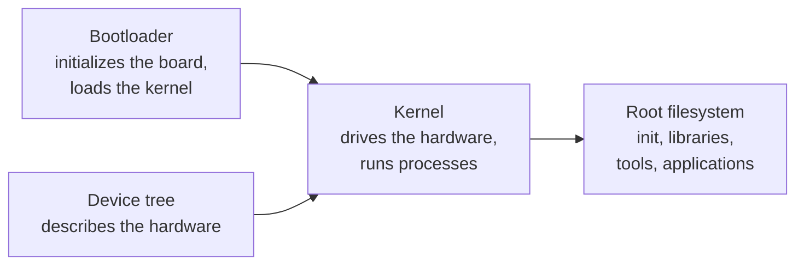

# Anatomy of an Embedded Linux System

> **Applies to:** PetaLinux 2024.1 · Zynq UltraScale+ MPSoC

**[02 · Embedded Linux Concepts](README.md)** · Part I: Foundations

## In short

- Every embedded Linux system has four software pillars: a **bootloader**, the **kernel**, a **device tree** that describes the hardware, and a **root filesystem**.
- ZynqMP adds three more: the **PMU firmware**, **Trusted Firmware-A** and, optionally, a **PL bitstream**. Its boot loader is split into the FSBL and U-Boot.
- In a PetaLinux project, all of them end up as files in `images/linux/`. `BOOT.BIN` alone bundles five of them.
- Embedded systems are shaped by constraints that desktops rarely have: fixed hardware, limited storage, boot-time budgets, field updates without a person at the keyboard, and lifetimes of ten years or more.

## Concepts

### The four pillars



| Pillar | Job | On the reference target |
| --- | --- | --- |
| Bootloader | Bring up clocks, DDR and the boot device; load the kernel, device tree and optionally an initial RAM disk; pass the kernel command line | FSBL (first stage) and U-Boot 2024.01 (second stage) |
| Kernel | Everything in [What Is Linux?](../01-linux-fundamentals/01-what-is-linux.md) | `linux-xlnx` 6.6.10 |
| Device tree | Tell the kernel which peripherals exist, at which addresses, with which interrupts and clocks, because an SoC cannot be probed like a PC's PCI bus | `system.dtb`, generated from the hardware design ([chapter 12](../12-device-tree/README.md)) |
| Root filesystem | `/sbin/init`, the C library, shells, services, your application | `rootfs.ext4` on the SD card; a small `ramdisk` that switches to it |

### What ZynqMP adds

A ZynqMP device is not just an Arm CPU. Before the Cortex-A53 cores run Linux, other processors and firmware must have done their part:

| Component | Runs on | Why it exists |
| --- | --- | --- |
| BootROM | CSU (in silicon) | Reads the boot header from the boot device and loads the first-stage code ([chapter 06](../06-boot-sequence/04-csu-bootrom.md)) |
| FSBL | Cortex-A53 #0, EL3 | Initializes clocks, MIO and DDR from the hardware design, loads the remaining partitions, can configure the PL ([chapter 08](../08-fsbl/README.md)) |
| PMU firmware | PMU (MicroBlaze) | Power, reset and error management for the whole SoC; keeps running while Linux runs ([chapter 09](../09-pmu-firmware/README.md)) |
| TF-A (BL31) | Cortex-A53, EL3 | Secure monitor: CPU power management (PSCI) and the gateway from Linux to the PMU firmware ([chapter 10](../10-trusted-firmware-a/README.md)) |
| PL bitstream | Programmable logic | Your FPGA design, loaded at boot or later from Linux ([chapter 17](../17-pl-integration-and-dfx/README.md)) |

### From project to files

All of these become files in a PetaLinux project's `images/linux/` directory ([chapter 05](../05-petalinux/06-images-linux-output-files.md) explains every one). The core set from the prebuilt ZCU106 2024.1 BSP:

```console
$ stat -c "%8s %n" BOOT.BIN Image Image.gz system.dtb ramdisk.cpio.gz.u-boot rootfs.ext4
 1838720 BOOT.BIN
24269312 Image
10435800 Image.gz
   54985 system.dtb
 5465043 ramdisk.cpio.gz.u-boot
1377373184 rootfs.ext4
```

`BOOT.BIN` is the boot image that the BootROM reads. It is assembled by Bootgen from a description file, the BIF. The BSP's BIF shows which pillars are inside:

```console
$ cat bootgen.bif
the_ROM_image:
{
	[bootloader, destination_cpu=a53-0] zynqmp_fsbl.elf
	[pmufw_image] pmufw.elf
	[destination_cpu=a53-0, exception_level=el-3, trustzone] bl31.elf
	[destination_cpu=a53-0, load=0x100000] system.dtb
	[destination_cpu=a53-0, exception_level=el-2] u-boot.elf
}
```

Five partitions: the FSBL, the PMU firmware, TF-A, the device tree (for U-Boot to pass on to Linux) and U-Boot. The kernel and root filesystem stay separate files, so they can be replaced without rebuilding the boot image. This BSP does not put the bitstream into `BOOT.BIN`; it loads PL designs later from Linux through the FPGA manager ([chapter 17](../17-pl-integration-and-dfx/03-fpga-manager.md)). [Chapter 07](../07-boot-images-and-bootgen/01-bif-file-format.md) dissects the BIF syntax.

The sizes tell a story too:

- The **kernel** is 24 MB uncompressed (`Image`) and 10 MB compressed (`Image.gz`). It contains drivers for everything the ZCU106 board and its PL designs might use.
- The **device tree** is 54 KB.
- The **root filesystem** is the giant: 1.3 GB, because the BSP image is a demonstration system with an X11 desktop, GStreamer, Jupyter, VCU firmware and OpenAMP demos (its `rootfs.manifest` lists 962 packages). At the other extreme, the BSP's own `ramdisk` is a complete, working root filesystem in 5.4 MB.

### Host and target

| | Host (development machine) | Target (board) |
| --- | --- | --- |
| CPU | x86-64 | Cortex-A53 (aarch64) |
| Role | Builds everything, stores sources, serves files (TFTP, NFS), runs debuggers | Runs the result |
| OS | Ubuntu 22.04 on the reference setup | PetaLinux 2024.1 |
| Toolchain | Native `gcc` and cross compilers | Usually none; programs arrive prebuilt |

Programs for the target are built on the host with a **cross compiler** ([section 02](02-cross-compilation-and-toolchains.md)). That is the main difference to desktop development, and the source of a whole class of problems.

### Development system vs. product

The same hardware runs very different software at different stages:

| Aspect | Development image | Production image |
| --- | --- | --- |
| Content | Debug tools, compilers, package manager, demos | Only what the product needs |
| Access | SSH with passwords, root via sudo, maybe telnet and FTP (the reference image has both) | No debug services; authenticated, minimal remote access |
| Root filesystem | Read-write ext4 | Often read-only, with a separate data partition |
| Updates | `dnf install`, `scp`, reflash the SD card | Signed, atomic image updates with rollback |
| Boot | Whatever works | Optimized, secure boot enabled |

The reference image is clearly a development image. It prints a reminder at every boot:

```text
The PetaLinux source code and images provided/generated are for demonstration purposes only.
```

## On ZynqMP

### Embedded constraints in numbers

| Constraint | Why it matters on ZynqMP | Where to read more |
| --- | --- | --- |
| **Boot storage** | QSPI flash is typically tens of MB; the reference image's QSPI partitions (`qspi-boot`, `qspi-bootenv`, `qspi-kernel`) add up to about 90 MB. A 1.3 GB root filesystem only fits on SD, eMMC or a network share | [Chapter 23](../23-storage-updates-and-production/01-mtd-and-flash.md) |
| **RAM** | DDR is shared by Linux, the RPU, the PL (through the HP ports) and the GPU/VCU. The reference image reserves 1000 MB for the contiguous memory allocator (`cma=1000M`) for video buffers | [Chapter 14](../14-kernel-modules-and-drivers/06-dma-and-memory-management.md) |
| **Boot time** | On the reference setup, the login prompt appears 35 s after power-on, most of it in user space | [Chapter 23](../23-storage-updates-and-production/05-boot-time-optimization.md) |
| **Power** | The PMU can switch off the PL and FPD power domains; Linux must cooperate | [Chapter 09](../09-pmu-firmware/03-eemi-and-platform-management.md) |
| **Lifetime** | Industrial products ship for ten years or more; the kernel and the Yocto release underneath must be maintained for that long | [Chapter 27](../27-linux-and-network-security/05-vulnerability-management.md) |

## Pitfalls

- **Treating the BSP's demo image as a starting point for a product.** It includes far more than any product needs, including insecure services. Start from a minimal image and add what you need.
- **Changing one pillar and forgetting another.** A new hardware design (XSA) changes the FSBL's `psu_init`, the device tree and possibly the bitstream. Rebuild and redeploy all of them together.
- **Assuming the kernel finds hardware on its own.** If a peripheral is not in the device tree, Linux does not know it exists, regardless of the driver.

## References

- `xilinx-zcu106-2024.1:pre-built/linux/images/` (`bootgen.bif`, file sizes, boot banner)
- UG1137 Zynq UltraScale+ MPSoC Software Developer Guide, boot and software stack chapters
- Captured on the reference setup: `/proc/mtd`, `/proc/cmdline` and the timestamped boot log ([01 · Serial Console](../01-linux-fundamentals/06-serial-console.md))

---

<sub>[Chapter index](README.md) · [Cross-Compilation and Toolchains](02-cross-compilation-and-toolchains.md) →</sub>
