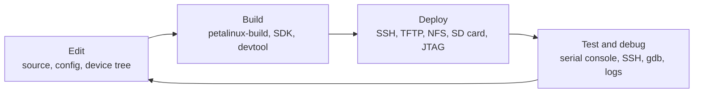

# Development Workflow

> **Applies to:** PetaLinux 2024.1 · Zynq UltraScale+ MPSoC

**[02 · Embedded Linux Concepts](README.md)** · Part I: Foundations

## In short

- Embedded development is a loop: **edit, build, deploy, test**. Productivity depends on how fast you can go around it, and the slowest step is usually deployment.
- Match the deployment method to what changed. An application goes over SSH in a second; a kernel over TFTP in a few seconds; a new `BOOT.BIN` needs the SD card, QSPI or JTAG.
- Put the PetaLinux project under version control, but not its build output. The BSP's own `.gitignore` is a good starting point; large hardware files belong in Git LFS.
- Record what you ran: tool versions, image checksums, kernel command line and timestamped boot logs. Most "it worked yesterday" problems are solved by those notes.

## Concepts

### The loop



Measure each step before optimizing. Numbers from the reference setup (QEMU, so only the proportions matter):

| Step | What | Time on the reference setup |
| --- | --- | --- |
| Deploy an application directory | `rsync -av app/ zcu106-qemu:/tmp/app/` | Under a second |
| Deploy a kernel | U-Boot `tftpboot` of the 24 MB `Image` | Under a second of transfer (QEMU reports about 98 MiB/s) |
| Reboot to a login prompt | Power-on to `login:` | About 35 s |
| Add a package at runtime | `dnf install i2c-tools rsync` | 1 min 40 s, mostly metadata download |

A real board is slower over TFTP and faster to boot to U-Boot, but the conclusion is the same: avoid reboots and reflashing when a file copy will do.

### Choosing the deployment method

| What changed | Fastest way to test it | Details |
| --- | --- | --- |
| User-space application, script, config file | `scp` / `rsync` over SSH, or `devtool deploy-target` | [01 · SSH](../01-linux-fundamentals/07-ssh.md), [chapter 04](../04-yocto-project/07-devtool-workflow.md) |
| Kernel module | Copy the `.ko`, then `rmmod` / `insmod` | [chapter 14](../14-kernel-modules-and-drivers/01-kernel-modules.md) |
| Kernel or device tree | TFTP from U-Boot, boot with `booti` | [01 · Networking](../01-linux-fundamentals/08-networking-for-development.md) |
| PL design | Load at runtime with `fpgautil` or `dfx-mgr` | [chapter 17](../17-pl-integration-and-dfx/README.md) |
| Many files in the root filesystem | NFS root during development | [01 · Networking](../01-linux-fundamentals/08-networking-for-development.md#nfs-root) |
| FSBL, PMU firmware, TF-A, U-Boot | New `BOOT.BIN` on SD card or QSPI, or load over JTAG | [chapter 07](../07-boot-images-and-bootgen/README.md), [chapter 06](../06-boot-sequence/14-jtag-boot.md) |
| Everything, for a release | Complete image (WIC on SD, or flash), as the customer would get it | [chapter 05](../05-petalinux/04-commands-and-workflow.md) |

> [!TIP]
> Test the release path regularly, not only at the end. A system that only works when its kernel comes over TFTP and its root filesystem over NFS has not been tested yet.

## Hands-on

### Version control for a PetaLinux project

A PetaLinux project mixes your sources with gigabytes of generated files. The ZCU106 2024.1 BSP comes with a `.gitignore` that separates them:

```console
$ cat .gitignore

*/*/config.old
*/*/rootfs_config.old
build/
images/linux/
pre-built/linux/
.petalinux/*
!.petalinux/metadata
*.o
*.jou
*.log
components/plnx_workspace
components/yocto
```

| Commit | Do not commit |
| --- | --- |
| `project-spec/configs/` (`config`, `rootfs_config`) | `build/` (Yocto work directories, tens of GB) |
| `project-spec/meta-user/` (your recipes, `system-user.dtsi`, patches, config fragments) | `images/linux/` (rebuildable outputs) |
| `project-spec/hw-description/` (the XSA from Vivado) | `components/yocto/`, `components/plnx_workspace/` (generated) |
| `.petalinux/metadata` | `pre-built/linux/` (unless you ship a BSP) |

`.petalinux/metadata` records which PetaLinux version created the project:

```console
$ cat .petalinux/metadata
PETALINUX_VER=2024.1
HDF_EXT=xsa
VALIDATE_HW_CHKSUM=1
YOCTO_SDK=52652d154ddc73d3f72fbc3b7e703dd288d990a9085c36399a106df849a5389f
```

**Large binary files.** Hardware handoff files are big. In the ZCU106 project used for this guide, three XSA files of about 176 MB each and one bitstream make up almost all of `project-spec`:

```console
$ find project-spec -type f \( -name "*.xsa" -o -name "*.bit" -o -name "*.mmi" \) -exec du -b {} + | sort -n
      6492 project-spec/hw-description/project_2.mmi
  10545840 project-spec/hw-description/project_2.bit
 176396894 project-spec/meta-user/recipes-firmware/zcu106-1.0/files/project_1.xsa
 176421736 project-spec/hw-description/system.xsa
 176421736 project-spec/meta-user/recipes-firmware/zcu106-2.0/files/project_2.xsa
```

Committing a new 176 MB file for every hardware iteration makes a Git repository unusable within weeks. Track these with **Git LFS** (`git lfs track "*.xsa" "*.bit"`), or keep them in an artifact store and record their checksum and source revision in the repository.

> [!NOTE]
> **Not run on the reference setup:** the Git LFS command, because this guide's repository does not contain a PetaLinux project.

### Recording what you ran

When something breaks, the first questions are always "which image, which configuration?". Capture the answers as you go:

| Record | How |
| --- | --- |
| Tool and BSP version | `.petalinux/metadata` of the project; `echo $PETALINUX_VER` after sourcing `settings.sh` (prints `2024.1`) |
| Kernel, distribution, C library | `uname -a`, `/etc/os-release` on the target ([01 · What Is Linux?](../01-linux-fundamentals/01-what-is-linux.md)) |
| Kernel command line | `cat /proc/cmdline` |
| Exact images | `md5sum` or `sha256sum` of `BOOT.BIN`, `Image`, `system.dtb`, before and after copying ([01 · Shell and Tools](../01-linux-fundamentals/05-shell-and-essential-tools.md#moving-files)) |
| What happened at boot | A timestamped serial log ([01 · Serial Console](../01-linux-fundamentals/06-serial-console.md#capturing-a-boot-log-with-timestamps)) |
| Source revisions | `git describe --always --dirty` of your project, embedded in the image (for example in `/etc/build-info`) |

### Making the loop faster

- **Keep two channels open**: the serial console for boot output and emergencies, SSH for everything else.
- **Boot the kernel over TFTP during kernel work.** A U-Boot script that fetches `Image` and `system.dtb` turns a kernel test into "build, reset" ([chapter 11](../11-u-boot/03-environment-and-boot-scripts.md)).
- **Use NFS root during user-space work**, so the target sees host-side changes immediately.
- **Use `devtool`** to edit a recipe's source in place, rebuild only that recipe and deploy it to the running target ([chapter 04](../04-yocto-project/07-devtool-workflow.md)).
- **Share the Yocto shared-state cache** between developers and CI, so that nobody rebuilds what someone else already built ([chapter 05](../05-petalinux/02-installation-and-host-setup.md)).
- **Script the boring parts.** Every manual step in the loop is a step someone will one day do differently.

## Pitfalls

- **Committing `build/` or `images/`.** The repository becomes huge and full of host-specific paths.
- **Changing configuration through menus without committing the result.** `petalinux-config` writes to `project-spec/configs/`; commit it, or the next person builds something else.
- **Testing only with development shortcuts** (NFS root, TFTP kernel, root over SSH). Test the image you ship.
- **Not recording versions and checksums.** Without them, a bug report from the lab cannot be reproduced.

## References

- `xilinx-zcu106-2024.1:.gitignore`, `.petalinux/metadata`
- UG1144 PetaLinux Tools Documentation: Reference Guide, chapters on project creation and version control
- Git LFS documentation: [git-lfs.com](https://git-lfs.com/)
- Measurements on the reference setup: [01 · Serial Console](../01-linux-fundamentals/06-serial-console.md), [01 · Networking](../01-linux-fundamentals/08-networking-for-development.md), [01 · Package Management](../01-linux-fundamentals/03-package-management.md), [01 · SSH](../01-linux-fundamentals/07-ssh.md)

---

<sub>← [Build Systems Landscape](03-build-systems-landscape.md) · [Chapter index](README.md) · Next chapter: [03 · Zynq UltraScale+ MPSoC Architecture](../03-zynqmp-architecture/README.md) →</sub>
