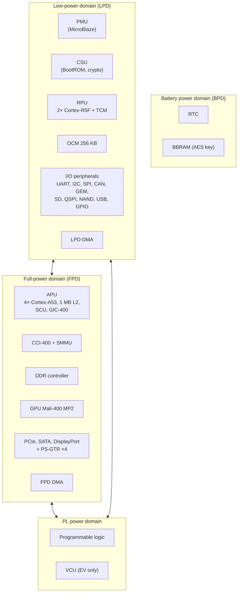
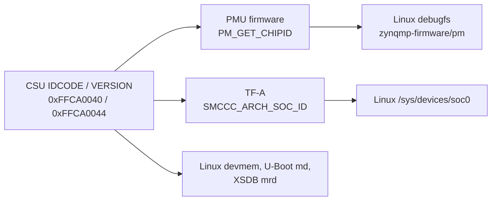

# Device Family Overview

> **Applies to:** PetaLinux 2024.1 · Zynq UltraScale+ MPSoC · ZCU102, ZCU104, ZCU106, Kria K24/K26

**[03 · Zynq UltraScale+ MPSoC Architecture](README.md)** · Part II: Zynq UltraScale+ MPSoC Hardware

## In short

- Every Zynq UltraScale+ MPSoC (ZynqMP) device has the **same processing system (PS)**. What differs is the programmable logic (PL), the number of application cores, and two optional hard blocks: the GPU and the video codec unit (VCU).
- The three variants are **CG** (dual-core APU, no GPU), **EG** (quad-core APU, Mali-400 GPU) and **EV** (EG plus the H.264/H.265 VCU). The RFSoC devices (DR) reuse the same PS.
- A part number such as `xczu7ev-ffvc1156-2-e` encodes the device size (7), the variant (EV), the package, the speed grade and the temperature grade.
- The PS is divided into power domains: the **low-power domain (LPD)**, the **full-power domain (FPD)**, the **PL power domain** and the **battery power domain**. Most later chapters refer to this split.
- Software can identify the device at run time from the CSU `IDCODE` and `VERSION` registers, directly or through the PMU firmware and TF-A.

## Concepts

### One PS, many devices

AMD (formerly Xilinx) builds the ZynqMP family around one processing system. DS891 states it directly: "each Zynq UltraScale+ MPSoC contains the same PS, the PL, Video hard blocks, and I/O resources vary between the devices".

| | CG devices | EG devices | EV devices |
| --- | --- | --- | --- |
| APU | Dual-core Cortex-A53 | Quad-core Cortex-A53 | Quad-core Cortex-A53 |
| RPU | Dual-core Cortex-R5F | Dual-core Cortex-R5F | Dual-core Cortex-R5F |
| GPU | – | Mali-400 MP2 | Mali-400 MP2 |
| VCU | – | – | H.264/H.265 |
| Sizes | ZU1 to ZU9 (and ZU3T) | ZU1 to ZU19 (and ZU3T) | ZU4, ZU5, ZU7 |

Source: DS891 (v1.11.1), Table 7 and Tables 1, 3, 5.

What all variants share, per the DS891 feature tables:

- 256 KB on-chip memory (OCM) with ECC.
- A DDR controller for DDR4, DDR3, DDR3L, LPDDR3 and LPDDR4.
- Four PS-GTR transceivers (PCIe Gen1/2, SATA 3.1, DisplayPort 1.2a, USB 3.0, SGMII).
- 78 multiplexed I/O (MIO) pins in three banks of 26, and up to 96 EMIO signals to the PL.
- The platform management unit (PMU) and the configuration and security unit (CSU).

The RFSoC devices (ZU21 to ZU67, family "DR" in UG1085 Table 1-2) combine the same PS with RF data converters. UG1085 covers them too, and `meta-xilinx` treats them as a fourth ZynqMP variant.

### Reading a part number

The ZCU106 board carries an `xczu7ev-ffvc1156-2-e`. The XSA exported from Vivado records the same fields separately:

| Field | Value | Meaning |
| --- | --- | --- |
| Device | `xczu7ev` | ZynqMP device size 7, EV variant |
| Package | `ffvc1156` | Package type and pin count (1156 balls) |
| Speed grade | `-2` | Middle speed grade; sets the maximum clock rates |
| Temperature grade | `e` | Extended temperature range |

The speed and temperature grades matter to software: the maximum CPU, DDR and peripheral clock rates in DS925 (the DC and AC switching characteristics data sheet) depend on them, and the Vivado PS configuration only offers rates the grade supports.

### Block diagram and power domains



Redrawn from UG1085 (v2.5), Chapter 1, Figure 1-2 and Chapter 6, Figure 6-1. UG1085 lists four main power domains and notes that "each power domain can be individually isolated". The PMU in the LPD controls that isolation.

The split explains several behaviors you will meet later:

- The **LPD** is always on while the device runs. It holds everything needed to boot: the PMU, the CSU, the OCM and the boot peripherals. It also holds the RPU, so real-time code can keep running with the FPD switched off.
- The **FPD** holds the APU, the DDR controller and the high-speed peripherals. Linux runs here. UG1085 notes that "if the FPD is needed at any point, it must be powered during the initial boot".
- The **PL** can be off, powered but not configured, or configured. The PS boots without it ([section 02](02-ps-and-pl.md)).
- The **BPD** keeps the RTC and the battery-backed RAM (BBRAM, which can hold the AES key) alive when the board has no power.

### Boards used in this guide

| Board | Device | Variant | Machine in `meta-xilinx` / `meta-kria` |
| --- | --- | --- | --- |
| ZCU102 | `xczu9eg-ffvb1156-2-e` | EG | `zcu102-zynqmp` |
| ZCU104 | `xczu7ev-ffvc1156-2-e` | EV | `zcu104-zynqmp` |
| ZCU106 | `xczu7ev-ffvc1156-2-e` | EV | `zcu106-zynqmp` |
| Kria K26 SOM (KV260, KR260) | `xck26-sfvc784-2LV-c` (`-2LVI-i`) | EV | `k26-smk`, `k26-smk-kv`, `k26-smk-kr` |
| Kria K24 SOM (KD240) | `xck24-ubva530-2LV-c` (`-2LVI-i`) | EG | `k24-smk`, `k24-smk-kd` |

The part names come from the Vivado 2024.1 board files (`data/xhub/boards/XilinxBoardStore/boards/Xilinx/*/board.xml`) and, for ZCU104 and ZCU106, from the BSP XSA files. The variant column comes from the machine configurations: the ZCU104 and ZCU106 machines require `zynqmp-ev-generic.conf`, ZCU102 `zynqmp-eg-generic.conf`. The Kria `k26-kria-common.inc` requires the EV file and `k24-kria-common.inc` the EG file.

The Kria devices (`xck26`, `xck24`) are Kria-specific part numbers, not catalog ZynqMP parts. Software treats them as EV- and EG-class ZynqMP devices.

### Zynq-7000, ZynqMP and Versal

ZynqMP sits between two other AMD SoC families. A lot of documentation, forum posts and code you find covers one of the others.

| | Zynq-7000 | Zynq UltraScale+ MPSoC | Versal adaptive SoC |
| --- | --- | --- | --- |
| Application CPU | 1–2× Cortex-A9 (32-bit Armv7-A) | 2–4× Cortex-A53 (64-bit Armv8-A) | 2× Cortex-A72 (64-bit Armv8-A) |
| Real-time CPU | – | 2× Cortex-R5F | 2× Cortex-R5F |
| Boot and platform management | BootROM, FSBL | CSU BootROM, PMU ROM, FSBL, PMU firmware | Platform management controller (PMC) running the PLM |
| Secure monitor | – | TF-A (BL31) | TF-A (BL31) |
| Boot image | `BOOT.BIN` | `BOOT.BIN` | Programmable device image (PDI), usually still named `BOOT.BIN` |
| Linux architecture | `arm` (32-bit) | `arm64` | `arm64` |
| Yocto `SOC_FAMILY` in `meta-xilinx` | `zynq` | `zynqmp` | `versal` |
| PS–PL connection | AXI GP/HP/ACP ports | AXI HPM/HP/HPC/ACP/ACE ports | Network on chip (NoC) plus AXI ports |

What carries over from ZynqMP to Versal: TF-A, U-Boot, the Linux drivers for most peripherals, the EEMI platform management API (ZynqMP: PMU firmware; Versal: PLM) and the Yocto layers. What does not: the boot flow (no FSBL, no PMU firmware), the boot image format and the address map. Versal is outside the scope of this guide.

## On ZynqMP

### Identifying the device at run time

The CSU holds two read-only identification registers. UG1085 (v2.5), Chapter 1, "Device ID Codes":

| Register | Address | Content |
| --- | --- | --- |
| `CSU.IDCODE` | `0xFFCA0040` | JTAG IDCODE. Bits [27:0] identify the device, bits [31:28] its revision |
| `CSU.VERSION` | `0xFFCA0044` | Bits [3:0] `PS_VERSION`; bits [15:12] platform (0 = silicon, 3 = QEMU) |

The `IDCODE` values come from UG1085 Table 1-2, for example `1473_0093h` for ZU7 and `2473_8093h` for ZU9, at the minimum production revision. UG1085 adds: "All production devices are [PS_Version] = 3 or later." The platform field encoding is from `xplatform_info.h` in embeddedsw (`XPLAT_ZYNQ_ULTRA_MP_SILICON 0x0`, `XPLAT_ZYNQ_ULTRA_MPQEMU 0x3`, shift `0xC`). The register addresses also appear in U-Boot (`ZYNQMP_PS_VERSION 0xFFCA0044`).

These registers are reachable from three places, each with its own path:



## Hands-on

### From the hardware design

The part is recorded in the XSA. In the project's `project-spec/hw-description/` directory:

```console
$ unzip -p system.xsa xsa.json | grep -E '"(device|package|speedGrade|tempGrade)"'
                "device": "xczu7ev",
                "package": "ffvc1156",
                "speedGrade": "-2",
                "tempGrade": "e"
```

### From Linux, without root

TF-A implements the Arm SMC Calling Convention `SMCCC_ARCH_SOC_ID` call, and the kernel's generic driver (`drivers/firmware/smccc/soc_id.c`) publishes the answer in `/sys/devices/soc0`:

```console
target$ head /sys/devices/soc0/family /sys/devices/soc0/soc_id /sys/devices/soc0/revision /sys/devices/soc0/machine
==> /sys/devices/soc0/family <==
jep106:0049

==> /sys/devices/soc0/soc_id <==
jep106:0049:0003

==> /sys/devices/soc0/revision <==
0x04600093

==> /sys/devices/soc0/machine <==
ZynqMP ZCU106 RevA
```

How to read it, from TF-A `plat/xilinx/zynqmp/aarch64/zynqmp_common.c` (`plat_get_soc_version()` and `plat_get_soc_revision()`):

- `jep106:0049` is the JEDEC JEP106 manufacturer code of Xilinx.
- The last field of `soc_id` is the CSU `VERSION` platform field: `0003` means QEMU. Silicon reports `0000`.
- `revision` is the raw CSU `IDCODE`.
- `machine` is the device tree `model` property, not a hardware register.

The QEMU model reports `IDCODE` `0x04600093`, which does not appear in UG1085 Table 1-2: QEMU does not emulate a specific catalog device. A ZCU106 board reports a ZU7 code, `x473_0093`, with its silicon revision in the top nibble.

### From Linux, as root

Ask the PMU firmware through the zynqmp-firmware debugfs interface. It needs `CONFIG_ZYNQMP_FIRMWARE_DEBUG`, which the 2024.1 kernel enables (`zcat /proc/config.gz | grep ZYNQMP_FIRMWARE_DEBUG` on the target):

```console
target# echo pm_get_chipid > /sys/kernel/debug/zynqmp-firmware/pm
target# cat /sys/kernel/debug/zynqmp-firmware/pm
Idcode: 0x4600093, Version:0x20003003
```

Or read the registers directly:

```console
target# devmem 0xFFCA0040 32
0x04600093
target# devmem 0xFFCA0044 32
0x00003003
```

The two version values differ because the PMU firmware adds information before it answers. From `PmGetChipid()` in `embeddedsw@xilinx_v2024.1:lib/sw_apps/zynqmp_pmufw/src/pm_core.c`:

- The eFUSE `IPDISABLE` bits (`EFUSE_IPDISABLE_VERSION`, mask `0x1FF`) are shifted into bit 20 and up (`CSU_VERSION_EMPTY_SHIFT 20`). They tell software which hard blocks are fused off. This is how a CG device is told apart from an EG device with the same IDCODE.
- The PL initialization state from `CSU.PCAP_STATUS` is placed in bit 29 (`CSU_VERSION_PL_STATE_SHIFT 29`). Here it is set: the PL is initialized.

U-Boot's SoC driver decodes the same answer to name the device. Its comment in `u-boot-xlnx@xilinx-v2024.1:drivers/soc/soc_xilinx_zynqmp.c` summarizes the layout:

```c
		 * payload[1] = IDCODE
		 * payload[2][19:0] = Version
		 * payload[2][28:20] = EXTENDED_IDCODE
		 * payload[2][29] = PL_INIT
```

It looks the IDCODE up in a table of devices and then appends `cg`, `eg` or `ev` from the GPU-disable and VCU-disable fuse bits, giving a name such as `zu7ev`. QEMU's placeholder IDCODE is not in that table, so U-Boot prints no device name on the reference setup.

## PetaLinux 2024.1 specifics

The variant selects machine features in Yocto. From `meta-xilinx-core/conf/machine/include/soc-zynqmp.inc`:

```text
# Available SOC_VARIANT's for zynqmp:
# "cg" - Zynq UltraScale+  CG Devices (default lowest common denominator)
# "eg" - Zynq UltraScale+  EG Devices
# "ev" - Zynq UltraScale+  EV Devices
# "dr" - Zynq UltraScale+  DR Devices

SOC_VARIANT ?= "cg"
```

The same file adds the `mali400` machine feature for EG and EV and `vcu` for EV only. Recipes such as the Mali user-space libraries and the VCU firmware are only built when the feature is present.

PetaLinux sets the variant from the XSA during `petalinux-config --get-hw-description`. The ZCU106 project records it as:

```text
CONFIG_SUBSYSTEM_VARIANT_ZYNQMPEV=y
```

## Pitfalls

- **Building for the wrong variant.** A CG device has no GPU. An image built with the `mali400` feature for a CG board contains a GPU driver and libraries that cannot work. Make sure the XSA, and therefore `CONFIG_SUBSYSTEM_VARIANT_*`, matches the real part.
- **Assuming the speed grade.** Clock rates copied from a `-2` design to a `-1` device can exceed DS925 limits. The design may appear to work in the lab and fail at temperature.
- **Trusting QEMU's identity registers.** QEMU reports a placeholder IDCODE and platform 3. Code that branches on the device ID behaves differently on hardware.
- **Reading Zynq-7000 or Versal material as if it applied to ZynqMP.** Boot flows, address maps and register names differ. Check the family before you copy a register address.

## References

- DS891 Zynq UltraScale+ MPSoC Data Sheet: Overview (v1.11.1), Tables 1, 3, 5, 7
- UG1085 Zynq UltraScale+ Device Technical Reference Manual (v2.5), Chapter 1: "System Block Diagram", "Power Domains and Islands", "Device ID Codes", Table 1-2; Chapter 6: Figure 6-1
- `meta-xilinx@rel-v2024.1:meta-xilinx-core/conf/machine/include/soc-zynqmp.inc`, `meta-xilinx-bsp/conf/machine/zcu10{2,4,6}-zynqmp.conf`
- `meta-kria@rel-v2024.1:conf/machine/include/k2{4,6}-kria-common.inc`
- `arm-trusted-firmware@xilinx-v2024.1:plat/xilinx/zynqmp/aarch64/zynqmp_common.c`
- `embeddedsw@xilinx_v2024.1:lib/sw_apps/zynqmp_pmufw/src/pm_core.c`, `csu.h`, `efuse.h`; `lib/bsp/standalone/src/common/xplatform_info.h`
- `linux-xlnx@xilinx-v2024.1:drivers/firmware/smccc/soc_id.c`
- `u-boot-xlnx@xilinx-v2024.1:arch/arm/mach-zynqmp/include/mach/hardware.h`, `drivers/soc/soc_xilinx_zynqmp.c`
- `linux-xlnx@xilinx-v2024.1:drivers/firmware/xilinx/Kconfig` (`ZYNQMP_FIRMWARE_DEBUG`)
- `xilinx-zcu106-2024.1:project-spec/hw-description/system.xsa`, `project-spec/configs/config`

---

<sub>[Chapter index](README.md) · [Processing System (PS) and Programmable Logic (PL)](02-ps-and-pl.md) →</sub>
