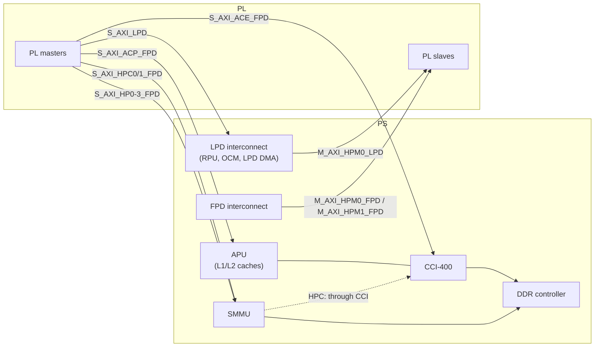

# Processing System (PS) and Programmable Logic (PL)

> **Applies to:** PetaLinux 2024.1 · Zynq UltraScale+ MPSoC · ZCU106

**[03 · Zynq UltraScale+ MPSoC Architecture](README.md)** · Part II: Zynq UltraScale+ MPSoC Hardware

## In short

- The **PS** is a fixed SoC: processors, memory controllers, interconnect and peripherals in hard silicon. It boots and runs on its own. The **PL** is FPGA fabric that you configure with a bitstream.
- The PS and PL talk through **AXI ports**. PS masters reach the PL through `M_AXI_HPM0_FPD`, `M_AXI_HPM1_FPD` and `M_AXI_HPM0_LPD`. PL masters reach PS memory through `S_AXI_HP{0-3}_FPD`, `S_AXI_HPC{0,1}_FPD`, `S_AXI_ACP_FPD`, `S_AXI_ACE_FPD` and `S_AXI_LPD`.
- Besides AXI, the PS gives the PL four clocks (`pl_clk0-3`), four resets (`pl_resetn0-3`, driven by EMIO GPIO), and accepts 16 interrupts (`pl_ps_irq0/1`) into the GIC.
- Every one of these connections appears three times: in the Vivado design, in `psu_init` (programmed by the FSBL) and in the device tree. They must agree.
- The port you pick decides coherency, latency and whether the SMMU is in the path. Pick it from the access pattern, not by habit.

## Concepts

### What lives where

| PS (hard silicon) | PL (configurable fabric) |
| --- | --- |
| APU, RPU, PMU, CSU, GPU | Your logic: accelerators, video pipelines, custom interfaces |
| DDR controller, OCM, interconnect, SMMU | Soft IP from AMD: AXI DMA, frame buffers, AXI GPIO, AXI interrupt controller |
| Peripherals: UART, I2C, SPI, CAN, GEM, USB, SD, QSPI, NAND, SATA, PCIe Gen2, DisplayPort | Hard blocks inside the PL region: VCU (EV devices), PCIe Gen3/4, 100G Ethernet, Interlaken (larger devices) |
| PS-GTR transceivers (4 lanes, up to 6 Gb/s) | GTH/GTY transceivers |
| MIO pins (78) | PL I/O banks (HP, HD) |

The PS does not need the PL. UG1085 (v2.5), Chapter 1: "PS acts as one standalone SoC and is able to boot and support all the features of the processing system shown in Figure 1-1 without powering on the PL."

Note that the VCU is a hard block, but DS891 lists it with the PL features: it is instantiated in the Vivado block design like PL IP and reached through the PL AXI ports. A design that uses it must configure the PL first.

### The PS-PL AXI interfaces



Simplified from UG1085 (v2.5), Chapter 35, Figure 35-2. The details are in Table 35-1:

| Interface | Direction | Data width | Address width | Coherency | Notes |
| --- | --- | --- | --- | --- | --- |
| `M_AXI_HPM0_FPD`, `M_AXI_HPM1_FPD` | PS FPD → PL | 32/64/128 | 40 | – | Main path from the APU and FPD DMA to PL slaves |
| `M_AXI_HPM0_LPD` | PS LPD → PL | 32/64/128 | 32 | – | Low-latency path from the RPU and LPD DMA; works with the FPD off |
| `S_AXI_HP0-3_FPD` | PL → PS FPD | 32/64/128 | 49 | Non-coherent | High bandwidth to DDR through the SMMU (AFI 2–5) |
| `S_AXI_HPC0/1_FPD` | PL → PS FPD | 128 | 49 | I/O coherent | Through the SMMU and the CCI; snoops APU caches, no L2 allocation (AFI 0–1) |
| `S_AXI_ACP_FPD` | PL → APU | 128 | 40 | I/O coherent | Into the APU's snoop control unit, with L2 cache allocation |
| `S_AXI_ACE_FPD` | PL ↔ CCI | 128 | 40 | Two-way coherent | For PL masters with their own caches |
| `S_AXI_LPD` | PL → PS LPD | 32/64/128 | 49 | Non-coherent | Reaches the RPU, OCM and LPD even when the FPD is powered down (AFI 6) |

Facts behind the table, from the same chapter:

- The PL side of each port is AXI4. The PS side is AXI3, so bursts are limited to 16 beats, and "the PS-side AXI interface is always 128 bits".
- "All high-performance interfaces into the FPD pass through the system memory management unit (SMMU)."
- Not all HP ports are equal: "The S_AXI_HP1_FPD and S_AXI_HP2_FPD interfaces share exclusive access to an AXI Port Interface (XPI 4)" of the DDR controller. HP0 shares a DDR port with the DisplayPort controller, HP3 with the FPD DMA controller.
- HPC ports reach DDR through the CCI and "have a longer latency to DDR". Coherency also needs the right `AxCACHE` bits from the PL master and snooping enabled in the CCI.

### Where the PL appears in the address map

The HPM ports are windows in the system address map ([section 04](04-memory-map.md)). From UG1085 (v2.5), Table 10-1:

| Window | Range (size) |
| --- | --- |
| `M_AXI_HPM0_LPD` | `0x8000_0000 – 0x9FFF_FFFF` (512 MB) |
| VCU (if enabled), inside the HPM0 window | `0xA000_0000 – 0xA3FF_FFFF` (64 MB) |
| `M_AXI_HPM0_FPD` (32-bit window) | `0xA400_0000 – 0xAFFF_FFFF` (192 MB) |
| `M_AXI_HPM1_FPD` (32-bit window) | `0xB000_0000 – 0xBFFF_FFFF` (256 MB) |
| `M_AXI_HPM0_FPD` (high) | `0x4_0000_0000 – 0x4_FFFF_FFFF` (4 GB) and `0x10_0000_0000 – 0x47_FFFF_FFFF` (224 GB) |
| `M_AXI_HPM1_FPD` (high) | `0x5_0000_0000 – 0x5_FFFF_FFFF` (4 GB) and `0x48_0000_0000 – 0x7F_FFFF_FFFF` (224 GB) |

UG1085 notes that without a VCU the `M_AXI_HPM0_FPD` window below 4 GB is the full 256 MB starting at `0xA000_0000`. Vivado's Address Editor assigns each PL slave a range inside one of these windows.

In the opposite direction, a PL master sees the same 40-bit physical address space as the APU. A PL master with a 32-bit address bus only reaches the low 4 GB: the lower 2 GB of DDR, the QSPI window and the LPD slaves, but not the upper DDR at `0x8_0000_0000`.

### Clocks, resets and interrupts

| Signal | Count | Source in the PS | Linux view |
| --- | --- | --- | --- |
| `pl_clk0` – `pl_clk3` | 4 | `PL{0-3}_REF_CTRL` in `CRL_APB`, from IOPLL, RPLL or DPLL | Clocks `PL0_REF` – `PL3_REF` (IDs 71–74 in `dt-bindings/clock/xlnx-zynqmp-clk.h`) |
| `pl_resetn0` – `pl_resetn3` | 4 | GPIO EMIO lines 95 down to 92 | Resets `ZYNQMP_RESET_PS_PL0` – `PL3` (IDs 116–119), or the GPIO lines directly |
| `pl_ps_irq0[7:0]` | 8 | – | GIC SPIs 89–96 (interrupt IDs 121–128) |
| `pl_ps_irq1[7:0]` | 8 | – | GIC SPIs 104–111 (interrupt IDs 136–143) |
| EMIO | up to 96 | GPIO banks 3–5, plus EMIO-routed peripherals | GPIO lines 78 + n on the `zynqmp_gpio` chip |

Sources: UG1085 (v2.5), Table 2-10 (clocks), Chapter 27 (GPIO banks; "Up to four outputs for GPIO[92:95] can act as reset signals to user-defined logic in the PL. [...] if one reset is selected, GPIO[95] is assigned"), Table 13-1 (`PL_PS_Group0` at 121:128, `PL_PS_Group1` at 136:143). The Linux IDs come from `linux-xlnx@xilinx-v2024.1:include/dt-bindings/`.

The interrupt numbers come in two forms, which causes many off-by-32 mistakes. The GIC numbers interrupts from 0, with shared peripheral interrupts (SPIs) starting at 32. UG1085 lists the GIC interrupt ID (121). The device tree `interrupts` property uses the SPI number (121 − 32 = 89). [Section 08](08-interrupts-and-gic.md) covers the encoding.

### When the PL is not there

The PL can be unpowered, powered but not configured, or configured. Only in the last state does anything answer on the HPM ports. Three mechanisms matter:

- **Isolation.** The interconnect has AXI isolation blocks (AIBs) between the PS and the PL. UG1085 (v2.5), Chapter 16: when the PMU commands isolation, "the AIB does not propagate new transactions; it will respond to the master with an SLVERR or ignore the transaction and cause the interconnect to timeout". The boot firmware manages it: `psu_init.c` contains `psu_ps_pl_isolation_removal_data()`, which the FSBL calls when it has loaded a bitstream in JTAG mode or after a PS-only reset (`xfsbl_handoff.c`). For bitstreams loaded later from Linux, the XilFPGA library inside the PMU firmware handles the isolation as part of the load (`XFpga_IsolationRestore()` in `xilfpga_pcap.c`).
- **No responder.** With isolation removed but no logic at the address (PL not configured, or the slave held in reset or without a clock), the access never completes and the CPU stalls. On a board this looks like a frozen system. Linux drivers for PL IP must therefore only probe after the bitstream is loaded, which is why PL nodes come in a device tree overlay ([chapter 17](../17-pl-integration-and-dfx/README.md)).
- **Reconfiguration.** Loading a new bitstream resets the PL. Any PS state that depends on the PL, such as the AFI data widths, must match the new design.

## On ZynqMP

### The ZCU106 design, end to end

The ZCU106 2024.1 BSP's hardware design (`system.xsa`) shows all of these connections in use. The PS configuration in the hardware handoff file (`project_2.hwh` inside the XSA) enables these ports (comments added):

```text
PSU__USE__M_AXI_GP0=1      # M_AXI_HPM0_FPD
PSU__USE__M_AXI_GP1=1      # M_AXI_HPM1_FPD
PSU__USE__M_AXI_GP2=1      # M_AXI_HPM0_LPD
PSU__USE__S_AXI_GP0=1      # S_AXI_HPC0_FPD
PSU__USE__S_AXI_GP3=1      # S_AXI_HP1_FPD
PSU__USE__S_AXI_GP4=1      # S_AXI_HP2_FPD
PSU__USE__S_AXI_GP5=1      # S_AXI_HP3_FPD
PSU__MAXIGP0__DATA_WIDTH=128
PSU__MAXIGP1__DATA_WIDTH=128
PSU__MAXIGP2__DATA_WIDTH=32
PSU__CRL_APB__PL0_REF_CTRL__ACT_FREQMHZ=99.990005
PSU__CRL_APB__PL1_REF_CTRL__ACT_FREQMHZ=93.740631
PSU__NUM_F2P0__INTR__INPUTS=3
PSU__NUM_F2P1__INTR__INPUTS=1
```

The comments map the parameter names to port names. The hwh port maps confirm them for the ports in use (`maxigp0`–`maxigp2` = `M_AXI_HPM0_FPD`, `M_AXI_HPM1_FPD`, `M_AXI_HPM0_LPD`; `saxigp0` = HPC0; `saxigp3`–`saxigp5` = HP1–HP3). The unused ports follow the AFI numbering of UG1085 Table 35-2: `saxigp0`–`1` = HPC0–1, `saxigp2`–`5` = HP0–3, `saxigp6` = LPD.

What the PL design puts on those ports, from the address maps in the same file:

| PL IP | Connection | Address or reach |
| --- | --- | --- |
| AXI interrupt controller | Slave on `M_AXI_HPM0_LPD` | `0x8000_0000 – 0x8000_FFFF` |
| Frame buffer read (`v_frmbuf_rd_0`) | Slave on `M_AXI_HPM0_FPD` | `0xA00F_0000 – 0xA00F_FFFF` |
| VCU | Slave on `M_AXI_HPM0_FPD` | `0xA010_0000 – 0xA01F_FFFF` |
| Frame buffer write (`v_frmbuf_wr_0`) | Slave on `M_AXI_HPM0_FPD` | `0xA020_0000 – 0xA020_FFFF` |
| PL DDR4 controller | Slave on `M_AXI_HPM1_FPD` (high window) | `0x48_0000_0000 – 0x48_7FFF_FFFF` (2 GB) |
| VCU | Master on HPC0, HP1, HP2, HP3 | PS DDR low and high, QSPI, LPS slaves |
| Frame buffer write | Master on HP3, **32-bit** address | PS DDR low (`0x0 – 0x7FFF_FFFF`), QSPI, LPS slaves |
| Frame buffer read | Master, 64-bit address | PL DDR4 only |

The frame buffer write IP is configured with a 32-bit address bus (`C_M_AXI_MM_VIDEO_ADDR_WIDTH=32`), so the upper PS DDR is unreachable for it. Its device tree node says so with `xlnx,dma-addr-width = <0x20>`, and the Linux driver must allocate its buffers below 4 GB. The reference image's contiguous memory allocator (CMA) region sits at `0x38E0_0000`, in low DDR.

### The same design in `psu_init`

The FSBL programs the PS side of these ports from `psu_init.c`, generated into the XSA. In `psu_afi_config()`:

```c
    * Register : afi_fs @ 0XFD615000
    *  PSU_FPD_SLCR_AFI_FS_DW_SS0_SEL                              0x2
    *  PSU_FPD_SLCR_AFI_FS_DW_SS1_SEL                              0x2
	PSU_Mask_Write(FPD_SLCR_AFI_FS_OFFSET, 0x00000F00U, 0x00000A00U);
    * Register : afi_fs @ 0XFF419000
    *  PSU_LPD_SLCR_AFI_FS_DW_SS2_SEL                              0x0
	PSU_Mask_Write(LPD_SLCR_AFI_FS_OFFSET, 0x00000300U, 0x00000000U);
```

`DW_SS0_SEL` and `DW_SS1_SEL` set the data widths of `M_AXI_HPM0_FPD` and `M_AXI_HPM1_FPD` (value `0x2` = 128-bit), `DW_SS2_SEL` that of `M_AXI_HPM0_LPD` (`0x0` = 32-bit). The same function sets the PL-side width of each HP/HPC port (`AFIFM*_RDCTRL/WRCTRL` `FABRIC_WIDTH`, `0x0` = 128-bit) and releases the AFI resets.

### The same design in the device tree

This BSP does not put PL nodes into `system.dtb`. It loads the PL at run time with `dfx-mgr` and applies a device tree overlay (`CONFIG_SUBSYSTEM_FPGA_MANAGER=y` in the project configuration). Two PL designs are installed, each with a bitstream and an overlay. `zcu106-2.0` is built from the same `project_2.xsa` as `system.xsa`; `zcu106-1.0`, which `dfx-mgr` loads at boot (`/etc/dfx-mgrd/default_firmware`), is a variant whose overlay differs only in the firmware name and one `xlnx,axi-addrwidth` value:

```console
target$ ls /lib/firmware/xilinx/zcu106-2.0/
shell.json       zcu106-2.0.bin   zcu106-2.0.dtbo
target$ cat /etc/dfx-mgrd/default_firmware
zcu106-1.0
```

Decompiled with `dtc -I dtb -O dts`, the overlay contains every PS-PL connection described above. Phandles to nodes of the base device tree appear as `0xffffffff`, because the overlay resolves them only when it is applied. Excerpts:

```dts
			firmware-name = "zcu106-2.0.bin";
			pid = <0x00>;
			resets = <0xffffffff 0x74 0xffffffff 0x75 0xffffffff 0x76 0xffffffff 0x77>;
			uid = <0x00>;

			clocking0 {
				#clock-cells = <0x00>;
				assigned-clock-rates = <0x5f5b9f5>;
				assigned-clocks = <0xffffffff 0x47>;
				clock-output-names = "fabric_clk";
				clocks = <0xffffffff 0x47>;
				compatible = "xlnx,fclk";
				phandle = <0x06>;
			};
...
			afi0 {
				compatible = "xlnx,afi-fpga";
				config-afi = <0x00 0x00 0x01 0x00 0x02 0x00 0x03 0x00 0x04 0x00 0x05 0x00 0x06 0x00 0x07 0x00 0x08 0x00 0x09 0x00 0x0a 0x00 0x0b 0x00 0x0c 0x00 0x0d 0x00 0x0e 0xa00 0x0f 0x00>;
				resets = <0xffffffff 0x74 0xffffffff 0x75 0xffffffff 0x76 0xffffffff 0x77>;
				phandle = <0x0a>;
			};
...
			interrupt-controller@80000000 {
				#interrupt-cells = <0x02>;
				clock-names = "s_axi_aclk";
				clocks = <0xffffffff 0x47>;
				compatible = "xlnx,axi-intc-4.1\0xlnx,xps-intc-1.00.a";
				interrupt-controller;
				interrupt-names = "irq";
				interrupt-parent = <0xffffffff>;
				interrupts = <0x00 0x68 0x04>;
				reg = <0x00 0x80000000 0x00 0x10000>;
...
			v_frmbuf_wr@a0200000 {
				#dma-cells = <0x01>;
				clock-names = "ap_clk";
				clocks = <0x02>;
				compatible = "xlnx,v-frmbuf-wr-2.5\0xlnx,axi-frmbuf-wr-v2.2";
				interrupt-names = "interrupt";
				interrupt-parent = <0xffffffff>;
				interrupts = <0x00 0x5b 0x04>;
				reg = <0x00 0xa0200000 0x00 0x10000>;
				reset-gpios = <0xffffffff 0x50 0x01>;
				xlnx,dma-addr-width = <0x20>;
```

Read against the earlier tables:

| Overlay property | Meaning |
| --- | --- |
| `clocking0`: `assigned-clocks = <... 0x47>`, rate `0x5f5b9f5` | `PL0_REF` (71) set to 99 990 005 Hz, the `pl_clk0` rate from the XSA. The `xlnx,fclk` driver (`drivers/staging/fclk/xilinx_fclk.c`) enables the clock and keeps it on |
| `afi0`: `config-afi` pair `0x0e 0xa00` | Register index 14 (`AFIFS`) set to `0xA00`: the same 128-bit HPM widths as `psu_init` |
| `afi0`: `resets = <... 0x74 ... 0x77>` | `ZYNQMP_RESET_PS_PL0` – `PL3` (116–119). The AFI driver (`drivers/fpga/xilinx-afi.c`) writes the `config-afi` values through the PMU firmware, then pulses these resets |
| AXI INTC `interrupts = <0x00 0x68 0x04>` | SPI 104 = ID 136 = `pl_ps_irq1[0]`, level-high |
| Frame buffer write `interrupts = <0x00 0x5b 0x04>` | SPI 91 = ID 123 = `pl_ps_irq0[2]` |
| Frame buffer write `reset-gpios = <... 0x50 0x01>` | GPIO line 80 = EMIO 2, active low |
| Frame buffer write `xlnx,dma-addr-width = <0x20>` | 32-bit DMA addresses, as in the hardware design |

The register indices of `config-afi` are listed in `linux-xlnx@xilinx-v2024.1:Documentation/devicetree/bindings/fpga/xlnx,afi-fpga.txt`.

On the running target, the frame buffer interrupts show up under their GIC IDs:

```console
target$ grep -E 'framebuffer' /proc/interrupts
 57:          0          0          0          0     GICv2 122 Level     xilinx_framebuffer
 58:          0          0          0          0     GICv2 123 Level     xilinx_framebuffer
```

## Hands-on

### List the PS-PL interfaces of a design

Without Vivado, the XSA answers most questions. The hwh file is XML; this Python snippet lists the PS bus interfaces that are connected:

```console
$ unzip -o -q system.xsa project_2.hwh
$ python3 - <<'EOF'
import xml.etree.ElementTree as ET
r = ET.parse('project_2.hwh').getroot()
ps = [m for m in r.find('MODULES') if m.get('MODTYPE') == 'zynq_ultra_ps_e'][0]
for bi in ps.find('BUSINTERFACES'):
    if bi.get('BUSNAME', '__NOC__') != '__NOC__':
        print(bi.get('NAME'), bi.get('TYPE'), bi.get('BUSNAME'))
EOF
M_AXI_HPM0_FPD MASTER mpsoc_ss_zynq_ultra_ps_e_0_M_AXI_HPM0_FPD
M_AXI_HPM1_FPD MASTER mpsoc_ss_zynq_ultra_ps_e_0_M_AXI_HPM1_FPD
M_AXI_HPM0_LPD MASTER mpsoc_ss_zynq_ultra_ps_e_0_M_AXI_HPM0_LPD
S_AXI_HPC0_FPD SLAVE axi_interconnect_3_M00_AXI
S_AXI_HP1_FPD SLAVE axi_interconnect_5_M00_AXI
S_AXI_HP2_FPD SLAVE axi_interconnect_7_M00_AXI
S_AXI_HP3_FPD SLAVE axi_interconnect_2_M00_AXI
```

The name of the hwh file follows the block design (`project_2` here); `unzip -l system.xsa` shows it. [Section 04](04-memory-map.md) uses `xsct` to print the complete address map.

### Check the PL state from Linux

```console
target$ cat /sys/class/fpga_manager/fpga0/name /sys/class/fpga_manager/fpga0/state
Xilinx ZynqMP FPGA Manager
operating
```

`operating` means a bitstream is loaded. [Chapter 17](../17-pl-integration-and-dfx/README.md) covers loading, unloading and partial reconfiguration.

## Choosing a port

| Need | Port | Why |
| --- | --- | --- |
| CPU or DMA access to PL registers | `M_AXI_HPM0_FPD` or `HPM1_FPD` | 40-bit addressing, high bandwidth |
| RPU access to PL, or PL access while the FPD is off | `M_AXI_HPM0_LPD` / `S_AXI_LPD` | Stays in the LPD |
| Streaming large buffers to or from DDR (video, ADC data) | `S_AXI_HP0-3_FPD` | Highest bandwidth, no snooping. Spread heavy masters across HP1/HP2 and HP0/HP3 |
| Sharing buffers with Linux without cache maintenance | `S_AXI_HPC0/1_FPD` | I/O coherent; the driver can use coherent DMA mappings. Higher latency |
| Medium-grain acceleration on data in the APU caches (block-level crypto, macro-block video processing) | `S_AXI_ACP_FPD` | Allocates in L2. Accepts only 64-byte (4-beat) or 16-byte (1-beat) aligned INCR transactions, at most four outstanding (UG1085 Chapter 35, "ACP Limitations") |
| PL masters with their own caches | `S_AXI_ACE_FPD` | Full coherency protocol; rarely needed |

Coherent versus non-coherent DMA and its consequences for Linux drivers are covered in [section 06](06-interconnect-coherency-and-smmu.md).

## Pitfalls

- **Changing PS-PL settings without rebuilding the boot image.** Port widths, PL clock rates and isolation are set by `psu_init` in the FSBL. A new XSA with different settings needs a new FSBL and `BOOT.BIN`, not just a new bitstream. When the PL is reloaded at run time, the overlay's `config-afi` and `xlnx,fclk` nodes must carry the new values.
- **Touching PL addresses before the PL is configured.** A `devmem` read of `0xA0200000` before the overlay is loaded can hang the system. The same happens when a PL clock is off or a PL reset is held.
- **Off-by-32 interrupt numbers.** `pl_ps_irq0[0]` is GIC ID 121 but `<0 89 4>` in the device tree.
- **32-bit PL masters with 4 GB of DDR.** They cannot reach the upper DDR region. Set `xlnx,dma-addr-width` or the DMA mask correctly, or the driver hands the IP buffers it cannot reach.
- **Assuming HPC gives free coherency.** The PL master must drive non-zero `AxCACHE[3:2]`, snooping must be enabled in the CCI, and Linux must know the device is coherent (`dma-coherent`).

## References

- UG1085 Zynq UltraScale+ Device TRM (v2.5): Chapter 1 ("System Block Diagram"), Chapter 2 (Table 2-10), Chapter 10 (Table 10-1), Chapter 13 (Table 13-1), Chapter 16 ("AIB Isolation Functionality"), Chapter 27 (GPIO banks), Chapter 35 (Table 35-1, Figure 35-2, "PL-PS Interface Specifics", "APU Coherent Interfaces")
- `xilinx-zcu106-2024.1:project-spec/hw-description/system.xsa` (`project_2.hwh`, `psu_init.c`)
- `xilinx-zcu106-2024.1:pre-built/linux/images/rootfs.ext4` (`/lib/firmware/xilinx/zcu106-{1.0,2.0}/`, `/etc/dfx-mgrd/default_firmware`)
- `linux-xlnx@xilinx-v2024.1:drivers/fpga/xilinx-afi.c`, `drivers/staging/fclk/xilinx_fclk.c`
- `embeddedsw@xilinx_v2024.1:lib/sw_apps/zynqmp_fsbl/src/xfsbl_handoff.c`, `lib/sw_services/xilfpga/src/interface/zynqmp/xilfpga_pcap.c`
- `linux-xlnx@xilinx-v2024.1:include/dt-bindings/clock/xlnx-zynqmp-clk.h`, `include/dt-bindings/reset/xlnx-zynqmp-resets.h`, `Documentation/devicetree/bindings/fpga/xlnx,afi-fpga.txt`
- PG201 Zynq UltraScale+ MPSoC Processing System LogiCORE IP Product Guide (Vivado PS configuration)

---

<sub>← [Device Family Overview](01-device-family-overview.md) · [Chapter index](README.md) · [Processing Units: APU, RPU, PMU, CSU, GPU and VCU](03-processing-units.md) →</sub>
