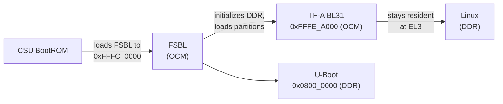

# On-Chip Memories: OCM, TCM and Friends

> **Applies to:** PetaLinux 2024.1 · Zynq UltraScale+ MPSoC · ZCU106

**[03 · Zynq UltraScale+ MPSoC Architecture](README.md)** · Part II: Zynq UltraScale+ MPSoC Hardware

## In short

- The **OCM** is 256 KB of SRAM with ECC at `0xFFFC_0000 – 0xFFFF_FFFF`, in four 64 KB banks. The BootROM loads the FSBL into it, and TF-A (BL31) stays resident in its top part while Linux runs.
- Each Cortex-R5F has 128 KB of **TCM** (64 KB ATCM + 64 KB BTCM), reachable at `0x0` from the core itself and at `0xFFE0_0000` (R5_0) or `0xFFE9_0000` (R5_1) from every other master. In lock-step mode R5_0 gets all 256 KB.
- The PMU and the CSU have their own RAM and ROM. The **BBRAM** and the **eFUSEs** are small non-volatile stores for keys and configuration, covered in [chapter 26](../26-zynqmp-hardware-security-and-secure-boot/README.md).
- Linux does not use the OCM or TCM by default. OpenAMP (`remoteproc`) loads R5 firmware into TCM and DDR through `mmio-sram` and `reserved-memory` nodes, and the kernel reaches the eFUSEs through an nvmem device.

## Concepts

### Overview

| Memory | Range (size) | Protection | Used by |
| --- | --- | --- | --- |
| OCM | `0xFFFC_0000 – 0xFFFF_FFFF` (256 KB) | 64-bit ECC, OCM_XMPU | BootROM → FSBL; TF-A BL31; optional user data |
| R5_0 TCM (global) | `0xFFE0_0000 – 0xFFE3_FFFF` (128 KB split, 256 KB lock-step) | 32-bit ECC | R5_0 code and data |
| R5_1 TCM (global) | `0xFFE9_0000 – 0xFFEB_FFFF` (128 KB, split mode only) | 32-bit ECC | R5_1 code and data |
| PMU RAM | `0xFFDC_0000 – 0xFFDD_FFFF` (128 KB) | ECC | PMU firmware |
| PMU ROM | `0xFFD0_0000` (32 KB) | – | PMU ROM code, visible only to the PMU |
| CSU RAM | `0xFFC4_0000 – 0xFFC4_7FFF` (32 KB) | ECC | CSU BootROM, not user accessible |
| CSU ROM | `0xFFC0_0000 – 0xFFC1_FFFF` (128 KB) | SHA-3 integrity check | CSU BootROM |
| BBRAM | Control at `0xFFCD_0000` | Battery-backed | 256-bit AES key |
| eFUSE | Controller at `0xFFCC_0000` | One-time programmable | Keys, key hashes, security settings, user bits |

Sources: UG1085 (v2.5), Tables 6-5, 10-2, 10-8 and 4-5; Chapter 12 ("Configuration Security Unit (CSU) Introduction", "BBRAM", "eFUSE").

### OCM

From UG1085 (v2.5), Chapter 18:

- 256 KB "mapped to a high address range (0xFFFC_0000 to 0xFFFF_FFFF) in a granularity of four independent 64 KB banks. Each bank is on a separate power island controlled by the PMU." The address range "cannot be modified".
- 64-bit ECC. A partial write (not all byte enables set) becomes a read-modify-write; if the read part finds an uncorrectable error, the write is dropped and the master gets an AXI `SLVERR`. Error addresses are captured in `OCM_CE_FFA` and `OCM_UE_FFA`.
- Eight exclusive-access monitors, so the OCM supports atomic operations from several masters. "The OCM clock is the same as the cpu_r5_clk" (up to 600 MHz), and the OCM "ensures low memory access latency for the RPU MCore AXI accesses".
- "Accesses to the OCM must pass through the OCM protection unit, OCM_XMPU. The entire 256 KB of RAM is divided into 64 blocks (4 KB each) and assigned security attributes independently."

| Bank | Range |
| --- | --- |
| 0 | `0xFFFC_0000 – 0xFFFC_FFFF` |
| 1 | `0xFFFD_0000 – 0xFFFD_FFFF` |
| 2 | `0xFFFE_0000 – 0xFFFE_FFFF` |
| 3 | `0xFFFF_0000 – 0xFFFF_FFFF` |

The OCM matters during boot because it is the only RAM available before the FSBL has initialized DDR:



Two pieces of AMD source code encode this layout:

- TF-A places BL31 at the top of OCM in a release build: `BL31_BASE` `0xfffea000`, `BL31_LIMIT` `0x100000000` (`plat/xilinx/zynqmp/include/platform_def.h`). In a debug build, or with a secure payload or SDEI enabled, it moves to DDR at `0x1000 – 0x80000`.
- The FSBL accepts a boot image partition with an OCM load address only from that point upward: `XFSBL_OCM_START_ADDRESS (0xFFFEA000U)`, with the comment "Check if Address is in the range of last bank of OCM" (`xfsbl_hw.h`, `xfsbl_image_header.c`). The lower part is where the FSBL itself runs.

### TCM

From UG1085 (v2.5), Chapter 4, Table 4-5 "TCM Address Map":

| Memory | Mode | R5_0 view | R5_1 view | Global address |
| --- | --- | --- | --- | --- |
| R5_0 ATCM | Split, 64 KB | `0x0000_0000` | – | `0xFFE0_0000` |
| R5_0 BTCM | Split, 64 KB | `0x0002_0000` | – | `0xFFE2_0000` |
| R5_1 ATCM | Split, 64 KB | – | `0x0000_0000` | `0xFFE9_0000` |
| R5_1 BTCM | Split, 64 KB | – | `0x0002_0000` | `0xFFEB_0000` |
| R5_0 ATCM | Lock-step, 128 KB | `0x0000_0000` | – | `0xFFE0_0000` |
| R5_0 BTCM | Lock-step, 128 KB | `0x0002_0000` | – | `0xFFE2_0000` |

UG1085 also maps the R5 instruction and data caches at `0xFFE4_0000`/`0xFFE5_0000` (R5_0) and `0xFFEC_0000`/`0xFFED_0000` (R5_1) for test access, and adds "R5_1 slave port is not accessible in lock-step mode."

Rules that follow from the TRM text:

- **Local and global addresses are the same memory.** Code linked for the R5 uses the local addresses; the APU, DMA engines and the PL use the global ones. Address translation is the most common bug when loading R5 firmware from Linux.
- **The R5 must not be in reset.** "A TCM cannot be accessed when the Cortex-R5F processor is in reset. The R5F processor must be in active or halt state to allow another master to access the TCM."
- **No SMMU, no protection from the R5 itself.** "The Cortex-R5F processor connection to TCM is a direct low-latency path that does not go through the SMMU. There is no protection to stop the Cortex-R5F processor from accessing the TCM."
- **Each 64 KB bank is a power island**: "The PMU block controls power gating to each of the 64 KB TCM banks". A bank must be powered before anyone uses it.

### PMU and CSU memories

The PMU firmware runs from the 128 KB PMU RAM. The program headers of the ZCU106 `pmufw.elf` span `0xFFDC_0000 – 0xFFDD_FAE0`, so it fills almost all of it, which is why PMU firmware features have to be chosen carefully ([chapter 09](../09-pmu-firmware/README.md)). Other masters can reach the PMU RAM and `PMU_GLOBAL` registers through the XPPU, but not the PMU ROM or its local registers (UG1085 Table 6-5). The CSU RAM and ROM are not user accessible.

### BBRAM and eFUSE

Both store secrets and configuration that must survive power cycles. From UG1085 (v2.5), Chapter 12:

- **BBRAM**: "The BBRAM key is stored in plain text form in a 256-bit RAM array." It lives in the battery power domain, so the key survives while `VCC_PSBATT` is present, and the tamper logic can erase it.
- **eFUSE**: "a small, one-time programmable, non-volatile memory element". Among others: a 256-bit AES key ("a block of 256 eFUSEs that can provide a key to the AES-256 crypto engine"), the hashes of the RSA primary public keys (PPK0/PPK1), the secondary key ID (SPK_ID), security control bits, user fuses and the device DNA. "Reading the eFUSE value means reading the eFUSE cache and not the physical device eFUSEs."

Programming eFUSEs is irreversible. [Chapter 26](../26-zynqmp-hardware-security-and-secure-boot/README.md) covers both in detail.

## On ZynqMP

### What Linux sees

| Memory | Linux interface in the reference image |
| --- | --- |
| OCM | Not mapped as memory. The OCM controller at `0xFF960000` (`xlnx,zynqmp-ocmc-1.0`) is an EDAC device for ECC error reporting |
| TCM | `mmio-sram` nodes in the BSP's `openamp.dtbo`, used by `remoteproc` (not applied by default) |
| R5 firmware in DDR | `reserved-memory` nodes with `no-map`: `rproc@3ed00000` and `rproc@3ef00000` (256 KB each), plus vring and buffer regions |
| eFUSE, SoC revision | nvmem device `zynqmp-nvmem0`, read through the PMU firmware |
| BBRAM | Not exposed by default; programmed from U-Boot, XSDB or a bare-metal application ([chapter 26](../26-zynqmp-hardware-security-and-secure-boot/README.md)) |

The BSP's `openamp.dtbo` describes each TCM bank as an SRAM with its own power domain. Excerpt, decompiled with `dtc`:

```dts
			tcm_0a@ffe00000 {
				no-map;
				reg = <0x00 0xffe00000 0x00 0x10000>;
				status = "okay";
				compatible = "mmio-sram";
				power-domain = <0xffffffff 0x0f>;
				phandle = <0x01>;
			};

			tcm_0b@ffe20000 {
				no-map;
				reg = <0x00 0xffe20000 0x00 0x10000>;
				status = "okay";
				compatible = "mmio-sram";
				power-domain = <0xffffffff 0x10>;
				phandle = <0x02>;
			};
```

The power domains `0x0f` and `0x10` are `PD_R5_0_ATCM` (15) and `PD_R5_0_BTCM` (16) in `dt-bindings/power/xlnx-zynqmp-power.h`; the R5_1 banks at `0xFFE9_0000` and `0xFFEB_0000` use `PD_R5_1_ATCM` (17) and `PD_R5_1_BTCM` (18). The kernel's SRAM driver (`CONFIG_SRAM=y` in the reference kernel) manages them, and the `remoteproc` driver writes the firmware's TCM sections there through the global addresses. [Chapter 21](../21-rpu-and-openamp/README.md) walks through the whole flow.

> [!IMPORTANT]
> The `xlnx,cluster-mode` property has opposite meanings in the two R5 `remoteproc` drivers in `linux-xlnx` 2024.1. In `zynqmp_r5_remoteproc.c` (compatible `xlnx,zynqmp-r5-remoteproc`, the one this kernel builds as `CONFIG_ZYNQMP_R5_REMOTEPROC=m`), it takes `PM_RPU_MODE_LOCKSTEP = 0` and `PM_RPU_MODE_SPLIT = 1`. In `xlnx_r5_remoteproc.c` (compatible `xlnx,zynqmp-r5fss`, used by the `remoteproc` node in `zynqmp.dtsi`, Kconfig entry commented out in 2024.1), `SPLIT_MODE = 0` and `LOCKSTEP_MODE = 1`. The BSP's `openamp.dtbo` uses the first driver with `xlnx,cluster-mode = <0x01>`: split mode.

## Hands-on

### TF-A is resident in OCM

Compare the first words of the BL31 binary on the host with the OCM contents on the running target:

```console
$ od -An -tx4 -N16 pre-built/linux/images/bl31.bin
 aa0003f4 aa0103f5 aa0203f6 aa0303f7
target# devmem 0xFFFEA000 32
0xAA0003F4
target# devmem 0xFFFEA004 32
0xAA0103F5
```

BL31 is still there, because it handles every secure monitor call from Linux: PSCI for CPU on/off and suspend, and the EEMI calls that TF-A forwards to the PMU firmware ([chapter 10](../10-trusted-firmware-a/README.md)). Overwriting it, for example with a careless `devmem` write into the OCM, breaks the next SMC.

In your own project, the file is `images/linux/bl31.bin`.

### eFUSE cells through nvmem

The device tree describes the eFUSE layout as nvmem cells under the zynqmp-firmware node:

```console
target$ ls /proc/device-tree/firmware/zynqmp-firmware/soc-nvmem/nvmem-layout
#address-cells     efuse-chash@50     efuse-ppk1hash@d0  efuse-spkid@5c     efuse-usr3@2c      efuse-usr7@3c
#size-cells        efuse-dna@c        efuse-pufmisc@54   efuse-usr0@20      efuse-usr4@30      name
compatible         efuse-miscusr@40   efuse-pufuser@100  efuse-usr1@24      efuse-usr5@34      soc-revision@0
efuse-aeskey@60    efuse-ppk0hash@a0  efuse-sec@58       efuse-usr2@28      efuse-usr6@38
```

The cell offsets are offsets into the nvmem device `/sys/bus/nvmem/devices/zynqmp-nvmem0/nvmem`, whose reads and writes go through the PMU firmware (`drivers/nvmem/zynqmp_nvmem.c` supports both `EFUSE_READ` and `EFUSE_WRITE`).

> [!CAUTION]
> Writing to `/sys/bus/nvmem/devices/zynqmp-nvmem0/nvmem` can program eFUSEs. Programming is permanent. Never write to it on a board you want to keep general-purpose.

## PetaLinux 2024.1 specifics

- TF-A runs from OCM unless you enable `CONFIG_SUBSYSTEM_TF-A_MEMORY_SETTINGS` (petalinux-config → Trusted Firmware ARM (TF-A) Configuration) and give a DDR base and size. A debug build (`CONFIG_SUBSYSTEM_TF-A_DEBUG`) also moves BL31 into DDR, as the `#if !DEBUG` in `platform_def.h` shows. The ZCU106 configuration sets neither.
- OpenAMP support is in the BSP but off by default: the `openamp.dtbo` overlay is shipped in `images/linux/dtbos/`, the R5 demo firmware packages (`openamp-fw-echo-testd`, `openamp-fw-mat-muld`, `openamp-fw-rpc-demo`) are in the root filesystem, and `boot.scr` applies the overlay only when a `devicetree/openamp.dtbo` file is present on the boot partition.

## Pitfalls

- **Touching TCM while the R5 is in reset.** The access does not complete. Bring the RPU out of reset (or halt it) first, or let `remoteproc` do it.
- **Linking R5 code at global TCM addresses, or loading it at local ones.** The R5 sees TCM at `0x0`; the loader on the APU must write to `0xFFE0_0000`.
- **Using R5_1 in lock-step mode.** Its TCM and slave port are not accessible.
- **Putting your own data into the top of OCM.** TF-A owns `0xFFFE_A000` upward in the default configuration.
- **Partial writes to OCM after an uncorrectable ECC error.** The write is silently dropped with `SLVERR`. Initialize OCM regions with full 64-bit writes before use.
- **Copying the `xlnx,cluster-mode` value between device trees for different drivers.** The same number means split in one driver and lock-step in the other.

## References

- UG1085 Zynq UltraScale+ Device TRM (v2.5): Chapter 4 ("Tightly Coupled Memory Functional Description", Table 4-5), Chapter 6 (Table 6-5), Chapter 10 (Table 10-2), Chapter 12 ("BBRAM", "eFUSE"), Chapter 18 (Table 18-1, "64-bit ECC Support")
- `arm-trusted-firmware@xilinx-v2024.1:plat/xilinx/zynqmp/include/platform_def.h`
- `embeddedsw@xilinx_v2024.1:lib/sw_apps/zynqmp_fsbl/src/xfsbl_hw.h`, `xfsbl_image_header.c`
- `linux-xlnx@xilinx-v2024.1:drivers/nvmem/zynqmp_nvmem.c`, `drivers/remoteproc/zynqmp_r5_remoteproc.c`, `drivers/remoteproc/xlnx_r5_remoteproc.c`, `drivers/remoteproc/Kconfig`, `include/linux/firmware/xlnx-zynqmp.h`, `include/dt-bindings/power/xlnx-zynqmp-power.h`, `arch/arm64/boot/dts/xilinx/zynqmp.dtsi`
- `xilinx-zcu106-2024.1:pre-built/linux/images/` (`bl31.bin`, `pmufw.elf`, `dtbos/openamp.dtbo`, `boot.scr`)
- Captured on the reference setup: `devmem`, `/proc/device-tree`, kernel configuration

---

<sub>← [System Address Map](04-memory-map.md) · [Chapter index](README.md) · [Interconnect, Cache Coherency and the SMMU](06-interconnect-coherency-and-smmu.md) →</sub>
