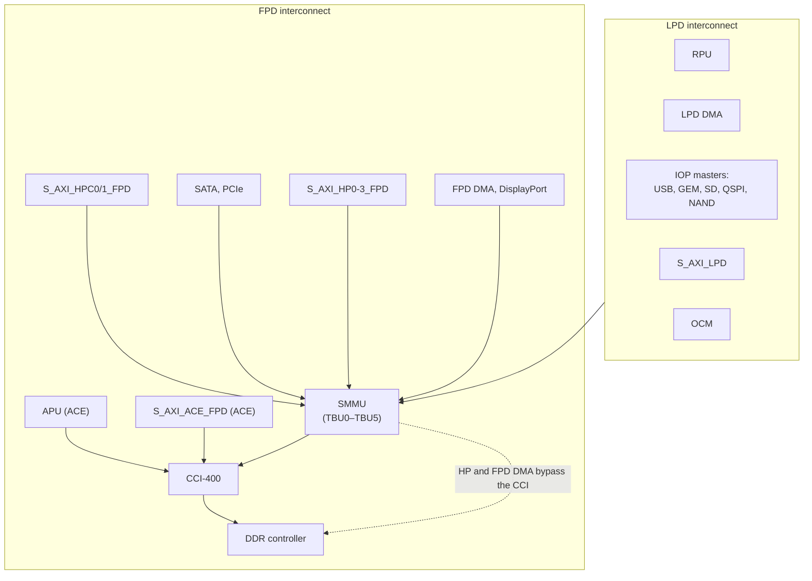

# Interconnect, Cache Coherency and the SMMU

> **Applies to:** PetaLinux 2024.1 · Zynq UltraScale+ MPSoC · ZCU106

**[03 · Zynq UltraScale+ MPSoC Architecture](README.md)** · Part II: Zynq UltraScale+ MPSoC Hardware

## In short

- The PS interconnect is a set of Arm NIC-400 AXI switches, one group in the LPD and one in the FPD, joined around an Arm **CCI-400** cache coherent interconnect in front of the DDR controller.
- A DMA master is either **non-coherent** (software must clean and invalidate CPU caches around each transfer), **I/O coherent** (its reads and writes snoop the APU caches), or **fully coherent** (caches on both sides snoop each other). Which one you get depends on the port, the AXI cache attributes and the configuration of the CCI.
- The **SMMU** (Arm MMU-500) sits in front of the DDR for most masters. It can translate addresses and isolate devices. In the PetaLinux 2024.1 device tree it is **disabled**. The PS peripherals already carry `iommus` properties with their stream IDs, but none is marked `dma-coherent`.
- The **XMPU** and **XPPU** are AMD protection units that check every transaction against a master ID and TrustZone state, for memory and for peripherals respectively.
- For Linux drivers, the practical question is always the same: is this device coherent, and does the device tree say so?

## Concepts

### The interconnect

From UG1085 (v2.5), Chapter 15:

- "Interconnect switches based on the Arm NIC-400", "Cache coherent interconnect (CCI-400)", "Separate interconnects in two power domains".
- QoS regulators, AXI performance monitors (APM), AXI timeout blocks (ATB) "that works as a watchdog timer for interconnect hang", and the AXI isolation blocks (AIB) used for powering domains down.
- The CCI-400 "provides two ACE slave ports (for full coherency), three ACE-Lite slaves (for I/O coherency), two ACE-Lite master ports (for DDR), and one ACE-Lite master port for non-DDR memory-mapped accesses". The APU cluster uses one ACE port, `S_AXI_ACE_FPD` the other.



Simplified from UG1085 (v2.5), Figure 15-1 and Table 16-4.

### Coherency models

| Model | Who | What software must do |
| --- | --- | --- |
| Non-coherent | `S_AXI_HP0-3_FPD`, FPD DMA, DisplayPort; any master with coherency disabled | Clean the CPU cache before the device reads a buffer, invalidate it before the CPU reads what the device wrote |
| I/O coherent (one-way) | `S_AXI_HPC0/1_FPD`, `S_AXI_ACP_FPD`, and PS masters configured for it | Nothing for cache maintenance; the master's accesses snoop the APU caches |
| Fully coherent (two-way) | APU, `S_AXI_ACE_FPD` | Nothing; caches on both sides snoop each other |

UG1085 (v2.5), Chapter 15, "I/O Coherency": "All of the PS masters, including the RPU but excluding the full-power DMA controller (FPD DMA), DisplayPort, and S_AXI_HP{0:3}_FPD PS masters, can be optionally configured as I/O coherent."

"Optionally" is the key word. I/O coherency needs three things:

1. **The hardware path** goes through the CCI: true for HPC, ACP, ACE and the PS masters routed through it, never for HP0–3.
2. **The transaction asks for it.** For the PL ports, UG1085 Chapter 35 says: "Drive any non-zero value on AxCACHE[3:2] for coherency; AxCACHE[3:2] = 2'b00 indicates a non-coherent transaction." The CCI must also have snooping enabled for the slave interface (`Snoop_Control_Register`).
3. **Linux knows.** The device's node needs `dma-coherent`, so the DMA API skips cache maintenance. Without it, Linux does cache maintenance on a coherent device, which costs time but is safe. The opposite mistake, `dma-coherent` on a device whose transactions do not snoop, causes data corruption.

The Vivado PS configuration has a coherency option per master. The ZCU106 design leaves them all off:

```text
PSU__AFI0_COHERENCY=0
PSU__AFI1_COHERENCY=0
PSU__CSU_COHERENCY=0
PSU__FPDMASTERS_COHERENCY=0
PSU__GEM0_COHERENCY=0
...
PSU__LPDMA0_COHERENCY=0
PSU__LPDMA1_COHERENCY=0
```

### What coherency means for a DMA driver

The Linux DMA API hides the difference, as long as the device tree is right:

| API | Non-coherent device | Coherent device (`dma-coherent`) |
| --- | --- | --- |
| `dma_alloc_coherent()` | Returns memory mapped non-cacheable for the CPU | Returns normal cacheable memory |
| `dma_map_single()` / `dma_map_sg()` | Cleans (to device) or invalidates (from device) the CPU caches | No cache maintenance |
| `dma_sync_single_for_cpu()` / `_for_device()` | Cache maintenance | No-op |

Two consequences for PL designs:

- **Throughput**: for large streaming buffers, HP ports with streaming mappings are usually faster than HPC, because they avoid the CCI and snoop traffic. Cache maintenance on very large buffers costs CPU time instead.
- **Small, frequent exchanges**: HPC or ACP avoids flushing caches for every descriptor or message.

### The SMMU

The SMMU is an Arm MMU-500 at `0xFD80_0000` (UG1085 Table 10-9 `SMMU_GPV`). It has one translation control unit (TCU) and six translation buffer units (TBUs), each in front of a group of masters. From UG1085 (v2.5), Table 16-4:

| TBU | Masters |
| --- | --- |
| TBU0 | `S_AXI_HPC0/1_FPD`, SMMU TCU, CoreSight |
| TBU1 | SIOU DMA units (SATA, PCIe) |
| TBU2 | LPD masters, for example LPD DMA, USB, GEM, SD, QSPI, NAND |
| TBU3 | `S_AXI_HP0_FPD`, DisplayPort |
| TBU4 | `S_AXI_HP1_FPD`, `S_AXI_HP2_FPD` |
| TBU5 | `S_AXI_HP3_FPD`, FPD DMA |

The SMMU identifies the master by a 15-bit **stream ID**. UG1085: "Bits [9:0] of the stream ID are the master ID defined in Table 16-13. Bits [14:10] are the TBU number the master transaction passes through. For example, for the GEM0 PS master, its master ID is 10'h074 and its TBU number is 5'h02. Concatenating these fields gives GEM0 a stream ID of 15'h0874."

Selected master IDs from Table 16-13:

| Master | Master ID [9:0] | Stream ID |
| --- | --- | --- |
| SD0, SD1 | `0001 11 0000`, `0001 11 0001` | `0x870`, `0x871` |
| QSPI | `0001 11 0011` | `0x873` |
| GEM0 – GEM3 | `0001 11 0100` – `0001 11 0111` | `0x874` – `0x877` |
| LPD DMA channel n | `0001 10 1nnn` | `0x868` + n |
| USB0, USB1 | `0001 10 0000`, `0001 10 0001` | `0x860`, `0x861` |
| FPD DMA channel n | `0011 10 1nnn` | `0x14E8` + n |
| `S_AXI_HP0_FPD` | `1010` + AXI ID[5:0] from the PL | TBU3: `0xE80` + AXI ID |

The stream IDs in the last column are the ones `zynqmp.dtsi` uses in its (commented-out) `iommus` properties, for example `/* iommus = <&smmu 0x874>; */` on `gem0`. For the PL ports, the master ID includes the AXI ID of the PL master, so each PL master can get its own translation context.

What the SMMU gives you when enabled:

- **Isolation**: a device can only reach memory mapped for it. This is the basis for assigning devices to virtual machines (Xen, KVM) or for containing a misbehaving PL master.
- **Scatter-gather for free**: a device sees a contiguous I/O virtual address range backed by scattered pages.
- **Addressing**: a 32-bit master can reach memory above 4 GB through translation.

What it costs: translation latency and TLB misses on the data path, and a correct `iommus` property for every master.

### XMPU and XPPU

The SMMU is optional; the AMD protection units are always in the path. From UG1085 (v2.5), Chapter 16:

| Unit | Protects | Granularity |
| --- | --- | --- |
| XMPU (8 instances: 6 at the DDR ports, 1 for OCM, 1 for FPD slaves) | DDR, OCM, FPD slaves | 16 regions each; 1 MB alignment at the DDR, 4 KB for OCM and FPD |
| XPPU (`0xFF98_0000`) | IOP peripherals, LPD and SIOU slave ports, QSPI | Apertures of 32 B (IPI buffers), 64 KB (IOP registers), 1 MB (memory) and 512 MB (Quad-SPI) |

Each region or aperture lists which master IDs may access it, read or write, and whether only secure transactions are accepted. A violation is either redirected to a "sink" or marked with a poison attribute, and raises an interrupt. The FSBL programs them from the XSA's isolation configuration (`psu_protection()` in `psu_init.c`); [chapter 26](../26-zynqmp-hardware-security-and-secure-boot/README.md) uses them to separate secure and non-secure software.

## On ZynqMP

### The state in the reference image

The SMMU node is present but disabled:

```console
target$ strings /proc/device-tree/axi/smmu@fd800000/status
disabled
target$ ls /sys/kernel/iommu_groups/
target$ dmesg | grep CCI
[    1.415941] ARM CCI_400_r1 PMU driver probed
```

The empty `iommu_groups` directory means no device is behind an enabled IOMMU, so every DMA master works with physical addresses. The kernel still prints its IOMMU defaults at boot (`iommu: Default domain type: Translated`), which only apply to devices behind an enabled IOMMU.

The PS peripherals nevertheless point at the SMMU. The device tree generator's copy of `zynqmp.dtsi` (`device-tree-xlnx`, used by PetaLinux) has active `iommus` properties; the prebuilt `system.dtb` contains 21 of them and no `dma-coherent`. For GEM3:

```console
target$ hexdump -C /proc/device-tree/axi/ethernet@ff0e0000/iommus
00000000  00 00 00 14 00 00 08 77                           |.......w|
00000008
```

The first cell is the phandle of the SMMU node, the second the stream ID `0x877` from the table above. The properties have no effect while the SMMU node is disabled.

The kernel's own source tree differs here: in `linux-xlnx@xilinx-v2024.1:arch/arm64/boot/dts/xilinx/zynqmp.dtsi` the SMMU node is called `iommu@fd800000` and the `iommus` lines are commented out:

```dts
		smmu: iommu@fd800000 {
			compatible = "arm,mmu-500";
			reg = <0x0 0xfd800000 0x0 0x20000>;
			#iommu-cells = <1>;
			status = "disabled";
			#global-interrupts = <1>;
			interrupt-parent = <&gic>;
			interrupts = <GIC_SPI 155 IRQ_TYPE_LEVEL_HIGH>,
```

and, for example, on the SATA controller:

```dts
			/* iommus = <&smmu 0x4c0>, <&smmu 0x4c1>, <&smmu 0x4c2>, <&smmu 0x4c3>; */
			/* dma-coherent; */
```

SPI 155 is interrupt ID 187, the SMMU line in UG1085 Table 13-1.

The CCI-400 is active either way: the APU reaches DDR through it, and the kernel's CCI performance-monitor driver found it at boot (the last command above). `strings` is used for the device tree property because property files end with a NUL byte instead of a newline.

## Hands-on

### Enabling the SMMU for a device

Because the generated device tree already gives the PS peripherals their stream IDs, enabling the SMMU node is the main step, for example in `project-spec/meta-user/recipes-bsp/device-tree/files/system-user.dtsi`:

```dts
&smmu {
	status = "okay";
};
```

PL masters need their own `iommus` entries, with stream IDs built from the HP port's master ID and the AXI ID the PL master drives. With the SMMU enabled, a master without an `iommus` property may be blocked, depending on how the SMMU treats unmatched streams. Check `dmesg` for `arm-smmu` faults, and test each DMA master under load.

> [!NOTE]
> **Not run on the reference setup:** QEMU's ZynqMP model is not a reliable place to validate SMMU translation, and the reference image keeps the SMMU disabled. Test SMMU changes on hardware.

### Declaring a coherent PL master

For a PL DMA engine on `S_AXI_HPC0_FPD` that drives `AxCACHE` with a coherent value, with snooping enabled for that CCI interface, add to its node:

```dts
	dma-coherent;
```

Then measure. If the data is ever stale, the hardware path is not actually snooping: check the port, the `AxCACHE` bits and the CCI snoop configuration before blaming the driver.

## PetaLinux 2024.1 specifics

- The device tree generator's `zynqmp.dtsi` (in `components/plnx_workspace/device-tree/device-tree/`) sets the SMMU to disabled, gives the PS peripherals `iommus` properties and sets no `dma-coherent`. Changes go into `system-user.dtsi` ([chapter 12](../12-device-tree/README.md)).
- The coherency options in the Vivado PS configuration (the `PSU__*_COHERENCY` parameters) change register settings that `psu_init` applies. They do not by themselves add `dma-coherent` to Linux nodes; check the generated device tree.

## Pitfalls

- **Expecting HP ports to be coherent.** They are not, whatever the AXI cache bits say. Use the DMA API's streaming mappings and let it do the cache maintenance.
- **Adding `dma-coherent` without a snooping path.** Linux skips cache maintenance and the device reads stale data or the CPU reads stale results.
- **Enabling the SMMU globally.** Every DMA master then needs a correct stream ID. Missing ones lead to translation faults, often only under load.
- **Forgetting the AXI ID in PL stream IDs.** A PL master behind an interconnect can present several AXI IDs, and each is a different stream ID.
- **Blaming software for XMPU/XPPU violations.** An access that works from one master and fails from another may be a protection-unit configuration issue. The violation interrupts and `ERR_STATUS` registers say which master tried what.

## References

- UG1085 Zynq UltraScale+ Device TRM (v2.5): Chapter 3 ("SMMU Architecture"), Chapter 15 ("Cache Coherent Interconnect", "I/O Coherency", "ACP Coherency", Figure 15-1), Chapter 16 ("XMPU Regions", Tables 16-4, 16-13, 16-14), Chapter 35 ("APU Coherent Interfaces"), Table 13-1
- `linux-xlnx@xilinx-v2024.1:arch/arm64/boot/dts/xilinx/zynqmp.dtsi` (`smmu`, `iommus`, `dma-coherent`)
- `xilinx-zcu106-2024.1:components/plnx_workspace/device-tree/device-tree/zynqmp.dtsi` (DTG copy), `pre-built/linux/images/system.dtb`
- Linux kernel documentation: `Documentation/core-api/dma-api.rst`, `Documentation/devicetree/bindings/iommu/arm,smmu.yaml`
- `xilinx-zcu106-2024.1:project-spec/hw-description/system.xsa` (`PSU__*_COHERENCY`)
- Captured on the reference setup: `/proc/device-tree`, `/sys/kernel/iommu_groups`, `dmesg`

---

<sub>← [On-Chip Memories: OCM, TCM and Friends](05-on-chip-memories.md) · [Chapter index](README.md) · [Clocks, Power Domains and Reset](07-clocks-power-and-reset.md) →</sub>
