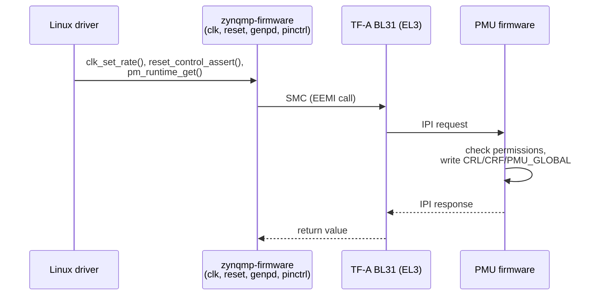

# Clocks, Power Domains and Reset

> **Applies to:** PetaLinux 2024.1 · Zynq UltraScale+ MPSoC · ZCU106

**[03 · Zynq UltraScale+ MPSoC Architecture](README.md)** · Part II: Zynq UltraScale+ MPSoC Hardware

## In short

- One reference clock (`PS_REF_CLK`, 33.33 MHz on the ZCU106) feeds **five PLLs**: IOPLL and RPLL in the LPD, APLL, DPLL and VPLL in the FPD. Several dozen **clock generators** each pick one of three PLLs and divide it down.
- The FSBL sets up PLLs and clock generators once, from `psu_init`. After boot, the **PMU firmware owns them**: Linux changes clocks, resets and power states by calling the PMU firmware through TF-A (the EEMI API), not by writing registers.
- The PS has four **power domains** (LPD, FPD, PL, battery) and many **power islands** inside them (each APU core, the L2, OCM and TCM banks, the RPU, USB, GPU pixel processors). The PMU switches them.
- **Resets** range from a full power-on reset to a PS-only reset that keeps the PL running, down to individual block resets. `CRL_APB.RESET_REASON` records which one happened.
- In Linux, these appear as the common clock framework (`/sys/kernel/debug/clk`), generic power domains (`/sys/kernel/debug/pm_genpd`) and the reset controller, all backed by the `zynqmp-firmware` driver.

## Concepts

### Clock sources and PLLs

From UG1085 (v2.5), Chapter 37: "There are five system PLLs to generate high-frequency signals that are used as clock sources for the several dozen clock generators in the LPD and FPD."

| PLL | Domain | Register | UG1085 suggested use |
| --- | --- | --- | --- |
| IOPLL | LPD | `CRL_APB.IOPLL_CTRL` (`0xFF5E0020`) | "clocks for all low speed peripherals and part of the interconnect" |
| RPLL | LPD | `CRL_APB.RPLL_CTRL` | "clocks for the RPU MPCore and part of the interconnect" |
| APLL | FPD | `CRF_APB.APLL_CTRL` (`0xFD1A0020`) | "clocks for the APU MPCore clock and part of the interconnect" |
| DPLL | FPD | `CRF_APB.DPLL_CTRL` | "clocks for the DDR controller and part of the interconnect" |
| VPLL | FPD | `CRF_APB.VPLL_CTRL` | "clocks for the video I/O" |

The suggestion is only a suggestion: "the individual clock generators can select from one of the three PLL clocks routed to it". PLL outputs can also cross domains through 6-bit dividers (`APLL_TO_LPD_CTRL`, `IOPLL_TO_FPD_CTRL` and so on). The DDR PHY has six more PLLs of its own, which cannot be used elsewhere.

The PLL equations (UG1085 Chapter 37, "Programming Examples"):

```text
F_VCO    = F_REFCLK × M.F      (M = FBDIV, F = fractional part, if enabled)
F_CLKOUT = F_VCO / O           (O = 1 or 2, set by DIV2)
```

In `xPLL_CTRL`, `FBDIV` is bits [14:8] and `DIV2` is bit 16 (mask `0x00717F00` in `psu_init.c` covers `PRE_SRC`, `DIV2` and `FBDIV`). UG1085 recommends integer mode where possible, because "PLL jitter performance is better in integer mode".

### The ZCU106 clock plan

The XSA records both the PLL settings that `psu_init` programs and the resulting clock rates. PLL settings from `psu_pll_init_data()`, with `PS_REF_CLK` = 33.33 MHz (`PSU__PSS_REF_CLK__FREQMHZ=33.330`):

| PLL | `FBDIV` | `DIV2` | VCO | Output |
| --- | --- | --- | --- | --- |
| IOPLL | `0x2d` (45) | 0 | 1499.85 MHz | 1499.85 MHz |
| RPLL | `0x46` (70) | 1 | 2333.10 MHz | 1166.55 MHz |
| APLL | `0x48` (72) | 1 | 2399.76 MHz | 1199.88 MHz |
| DPLL | `0x40` (64) | 1 | 2133.12 MHz | 1066.56 MHz |
| VPLL | `0x47` (71) | 1 | 2366.43 MHz | 1183.215 MHz |

All five run in integer mode (`FRAC_CFG_ENABLED` = 0). Selected clock generators, from the `PSU__*__SRCSEL` and `PSU__*__ACT_FREQMHZ` parameters:

| Clock | Source | Rate (MHz) | Arithmetic |
| --- | --- | --- | --- |
| `ACPU` (APU) | APLL | 1199.88 | APLL / 1 |
| `DDR` | DPLL | 533.28 | DPLL / 2 |
| `TOPSW_MAIN` (FPD interconnect) | DPLL | 533.28 | DPLL / 2 |
| `CPU_R5` (RPU) | IOPLL | 499.95 | IOPLL / 3 |
| `GPU_REF` | IOPLL | 499.95 | IOPLL / 3 |
| `LPD_SWITCH` | IOPLL | 499.95 | IOPLL / 3 |
| `IOU_SWITCH` | IOPLL | 249.98 | IOPLL / 6 |
| `SDIO1_REF` | IOPLL | 187.48 | IOPLL / 8 |
| `QSPI_REF`, `GEM3_REF` | IOPLL | 124.99 | IOPLL / 12 |
| `UART0_REF` | IOPLL | 99.99 | IOPLL / 15 |
| `PL0_REF` (`pl_clk0`) | IOPLL | 99.99 | IOPLL / 15 |
| `DP_VIDEO_REF` | VPLL | 295.80 | VPLL / 4 |

The divisions are mine; the rates are the XSA's. The pattern is typical: one PLL per big consumer (APU, DDR, video), and the IOPLL for almost everything else. Because every LPD peripheral derives from the IOPLL, changing it changes UART baud rates, SD clocks and PL clocks at the same time, which is why nobody changes it at run time.

### Clock generators

Most generators follow one pattern (UG1085 Chapter 37, "Basic Clock Generator Unit"): a 3-input mux (`SRCSEL`), one or two 6-bit dividers (`DIVISOR0`, `DIVISOR1`) and one or more clock-active bits (`CLKACT`). For example `CRL_APB.UART0_REF_CTRL` at `0xFF5E0074` and `CRL_APB.PL0_REF_CTRL` at `0xFF5E00C0`. The APU (`ACPU_CTRL`) and the DDR controller have special generators.

Linux models each stage as a separate clock: a mux, a divider, a gate. That is why `clk_summary` shows chains such as `pl0_ref_mux` → `pl0_ref_div1` → `pl0_ref_div2` → `pl0_ref`.

### Power domains and islands

The domains were introduced in [section 01](01-device-family-overview.md#block-diagram-and-power-domains). Within them, the PMU controls individual power islands. UG1085 (v2.5), Chapter 6, lists the PMU's "Power control interface to all islands within the PS":

- L2, OCM and TCM RAMs (each OCM and TCM bank separately)
- `APU_Cores [3:0]`
- the dual-core Cortex-R5F
- USB0 and USB1
- GPU pixel processors PP0 and PP1
- the full-power and PL domain crossing bridges

Switching an island off saves leakage power; the cost is the state inside it. The PMU sequences the isolation, clock and reset steps so that this happens safely.

### Resets

From UG1085 (v2.5), Chapter 38, Table 38-1, from widest to narrowest:

| Reset | Triggered by | Effect | `RESET_REASON` bit |
| --- | --- | --- | --- |
| External POR | `PS_POR_B` pin | Everything, mode pins sampled | `external_por` (0) |
| Internal POR | System error (`PMU_GLOBAL.ERROR_POR_{1,2}`) | As external POR, error status kept | `internal_por` (1) |
| External system reset | `PS_SRST_B` pin | As POR but mode pins not sampled, some registers kept, RAMs not cleared | `srst` (4) |
| Software system reset | `CRL_APB.RESET_CTRL[soft_reset]` | As external system reset | `soft` (5) |
| System error reset | `PMU_GLOBAL.ERROR_SRST_{1,2}` | As external system reset | `pmu_sys_reset` (2) |
| PS-only reset | `PMU_GLOBAL.GLOBAL_RESET[PS_ONLY_RST]` | PS reset, PL keeps running | `psonly_reset_req` (3) |
| FPD reset | `CRL_APB.RST_LPD_TOP[fpd_reset]` | FPD only; PL and LPD unaffected | – |
| Debug system reset | Arm DAP | As system reset, debug state preserved | `debug_sys` (6) |
| Block resets | `CRL_APB.RST_LPD_*` (for example `RST_LPD_IOU0`, `RST_LPD_IOU2`, `RST_LPD_TOP`), `CRF_APB.RST_FPD_*` | One peripheral or subsystem | – |

The reason register is `CRL_APB.RESET_REASON`, at offset `0x220` (`0xFF5E0220`; `u32 reset_reason; /* 0x220 */` in U-Boot's `struct crlapb_regs`). U-Boot decodes it at every boot and prints `Reset reason:` followed by the cause, and stores it in the `reset_reason` environment variable.

Two warnings from Chapter 38: "resetting of individual peripherals should not be attempted without knowing that the system is quiet", and "The system can hang when software reset control is asserted during a pending AXI/APB transfer."

By default a system reset also clears the PL configuration. The PS-only reset exists so that the PL can keep running, for example while the APU reboots ([chapter 09](../09-pmu-firmware/README.md)).

## On ZynqMP

### Who controls clocks, power and resets at run time



Every clock, reset, power domain and pin in the Linux device tree is a reference to the firmware node: `clocks = <&zynqmp_clk ...>`, `resets = <&zynqmp_reset ...>`, `power-domains = <&zynqmp_firmware ...>`, `pinctrl-0 = <...>`. The PMU firmware arbitrates between all its clients (the APU running Linux, the RPU, and others), so a clock that the RPU needs is not switched off because Linux no longer uses it. Chapters [09](../09-pmu-firmware/README.md) and [10](../10-trusted-firmware-a/README.md) cover the two firmware layers.

### What the reference setup shows, and what it does not

In QEMU, no FSBL runs `psu_init`: the boot files are loaded directly. Clock registers therefore hold the values of the QEMU model and its PMU ROM, not the ZCU106 plan above. This is useful in one way: it shows that Linux reads the actual hardware state through the PMU firmware, not the values from the XSA.

## Hands-on

### Decode a PLL from its register

```console
target# devmem 0xFF5E0020 32
0x00013200
```

`FBDIV` = bits [14:8] = `0x32` = 50, `DIV2` = bit 16 = 1, so IOPLL = 33.33 MHz × 50 / 2 = 833.25 MHz. Linux agrees:

```console
target# grep -E "^ +(iopll_int|iopll|uart0_ref|pl0_ref) " /sys/kernel/debug/clk/clk_summary
       iopll_int                      1        1        1  1666500000          0     0  50000         Y
                iopll                12       15        9   833250000          0     0  50000         Y
                            pl0_ref       2        2        0    92583334          0     0  50000         Y
                            uart0_ref       1        1        1    34718750          0     0  50000         Y
```

On a real ZCU106, `psu_init` writes `0x00002D00` under that mask: `FBDIV` = 45, `DIV2` clear, and `iopll` is 1499.85 MHz. Note also `pl0_ref`: the overlay requests 99 990 005 Hz ([section 02](02-ps-and-pl.md)), but from an 833.25 MHz IOPLL the highest rate that does not exceed the request is 92 583 334 Hz (833.25 / 9); the next divider would give 104.16 MHz. A PL clock is always an integer division of a PS PLL, so not every frequency is available.

### Ask the PMU firmware directly

The zynqmp-firmware debugfs interface exposes the clock calls. Clock IDs come from `include/dt-bindings/clock/xlnx-zynqmp-clk.h` (`ACPU` = 10, `UART0_REF` = 56, `PL0_REF` = 71):

```console
target# echo pm_clock_getdivider 10 > /sys/kernel/debug/zynqmp-firmware/pm
target# cat /sys/kernel/debug/zynqmp-firmware/pm
Divider Value: 3
target# echo pm_clock_getparent 10 > /sys/kernel/debug/zynqmp-firmware/pm
target# cat /sys/kernel/debug/zynqmp-firmware/pm
Clock parent Index: 2
target# echo pm_clock_getdivider 56 > /sys/kernel/debug/zynqmp-firmware/pm
target# cat /sys/kernel/debug/zynqmp-firmware/pm
Divider Value: 24
```

`ACPU` uses mux input 2 ("000 = APLL; 010 = DPLL; 011 = VPLL" in the `ACPU_CTRL` description in `psu_init.c`) divided by 3, and `UART0_REF` divides the 833.25 MHz IOPLL by 24 to 34.72 MHz, the values `clk_summary` shows. `devmem 0xFD1A0060 32` returns `0x03000302` on the reference setup: `SRCSEL` = 2 in bits [2:0], `DIVISOR0` = 3 in bits [13:8], the same answer from the register.

> [!WARNING]
> The same interface can also change clocks (`pm_clock_setdivider`, `pm_clock_setparent`, `pm_clock_disable`). Doing that behind the back of the Linux clock framework can stop the console, the root filesystem device or the PL. Treat it as a read-only tool.

### Power domains

```console
target# grep -B1 -E "ff000000.serial|fd4b0000.gpu|ff9d0000.usb" /sys/kernel/debug/pm_genpd/pm_genpd_summary
domain18                        off-0                                              0
    /devices/platform/axi/fd4b0000.gpu                  suspended                  0
domain17                        on                                                 0
    /devices/platform/axi/ff9d0000.usb                  active                     0
--
domain0                         on                                                 0
    /devices/platform/axi/ff000000.serial               active                     0
```

The ZynqMP power domain driver (`drivers/pmdomain/xilinx/zynqmp-pm-domains.c`) creates 100 generic domains named `domain0` to `domain99` and binds each one to an EEMI node the first time a device refers to it, so the numbers carry no meaning. What matters is the state: the GPU is idle (`suspended`), so its domain is off and the PMU firmware has released the node; the UART is active, so its domain is on. Runtime PM uses `zynqmp_pm_request_node()`, `zynqmp_pm_set_requirement()` and `zynqmp_pm_release_node()` to tell the PMU firmware what Linux needs.

### Reboot scope and reset reason

What a Linux `reboot` resets is selectable:

```console
target# cat /sys/devices/platform/firmware:zynqmp-firmware/shutdown_scope
subsystem ps_only [system]
```

`system` (the default) resets the whole device, `ps_only` keeps the PL running, `subsystem` restarts only the APU subsystem, leaving for example the RPU running. Writing one of the words selects it for the next reboot. [Chapter 09](../09-pmu-firmware/README.md) explains the conditions each one needs.

U-Boot prints the reset reason at boot. On the reference setup the line is empty, because QEMU leaves `RESET_REASON` at 0:

```text
Reset reason:	
```

On hardware it shows, for example, `EXTERNAL` after power-on.

> [!NOTE]
> **Not run on the reference setup:** reset reasons other than the empty QEMU value, and `ps_only`/`subsystem` reboots, need hardware.

## PetaLinux 2024.1 specifics

- Clock rates are set in Vivado and reach the board through `psu_init` in the FSBL. There is no PetaLinux setting for them. A new clock plan means a new XSA, `petalinux-config --get-hw-description`, and a new `BOOT.BIN`.
- The device tree tells Linux the reference clocks. The generated `system.dtb` has `pss_ref_clk` with `clock-frequency = <0x1fc9350>` (33 330 000 Hz), taken from the XSA. If this value is wrong, every rate Linux computes is wrong, including the console baud rate.

## Pitfalls

- **Changing clocks or resets with `devmem`.** The PMU firmware and Linux keep their own state. Use the frameworks.
- **Assuming a PL clock is exact.** It is a PS PLL divided by two integers. Check `clk_summary` for the rate you actually got.
- **Asserting a block reset during traffic.** UG1085 warns that it can hang the system.
- **Expecting `reboot` to keep the PL configured.** The default `shutdown_scope` is `system`, which resets the PL too.
- **Trusting clock rates measured in QEMU.** They do not come from your XSA.

## References

- UG1085 Zynq UltraScale+ Device TRM (v2.5): Chapter 6 ("PMU Processor Interfaces"), Chapter 37 ("System PLL Clock Units", "PLL Frequency Control", "Basic Clock Generator Unit"), Chapter 38 (Tables 38-1, 38-2, "PS Only Reset", "System-level Software Reset")
- DS925 Zynq UltraScale+ MPSoC Data Sheet: DC and AC Switching Characteristics (PLL and clock limits)
- `xilinx-zcu106-2024.1:project-spec/hw-description/system.xsa` (`psu_init.c` `psu_pll_init_data()`, `PSU__*` clock parameters), `pre-built/linux/images/system.dtb`
- `linux-xlnx@xilinx-v2024.1:include/dt-bindings/clock/xlnx-zynqmp-clk.h`, `drivers/pmdomain/xilinx/zynqmp-pm-domains.c`, `drivers/firmware/xilinx/zynqmp-debug.c`, `Documentation/ABI/stable/sysfs-driver-firmware-zynqmp` (`shutdown_scope`)
- `u-boot-xlnx@xilinx-v2024.1:arch/arm/mach-zynqmp/include/mach/hardware.h` (`struct crlapb_regs`), `board/xilinx/zynqmp/zynqmp.c` (`reset_reason()`)
- Captured on the reference setup: `devmem`, `clk_summary`, zynqmp-firmware debugfs, `pm_genpd_summary`, `shutdown_scope`, U-Boot boot log

---

<sub>← [Interconnect, Cache Coherency and the SMMU](06-interconnect-coherency-and-smmu.md) · [Chapter index](README.md) · [Interrupts and the GIC](08-interrupts-and-gic.md) →</sub>
