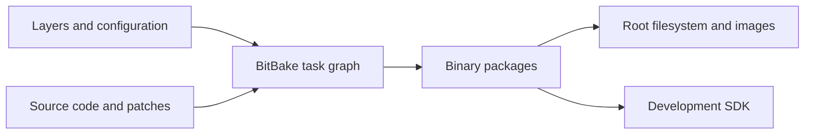

# Yocto Project, OpenEmbedded, Poky and BitBake

> **Applies to:** PetaLinux 2024.1 · Zynq UltraScale+ MPSoC

**[04 · The Yocto Project](README.md)** · Part III: Build Systems

## Concepts

The **Yocto Project** provides tools, testing and documentation for custom Linux systems. **OpenEmbedded-Core (OE-Core)** supplies shared build metadata. **BitBake** reads that metadata and runs tasks. **Poky** combines BitBake, OE-Core and reference layers into a useful starting point.

A recipe describes how to fetch, patch, build and package software. A class shares build rules between recipes. Configuration selects the machine and distribution policy. Layers group these files so board support and product changes can be maintained separately.

An image is the result of a build. It is not the build system itself. One recipe may produce several packages, and one image combines packages from many recipes.

## PetaLinux 2024.1 specifics

The local ZCU106 BSP contains `components/yocto/layers/poky/meta-poky/conf/distro/poky.conf`. Its release fields identify **4.1.4, Langdale**. AMD adds its platform layers and PetaLinux tools around this base. The kernel version is selected separately: the BSP's `linux-xlnx_2024.1.bb` selects Linux 6.6.10. A Yocto release number therefore does not determine the kernel version by itself.

Langdale and Scarthgap are different Yocto release series. Scarthgap is 5.0; a recipe written for it may use classes or variables missing from Langdale. Keep the layers on matching release branches. Do not choose a branch only because it has a newer date.

## Debugging

First identify whether a failure comes from metadata parsing, fetching, compiling, packaging or image assembly. These stages have different inputs. Installing a missing program on the host does not necessarily fix a missing recipe dependency: builds use controlled sysroots.

## References

- Yocto Project 4.1.4, [build concepts](https://docs.yoctoproject.org/4.1.4/overview-manual/concepts.html)
- `xilinx-zcu106-2024.1:components/yocto/layers/poky/meta-poky/conf/distro/poky.conf`
- `meta-xilinx@rel-v2024.1:meta-xilinx-core/recipes-kernel/linux/linux-xlnx_2024.1.bb`

---

[Chapter index](README.md) · [Layers and the Layer Model](02-layers.md) →
