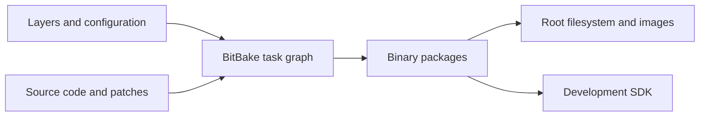

# Yocto Project, OpenEmbedded, Poky and BitBake

> **Applies to:** PetaLinux 2024.1 · Zynq UltraScale+ MPSoC

**[04 · The Yocto Project](README.md)** · Part III: Build Systems

## Concepts

The **Yocto Project** provides tools, testing and documentation for custom Linux systems. **OpenEmbedded-Core (OE-Core)** supplies shared build metadata. **BitBake** reads that metadata and runs tasks. **Poky** combines BitBake, OE-Core and reference layers into a useful starting point.

A recipe describes how to fetch, patch, build and package software. A class shares build rules between recipes. Configuration selects the machine and distribution policy. Layers group these files so board support and product changes can be maintained separately.

An image is the result of a build. It is not the build system itself. One recipe may produce several packages, and one image combines packages from many recipes.

## PetaLinux 2024.1 specifics

The local ZCU106 BSP contains `components/yocto/layers/poky/meta-poky/conf/distro/poky.conf`. Its release fields identify **4.1.4, Langdale**. AMD adds its platform layers and PetaLinux tools around this base. The kernel version is selected separately: the BSP's `linux-xlnx_2024.1.bb` selects Linux 6.6.10. A Yocto release number therefore does not determine the kernel version by itself.

Langdale and Scarthgap are different Yocto release series. Scarthgap is 5.0; a recipe written for it may use classes or variables missing from Langdale. Keep the layers on matching release branches. Do not choose a branch only because it has a newer date.

## Debugging

First identify whether a failure comes from metadata parsing, fetching, compiling, packaging or image assembly. These stages have different inputs. Installing a missing program on the host does not necessarily fix a missing recipe dependency: builds use controlled sysroots.

## Follow one program through the system

Consider a product that needs a small sensor service and a shared library. There are three different questions: can the compiler build the service, can the package manager install it, and will it start correctly on the board? Each question belongs to a different part of the build. Keeping these parts separate makes failures much easier to explain.

First, the recipe identifies the source and its revision. BitBake fetches the source, applies patches and prepares a build directory. A recipe can inherit a class that supplies common tasks. For example, the `cmake` class connects CMake to the cross compiler and the correct sysroot. The recipe then supplies the project-specific inputs, such as optional features and dependencies. A class is therefore executable build policy, not only a convenient collection of variables.

Next, `do_install` places files in a temporary destination called `${D}`. This is a staging tree on the build host. A target path such as `/usr/bin/sensor-service` is represented under that tree. The package tasks divide the staged files into packages. The application, development headers, debug information and documentation can become separate packages even though they came from one source recipe.

Finally, an image recipe chooses packages for a root filesystem. The package manager resolves runtime dependencies and installs the chosen package set into an image directory. Image tasks turn that directory into the requested formats. A boot image is a further platform concern: firmware, a bitstream and a bootloader do not become a valid `BOOT.BIN` simply because an application package was built.

This gives four useful checkpoints:

| Checkpoint | Evidence to inspect | What it does not prove |
| --- | --- | --- |
| Source prepared | Selected revision and applied patch series | The compiler accepts the source |
| Recipe built | Compile and install task results | A package contains every required file |
| Package produced | Package file list and dependency metadata | The image selected that package |
| Image assembled | Image manifest and root filesystem contents | The real board boots and the service works |

A successful result at one checkpoint cannot replace the next. For example, a daemon may be in the root filesystem while its service file is missing. The build can still complete because the package manager cannot know the intended product behavior.

## Build host, target and SDK are separate contexts

The **build host** runs BitBake. The **target** runs the resulting Linux image. A program needed during the build must run on the host, even when it generates data for Arm. This is why OpenEmbedded has native recipes and native sysroots. Accidentally executing a target binary during configuration usually causes an execution-format failure. Accidentally linking against a host library can produce a less obvious failure later.

An SDK adds another context: the computer on which application developers use the installed SDK. Its compiler and tools must run on that computer, while its target libraries must match the image. `nativesdk` recipes serve the SDK host side. They are not interchangeable with target packages or with build-time `native` recipes.

For a concrete example, inspect the shipped `which_2.21.bb` recipe. It depends on `cwautomacros-native`, inherits `autotools`, and declares a `nativesdk` extension. These choices answer different questions. The native dependency supplies build macros. The class defines the build procedure. The extension allows an SDK-host form of the utility. None of these choices alone installs `which` into your target image.

## What the PetaLinux wrapper changes

PetaLinux adds hardware import, project configuration, component build commands and packaging around OpenEmbedded. It does not remove the underlying dependency graph. A menu selection can become generated configuration, which changes the recipe environment, which changes task inputs, which changes the final artifact. When a menu change appears to have no effect, follow this chain instead of repeatedly rebuilding everything.

Treat generated configuration as a view of the selected project inputs. Keep persistent product changes in the supported project configuration or a maintained layer. An edit made directly in a temporary work directory may explain a local experiment, but it cannot explain how another machine should reproduce the result.

The reference BSP offers an instructive boundary. Its Poky distribution file identifies Langdale, while its AMD kernel recipe selects `LINUX_VERSION = "6.6.10"`. This is a vendor-maintained combination. Updating a kernel recipe does not automatically update every userspace recipe or BitBake feature. Conversely, changing the OpenEmbedded release can alter parsing and class behavior even if the kernel version stays the same.

## Diagnose the boundary that failed

Suppose a service reports that a shared library is missing on the target. Start with the target error and the image manifest. If the library package is absent, inspect runtime dependencies and image selection. If the package is present but the loader rejects it, inspect architecture, ABI and the actual library path. Rebuilding the cross compiler is not a useful first step for either case.

Suppose the same project builds on one workstation but fails on another. Compare layer revisions, configuration, source revisions and host assumptions before comparing CPU speed. The intended result is that declared inputs explain the output. A hidden dependency on a host file breaks that model and must be fixed at the recipe boundary.

**Source trail:** local BSP `poky/meta/recipes-extended/which/which_2.21.bb`, `poky/meta/classes-recipe/autotools.bbclass`, `poky/meta/classes-recipe/cmake.bbclass`, and `poky/meta/recipes-core/images/core-image-minimal.bb`. The examples above explain those mechanisms; they are not a record of a fresh sensor-service build.

## References

- Yocto Project 4.1.4, [build concepts](https://docs.yoctoproject.org/4.1.4/overview-manual/concepts.html)
- `xilinx-zcu106-2024.1:components/yocto/layers/poky/meta-poky/conf/distro/poky.conf`
- `meta-xilinx@rel-v2024.1:meta-xilinx-core/recipes-kernel/linux/linux-xlnx_2024.1.bb`

---

[Chapter index](README.md) · [Layers and the Layer Model](02-layers.md) →
