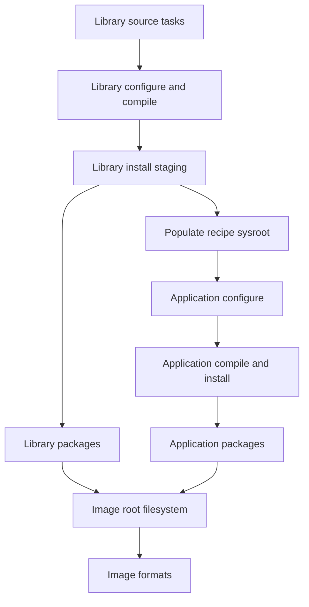

# BitBake Tasks and the Build Process

> **Applies to:** PetaLinux 2024.1 · Zynq UltraScale+ MPSoC

**[04 · The Yocto Project](README.md)** · Part III: Build Systems

## Concepts

BitBake builds a dependency graph. A task runs only when its required inputs are ready. The common source-build path is fetch → unpack → patch → configure → compile → install → package. Image tasks then install selected packages into a root filesystem and create output formats.

`do_install` writes into `${D}`. It does not install software on your host or target. Packaging splits that staged tree into packages. Image assembly uses package dependencies, so a successful compile alone does not prove that a file reaches the image.

## Files worth knowing

| Location | Use |
| --- | --- |
| Recipe `temp/log.do_*` | Task output, including the compiler error |
| Recipe `temp/run.do_*` | Expanded task script and environment |
| `recipe-sysroot` | Target dependencies available to that recipe |
| `recipe-sysroot-native` | Build-host tools available to that recipe |
| `tmp/deploy` | Deployable images, packages and SDK output |
| `DL_DIR` | Download cache |
| `SSTATE_DIR` | Shared-state cache of reusable task results |

A task signature describes its relevant inputs. Shared state can restore a result when the signature matches. Hash equivalence can also identify tasks with equivalent output. Neither cache should replace source control or a record of build configuration.

## Debugging sequence

Read the first failing task's log before cleaning anything. Check its generated script, compiler invocation and sysroot. Then inspect the final recipe environment and dependency graph. BitBake supports `-e` for the environment, `-g` for graphs, `-c` for selecting a task and `-k` to continue independent work after an error.

`listtasks` lists tasks; `devshell` opens the recipe's development environment. `-f` forces a task and changes normal reuse behavior. `cleansstate` removes reusable state for a recipe and can make diagnosis slower by destroying useful evidence. Avoid broad cleaning as the first response to a configuration mistake.

> [!NOTE]
> **Not run on the reference setup:** a fresh full BitBake build and shared-state recovery test during this writing pass. No build-success output is implied here.

## The dependency graph is finer than the recipe list

BitBake schedules tasks, not a simple sequence of whole recipes. One recipe may be ready to compile while another is still fetching source. A library's sysroot output can be needed by an application's configure task, while its final binary package is needed later during image assembly. These are different edges in the graph.

This explains why a dependency error can appear far from the recipe you are building. If the application needs a generated header, the task that creates and stages that header must finish before the application configures. Naming the application in an image does not define that build dependency. Similarly, building a library recipe does not automatically install its runtime package in every image.

The diagram omits many tasks, but preserves the important separation: the application consumes a build sysroot, while the image consumes packages.

## What a task signature protects

A task signature represents the inputs BitBake considers relevant to that task. These include metadata and dependency information. If an input changes, the signature can change and cached output may no longer apply. This is why changing a variable can rebuild a task even when no source file changed.

The model works only when inputs are declared correctly. A script that reads an untracked file from the workstation creates a hidden dependency. A build that downloads its own source during compilation can bypass the fetcher's source record. These are recipe defects; clearing caches may hide them for one build, but it does not restore reproducibility.

A stamp and a shared-state object solve different problems. Stamps help BitBake track task completion in a build directory. Shared state stores selected outputs that can be restored into another suitable build context. Not every task is a shared-state task, and cache reuse does not mean every original command ran again.

Hash equivalence adds another distinction: two different task input signatures may be associated with equivalent output. When investigating reuse, record the signature and the reuse decision instead of inferring them only from elapsed time.

## Read the generated task, not only the recipe

A recipe is one input to a much larger environment. Classes, includes, overrides and appends can all change a task. The generated `run.do_*` file shows the expanded task that BitBake executed. The corresponding `log.do_*` file shows the captured output. Read both when the visible recipe does not explain a failure.

For example, a configuration failure may show the correct cross compiler in the task script but a failed test link in the log. This points toward flags or sysroot contents. If the task script instead invokes the host compiler, investigate variable handling or an upstream build script that ignores the cross-build settings. These cases should not receive the same fix.

Task logs often contain a final summary that is less useful than the first compiler or configuration error. Find the first failing operation and trace its inputs. A later missing-file error may only be a consequence of an earlier failure to generate that file.

## Cleaning changes the evidence

A normal rebuild asks BitBake which tasks are stale. Forcing a task changes that decision. Cleaning removes some of the state that would otherwise help explain it. These operations are useful when chosen deliberately, but they should follow diagnosis.

| Situation | First evidence | Why broad cleaning is weak evidence |
| --- | --- | --- |
| Patch no longer applies | Patch task log and selected source revision | A different source revision will reject the patch again |
| Header is missing | Recipe dependencies and sysroot contents | A missing declared dependency remains missing |
| Old configuration appears | Final variable history and selected provider | Rebuilding the wrong provider preserves the problem |
| Package absent from image | Package contents and image manifest | Compilation does not change image selection |
| Cache result seems wrong | Task signatures and undeclared inputs | A clean build can hide a hidden dependency |

`clean`, `cleansstate` and `cleanall` have different scopes. In particular, removing download state is a separate action from removing work or shared-state output. Check the task definition before using it on a shared build system. Other builds can depend on the same download and state directories.

## Define a meaningful rebuild experiment

To test a metadata change, record the original configuration and change one input. Identify the earliest task expected to change. Then inspect whether that task runs or restores output and whether the final artifact contains the intended change. A build that exits successfully is only one part of this experiment.

For an application configuration file, verify its staged contents, package ownership and image contents. For a kernel fragment, verify the resulting kernel configuration and the deployed kernel identity. For a device tree, inspect the deployed DTB and the tree actually passed at boot. Each experiment ends at the consumer of the changed artifact.

The full build and cache experiments described here remain unrun in this writing pass. The mechanism is grounded in the bundled `base.bbclass`, `sstate.bbclass`, BitBake execution manual and task definitions. This distinction keeps the engineering procedure useful without inventing build logs.

## References

- Local BSP: `poky/meta/classes-global/base.bbclass`, `poky/meta/classes-global/sstate.bbclass`
- Yocto 4.1.4 [task reference](https://docs.yoctoproject.org/4.1.4/ref-manual/tasks.html)
- BitBake manual shipped in `poky/bitbake/doc/`

---

← [Recipes and Metadata Syntax](03-recipes-and-metadata-syntax.md) · [Chapter index](README.md) · [Images, Packagegroups and Features](05-images-packagegroups-and-features.md) →
