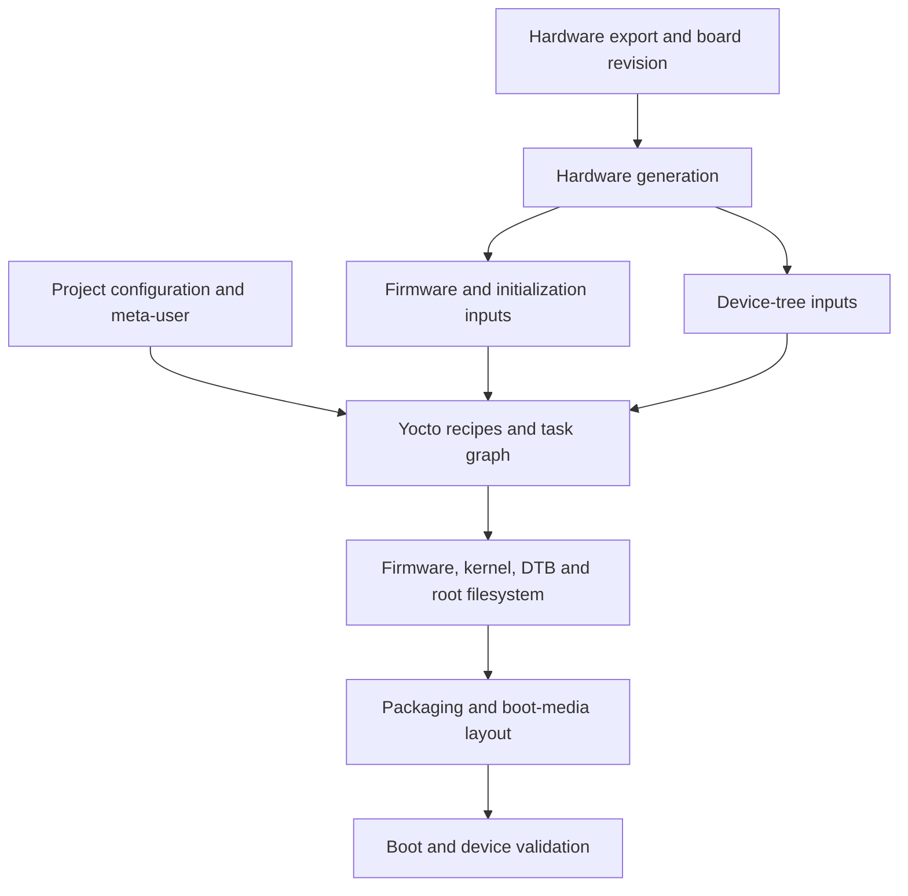

# What Is PetaLinux?

> **Applies to:** PetaLinux 2024.1 · Zynq UltraScale+ MPSoC

**[05 · PetaLinux 2024.1](README.md)** · Part III: Build Systems

## Concepts

PetaLinux combines an AMD-supported tool set with Yocto layers, hardware import and project configuration. It helps turn an exported hardware design into boot firmware, a kernel, a device tree and a root filesystem.

The wrapper does not replace BitBake. A PetaLinux build still follows recipes, task dependencies, package rules and shared-state signatures. When a build fails inside a recipe, the BitBake log is usually more useful than the final wrapper error.

## Tools and responsibilities

| Tool | Main job |
| --- | --- |
| `petalinux-create` | Create a project, application or module |
| `petalinux-config` | Import hardware and configure the project or components |
| `petalinux-build` | Build images, components or SDKs |
| `petalinux-package` | Package boot files, disk images and BSPs |
| `petalinux-boot` | Start supported JTAG or QEMU boot flows |
| `petalinux-devtool` | Connect source development with recipes |
| `petalinux-upgrade`, `petalinux-util` | Release-specific maintenance and utility operations |

The **Xilinx Support Archive (XSA)** contains exported hardware information. PetaLinux uses it to generate hardware-related inputs. It cannot infer all external board wiring or product policy from that archive.

## Choosing a flow

Use PetaLinux when its supported project flow fits the team. Use plain Yocto when you need direct control over layers and automated build policy. Both require correct hardware metadata. Newer AMD flows may use a System Device Tree; do not mix their instructions into a 2024.1 project without checking release support.

## The hardware-to-software contract

A ZynqMP Linux system contains several programs with different execution environments. The FSBL performs early platform work. PMU firmware manages platform services. TF-A provides the secure monitor interface. U-Boot selects and starts the operating system. Linux manages devices and userspace. PetaLinux coordinates the build inputs for these components, but each component still has its own source, configuration and handoff rules.

The hardware export is one input to that coordination. It describes processors, addressable blocks and hardware configuration needed by generation tools. It does not fully describe a product. An external sensor, a power-enable GPIO, an application protocol and an update policy may require additional maintained information. A generated Linux image can therefore compile correctly and still describe the board incorrectly.

Think of hardware import as the beginning of a dependency chain:

Every arrow is a place where an old or mismatched file can enter the system. A working kernel does not compensate for a stale hardware initialization file. A correct device tree does not update a bitstream already embedded in `BOOT.BIN`.

## Read the wrappers through their outputs

The top-level tools are useful because they translate project choices into a repeatable workflow. They also hide some details until you need to debug. When a command fails, identify which underlying operation failed: configuration generation, source fetching, a BitBake task, packaging or target launch.

For a compilation error, preserve the task log and generated task script. For a hardware-import error, preserve the XSA identity and generation log. For a packaging error, preserve the BIF and exact input files. For a boot error, preserve the serial log and the actual files deployed to the boot medium. A single wrapper log rarely answers all four questions.

The same separation helps when a command succeeds but the result is wrong. A successful package operation means the selected files were processed. It does not prove they came from the intended build. A successful QEMU launch means the selected emulator flow started; it does not prove a physical boot device or PL peripheral works.

## What a BSP adds

A BSP supplies a starting project with board choices, hardware assets and often prebuilt output. It is useful because it captures a known vendor configuration. It is also easy to misread: files in `pre-built/linux` were supplied with the BSP, while files in `images/linux` are associated with the project's local output flow.

Keep those identities separate when reporting results. Booting the vendor image is a valuable baseline. It does not establish that a changed recipe, a new kernel configuration or a modified device tree built successfully. First reproduce the baseline behavior, then introduce one controlled change and verify the newly built artifact.

The inspected BSP's `petalinux-image-minimal.bb` includes common image metadata and inherits `core-image`, `plnx-image` and `image_types_plnx`. Its common metadata selects additional software and features. Therefore, the word “minimal” is a recipe name within this product flow, not a promise that the image contains only a kernel and a shell.

## Decide which layer owns a change

If a change describes exported hardware, begin with the hardware design and import path. If it describes external board wiring, use maintained board/device-tree data. If it changes a component's source, use a recipe patch or a maintained source revision. If it selects product packages, use image or packagegroup policy. If it controls deployment, use the packaging and release process.

For example, adding a PL register block requires more than a Linux application. The hardware needs an address and clock/reset behavior. Software needs a compatible binding and an access method. The boot flow must make the block available before its driver accesses it. The release must keep the hardware and software revisions together. PetaLinux helps build these pieces but cannot decide the register contract for you.

## Pinned release does not mean every component has one version

PetaLinux 2024.1 is a tool release. Its project uses a particular combination of BitBake, OpenEmbedded metadata, vendor recipes and source revisions. The reference BSP combines Langdale metadata with an AMD Linux 6.6.10 recipe. Individual components still need their own provenance.

When investigating a bug, record the tool release and the relevant component revision. An issue fixed in upstream Linux may be absent, present or differently patched in the selected AMD tree. A command accepted by a newer PetaLinux installation may not be accepted by the pinned one. This guide uses the installed 2024.1 help and the supplied BSP files as concrete evidence for that combination.

**Source trail:** local `meta-petalinux/recipes-core/images/petalinux-image-minimal.bb`, `petalinux-image-common.inc`, project configuration, and the captured tool-help sessions. The diagram is an original explanation of the artifact relationships.

## References

- AMD [UG1144, PetaLinux 2024.1](https://docs.amd.com/r/2024.1-English/ug1144-petalinux-tools-reference-guide)
- Locally executed 2024.1 tool help: `petalinux-create`, `petalinux-config`, `petalinux-build`, `petalinux-package`, `petalinux-boot`

---

[Chapter index](README.md) · [Installation and Host Setup](02-installation-and-host-setup.md) →
