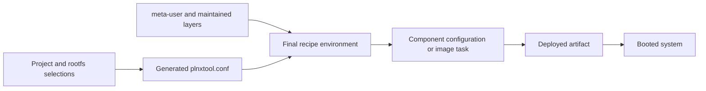

# The Configuration System

> **Applies to:** PetaLinux 2024.1 · Zynq UltraScale+ MPSoC

**[05 · PetaLinux 2024.1](README.md)** · Part III: Build Systems

## Configuration layers

PetaLinux configuration combines project choices, generated hardware settings and Yocto policy. The top-level menu covers hardware, device-tree generation, bootloader settings, image packaging, firmware and build-system options.

The project configuration is an input to generation. Files such as `build/conf/plnxtool.conf` carry the translated settings into BitBake. `project-spec/meta-user/conf/petalinuxbsp.conf` supplies maintained user overrides. Editing only a generated file risks losing the change during the next configuration run.

## Root filesystem selection

`rootfs_config` records package and feature selections. `user-rootfsconfig` can expose additional choices in the menu. A recipe must exist and be visible to BitBake before its package can be included successfully. Use the final image manifest to confirm the result.

## Hardware and boot policy

The machine name selects the platform metadata. Hardware import and machine-generation tools can create settings from the XSA. Check the generated value rather than assuming that `YOCTO_MACHINE_NAME`, an XSA filename and a layer machine identifier all match.

Boot-device choices affect more than the kernel command line. Flash partitions, bootloader search behavior and image packaging must agree. For example, moving the root filesystem from RAM to eMMC requires a root-device description and the necessary storage driver early enough in boot.

## Review method

Compare the maintained configuration before and after using a menu. Then inspect the generated BitBake settings and image output. A menu default may change after importing a different BSP. Keep the configuration diff with the reason for the change.

## Configuration passes through several interpreters

The project menu is one interface to configuration. It is not the final environment used by every compiler. Project selections are translated into generated metadata; BitBake combines that metadata with layers, recipes and overrides; component-specific tools then interpret their own configuration. A kernel option, an image package and a Bootgen attribute therefore follow different paths.

For a kernel option, the important endpoint is the kernel's final `.config`. For an application package, it is the image manifest and installed files. For a boot address, it is the generated script or packaging input actually used. Reading the menu only tells you the requested state, not whether every later stage used it.

Use this chain to localize a problem. A mismatch between project input and generated metadata belongs to generation. A mismatch between generated metadata and final variables belongs to parsing or overrides. A mismatch between a correct artifact and runtime behavior may belong to deployment or boot selection.

## Inspect real generated values

The reference `build/conf/plnxtool.conf` sets `MACHINE = "xilinx-zcu106"` and `PACKAGE_CLASSES = "package_rpm"`. It adds `kernel-fitimage` to `KERNEL_CLASSES` and adds `fitImage`, `vmlinux` and `Image.gz` to the requested kernel image types. It sets `INITRAMFS_IMAGE = "petalinux-initramfs-image"`.

These settings explain why the output directory can contain both a raw kernel and a FIT container. The FIT is produced through kernel/image integration; it is not another spelling of the raw `Image` file. The initramfs selection also identifies a separate image recipe, so changes to the main root filesystem do not necessarily change the small initramfs in the same way.

The generated configuration sets `PLNX_DEPLOY_DIR` to the project's `images/linux` directory and names the FIT output `image.ub`. These are deployment conventions of this project. Inspect them when a build produces a valid artifact under a name different from the one your boot script loads.

## Overrides limit the scope of a setting

The same file contains `IMAGE_INSTALL:pn-petalinux-image-minimal`. The `pn-` override targets the environment of that image recipe. It is more specific than a global statement that every image should install the same packages.

This matters when a project has a main root filesystem and a separate initramfs. Adding a package to the main image does not guarantee that the early userspace image contains it. If early boot needs a storage helper or decryption tool, inspect the initramfs image's package selection directly.

Machine overrides similarly select hardware-specific values. A value with `:zynqmp` does not apply to every machine family. A setting can be present in a file yet inactive in the current context. The final recipe environment is the evidence for whether the condition applied.

## Boot addresses describe different address spaces

The reference generated configuration names a kernel RAM offset of `0x200000`, a device-tree RAM offset of `0x100000`, and a FIT staging offset of `0x10000000`. It also has separate QSPI storage offsets. These values describe different uses and must not be substituted for one another.

A storage offset tells the bootloader where bytes reside on a medium. A load address tells it where bytes should reside in RAM. An entry address tells a processor where to begin execution. A compressed payload can also require a distinct destination and enough space for its expanded form. Configuration review must account for all these regions, not only the file's size on disk.

The listed values are observations from this BSP, not universal safe addresses. A custom memory map, larger image or additional reserved region requires a new overlap analysis. See the boot-address chapter before changing them.

## Device-tree generation can intentionally omit PL nodes

The inspected generated configuration sets `YAML_REMOVE_PL_DT:pn-device-tree = "1"`. That is useful evidence when PL nodes are absent from a generated base tree. It means you should inspect the selected PL loading and device-tree flow before assuming hardware import failed.

A late-loaded PL design may use separate firmware and overlays. Its driver must not probe a register block before the hardware and required clocks exist. Conversely, a design intended for early loading needs a base tree and boot package consistent with that choice. Configuration, hardware availability and driver lifetime must agree.

## Make one change and verify its endpoint

Before using a menu, preserve the maintained configuration. After saving, review its diff and inspect the corresponding generated setting. Build the affected component, inspect its final configuration or content, and then verify the artifact selected during boot.

For an init-system change, inspect both distribution policy and installed packages. For a root filesystem move to eMMC, inspect early storage-driver availability, root-device arguments and the actual partition identity. For a package selection, inspect the package's files and runtime dependencies. The same general chain applies, but each endpoint needs a subject-specific check.

**Source trail:** the actual BSP `build/conf/plnxtool.conf` and `project-spec/configs/`. The values above were read from that project; they are not recommendations to copy its memory layout or package policy to another board.

## References

- Inspected `xilinx-zcu106-2024.1:project-spec/configs/`, `build/conf/plnxtool.conf`
- Inspected `project-spec/meta-user/conf/petalinuxbsp.conf`
- AMD UG1144 (2024.1), project and rootfs configuration

---

← [Commands and Workflow](04-commands-and-workflow.md) · [Chapter index](README.md) · [Output Files in images/linux](06-images-linux-output-files.md) →
