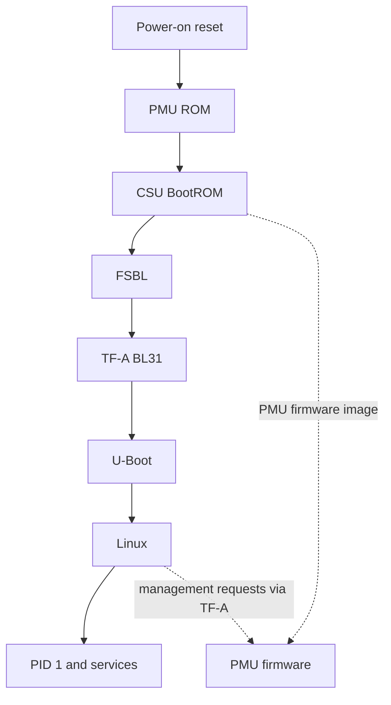

# Boot Flow at a Glance

> **Applies to:** PetaLinux 2024.1 · Zynq UltraScale+ MPSoC

**[06 · Boot Sequence](README.md)** · Part IV: Boot

## The boot chain

Boot is a sequence of software owners. Each stage prepares enough hardware and memory for the next one. Some firmware remains active after Linux starts.

| Stage | Processor and role |
| --- | --- |
| PMU ROM and PMU firmware | Platform Management Unit; early initialization and runtime management |
| CSU BootROM | Configuration Security Unit; boot-device access and initial image processing |
| FSBL | Normally A53-0 at EL3; hardware initialization and partition loading |
| TF-A | A53 EL3 runtime services and Non-secure handoff |
| U-Boot | Normally A53 Non-secure EL2; selects and loads Linux inputs |
| Linux and applications | Kernel normally EL1, applications EL0 |

Authentication and encryption add checks and transformations to this flow. A successful unsigned boot does not validate secure boot. PMU firmware can also be loaded through a different path; [section 07](07-pmufw-stage.md) explains the distinction.

## Sources and evidence

FSBL and PMU firmware come from `embeddedsw@xilinx_v2024.1`. TF-A, U-Boot and Linux use their `xilinx-v2024.1` tags. The saved BSP boot logs demonstrate the runtime sequence, while `bootgen.bif` describes the packaged partitions.

## References

- UG1085 (v2.5), Chapter 11, Boot and Configuration
- `xilinx-zcu106-2024.1:pre-built/linux/images/bootgen.bif`
- Saved reference `boot-manual-1.log` and `ttyPS1-tfa.log`

---

[Chapter index](README.md) · [Boot Modes](02-boot-modes.md) →
