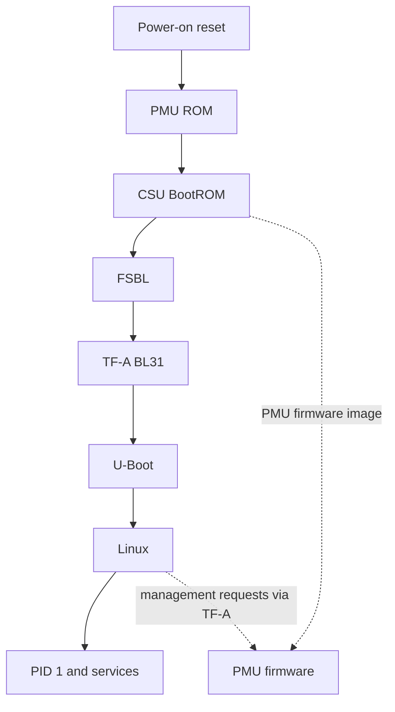

# Boot Flow at a Glance

> **Applies to:** PetaLinux 2024.1 · Zynq UltraScale+ MPSoC

**[06 · Boot Sequence](README.md)** · Part IV: Boot

## The boot chain

Boot is a sequence of software owners. Each stage prepares enough hardware and memory for the next one. Some firmware remains active after Linux starts.

| Stage | Processor and role |
| --- | --- |
| PMU ROM and PMU firmware | Platform Management Unit; early initialization and runtime management |
| CSU BootROM | Configuration Security Unit; boot-device access and initial image processing |
| FSBL | Normally A53-0 at EL3; hardware initialization and partition loading |
| TF-A | A53 EL3 runtime services and Non-secure handoff |
| U-Boot | Normally A53 Non-secure EL2; selects and loads Linux inputs |
| Linux and applications | Kernel normally EL1, applications EL0 |

Authentication and encryption add checks and transformations to this flow. A successful unsigned boot does not validate secure boot. PMU firmware can also be loaded through a different path; [section 07](07-pmufw-stage.md) explains the distinction.

## Sources and evidence

FSBL and PMU firmware come from `embeddedsw@xilinx_v2024.1`. TF-A, U-Boot and Linux use their `xilinx-v2024.1` tags. The saved BSP boot logs demonstrate the runtime sequence, while `bootgen.bif` describes the packaged partitions.

## A handoff transfers a contract, not only control

Every boot stage needs more than its code bytes. It needs usable memory, a processor state, a description of the next image and a way to report failure. A loader can place the correct executable at the correct address and still fail if the next stage receives the wrong exception level, security state or device-tree pointer.

Follow four questions at each handoff: who loads the next image, where is it placed, which state does the receiving processor expect, and which memory remains owned by the previous stage? These questions explain why boot problems often appear one stage after the actual mistake.

For example, the FSBL initializes hardware and loads later partitions. TF-A consumes handoff information and prepares a Non-secure entry. U-Boot later places Linux and its data in memory. Linux treats unreserved described RAM as available. If resident firmware memory is incorrectly exposed as ordinary RAM, the board may boot and fail only after Linux allocates that area.

## Loading order and execution lifetime differ

The FSBL normally finishes its main boot work before U-Boot starts. PMU firmware and TF-A continue to provide services after Linux starts. They are not merely old boot code that can be ignored once a login prompt appears.

A Linux driver may request a clock, reset or power-domain operation through the firmware interface. TF-A can handle or route that call, and PMU firmware can apply platform policy. A failure at that boundary may look like a peripheral-driver problem even though the driver bound correctly.

| Component | Boot-time responsibility | Later relevance |
| --- | --- | --- |
| FSBL | Hardware setup and partition loading | Its initialization and handoff choices remain part of system state |
| PMU firmware | Platform-management startup | Resource, power and reset services |
| TF-A BL31 | Secure monitor setup and Non-secure entry | Runtime monitor and standard/platform services |
| U-Boot | OS selection, loading and boot arguments | Its selected DTB, command line and memory layout shape Linux |
| Linux | Kernel initialization and device management | Owns normal runtime execution and userspace |

The exact service policy depends on the firmware build and platform configuration. A component's version banner proves that code ran; it does not prove every requested service is available.

## Read the actual reference evidence carefully

The saved QEMU boot log contains a PMU firmware banner, a U-Boot banner, `EL Level: EL2`, `Bootmode: JTAG_MODE`, and Linux startup. Its launch command loads several files directly with QEMU loader devices. This is evidence for that emulator launch path, not for a physical BootROM reading an SD card.

The separately inspected `BOOT.BIN` provides another kind of evidence: its headers describe packaged files and addresses. The saved TF-A message `Secure code at 0x60000000` reports the prepared **BL32** entry, not BL31's own address. The pinned source prints `bl32_image_ep_info.pc` there and assigns its default during JTAG boot. The inspected boot image places **BL31** at `0xFFFEA000`. Neither the message nor that default proves that an OP-TEE payload was loaded.

When comparing two logs, first compare the loader path. A debugger or emulator can establish state that a cold storage boot must establish through firmware. This explains why a JTAG success can coexist with an SD-boot failure without contradiction.

## Choose observable milestones

A useful boot investigation records the last confirmed milestone rather than the last component expected by the diagram. A serial banner proves that the program reached its print path and that the console worked at that moment. It does not prove that the stage completed its memory or security checks.

For the transition into Linux, `Starting kernel ...` is printed by U-Boot before the kernel's first output. If no kernel message follows, investigate entry state, image placement, DTB validity and early-console setup. The absence of text alone cannot distinguish a silent kernel from a processor exception.

For userspace, distinguish starting PID 1, reaching a login prompt and making the product service ready. A board can reach login while a required driver repeatedly defers probe or a service fails its dependencies. Define the endpoint that matters to the product.

## Build a coherent artifact set

Keep the hardware export, firmware ELFs, bitstream, DTB, kernel and root filesystem tied to one release record. Preserve the boot script and bootloader environment policy as part of that record. They decide which artifacts actually run.

After a component change, trace the new result through packaging and deployment. A rebuilt FSBL does not alter an old `BOOT.BIN`. A rebuilt kernel does not update an old FIT container. A new root filesystem does not change a boot argument that still selects the previous partition.

**Source trail:** pinned FSBL `xfsbl_main.c` and `xfsbl_handoff.c`, TF-A `plat/xilinx/zynqmp/bl31_zynqmp_setup.c`, Linux `Documentation/arch/arm64/booting.rst`, and the saved reference launch/boot captures. Hardware reset and storage boot remain separate validation tasks.

## References

- UG1085 (v2.5), Chapter 11, Boot and Configuration
- `xilinx-zcu106-2024.1:pre-built/linux/images/bootgen.bif`
- Saved reference `boot-manual-1.log` and `ttyPS1-tfa.log`

---

[Chapter index](README.md) · [Boot Modes](02-boot-modes.md) →
