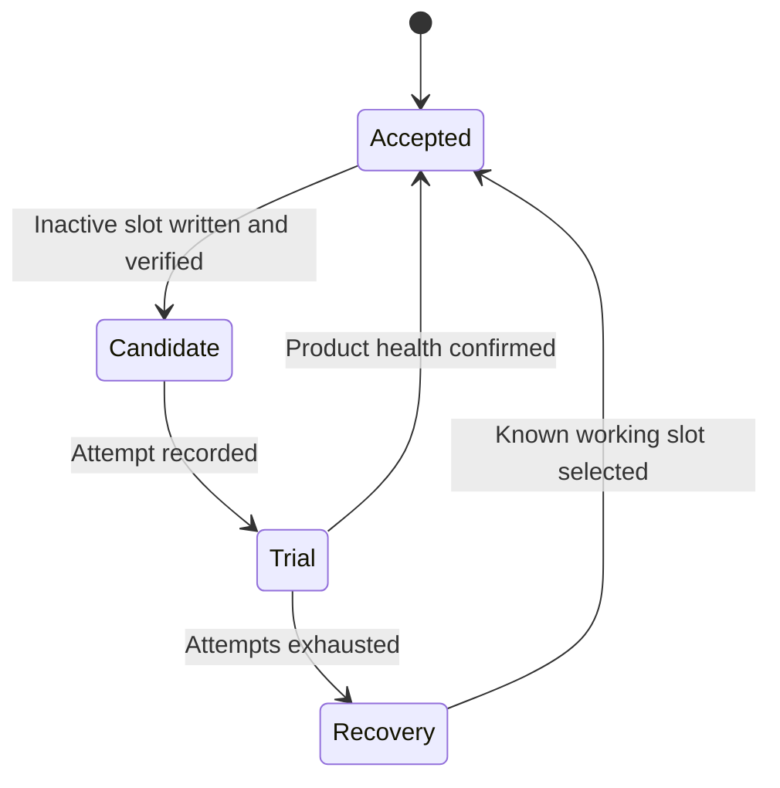

# Multiboot, Fallback and Golden Images

> **Applies to:** PetaLinux 2024.1 · Zynq UltraScale+ MPSoC

**[06 · Boot Sequence](README.md)** · Part IV: Boot

## Multiboot and fallback

Multiboot changes where the boot logic searches for an image. `CSU_MULTI_BOOT` participates in that selection, but its meaning must be interpreted with the boot medium and documented search rules. It is not a general byte-address register for every storage type.

A **golden image** is a known recovery image kept available when an update fails. An **A/B system** has two software slots and a controlled switch between them. These designs overlap, but neither guarantees recovery without a tested failure path.

## Product design

Keep the recovery image outside the normal update erase range. Record a boot attempt before trusting the new slot, and confirm success only after meaningful application health checks. A kernel reaching userspace can still leave the product unusable.

BootROM fallback, bootloader slot selection and userspace update policy are separate mechanisms. Decide which layer handles corruption, failed authentication and a runtime hang. A watchdog may detect the last case when header checks cannot.

Kria image-selector and recovery flows add platform-specific logic. Use the SOM's documented flash layout and update procedure rather than replacing it with generic ZynqMP offsets.

> [!NOTE]
> **Not run on the reference setup:** multiboot register changes, corrupted-image fallback and power-loss recovery tests on flash.

## Define which failure each recovery layer detects

BootROM image search can react to certain initial-image failures. A first-stage loader can reject or fail to load a later partition. U-Boot can choose another OS slot. Userspace can decide that a booted image is unhealthy. These layers operate at different times and cannot substitute for one another.

A valid image that hangs after starting the application may pass every early format and signature check. Recovery then needs a watchdog or health policy that causes another attempt and changes the next selection. Conversely, userspace cannot repair an initial boot image that prevents all programmable recovery code from running.

Design the recovery chain from the earliest failure the product must tolerate. Identify which code remains executable, which state it can read and which alternative image it can reach.

## A/B selection is a state machine

A typical design distinguishes an accepted slot, a candidate slot and an attempt count. After writing and verifying the inactive slot, the updater marks it as a candidate. The bootloader records an attempt before handing control to it. Userspace confirms health only after the required functions work. If confirmation never arrives, later boots can return to an accepted slot.

This is an original design model, not a claim that the reference BSP implements it. A real product must define persistent state encoding, atomic updates, attempt limits and the reset path that executes the next selection.

## Metadata must survive interrupted writes

An update can lose power while writing payloads or selection metadata. Keep the current accepted image available until the candidate is complete and verified. Design selection-state updates so an interrupted write can be recognized and a safe choice remains possible.

A redundant metadata scheme needs more than two copies. It needs a rule for choosing the newest valid copy, checking integrity and handling an interrupted transition. Flash erase geometry and endurance influence that design. Do not place recovery data inside an erase block that the normal update must erase.

The recovery image also needs compatible access to persistent product data. Rolling software back while leaving a newer incompatible database format can produce a bootable but unusable device. Define data migration and rollback policy alongside image selection.

## Multiboot values are medium-specific

`CSU_MULTI_BOOT` participates in the ZynqMP search flow, but its units and interpretation depend on the documented boot mode. It is not a universal byte pointer to any arbitrary image. Follow the relevant search spacing, supported range and medium rules from UG1085.

Record which reset causes a changed selection to take effect and which state is retained. A register update that works in one debugger sequence may not implement the intended field recovery behavior. Test from the actual reset and boot path.

For Kria or another platform with a documented image selector, preserve that platform's layout and policy unless deliberately replacing the complete recovery design. Generic ZynqMP concepts do not authorize arbitrary offsets in a vendor-managed flash map.

## Secure boot changes the acceptance rules

A recovery image must satisfy the device's active trust policy. An older image may be correctly signed yet prohibited by an anti-rollback rule. Revoking a key can also remove the ability to boot a recovery image signed only by that key.

Plan key transitions, accepted versions and recovery together. Encryption alone does not determine which image is authorized. A fallback design that works on an unprovisioned development board can fail on a production device with enforced security policy.

## Test faults at each transition

Test interrupted payload writes, interrupted metadata updates, corrupted headers, rejected signatures, missing root filesystems, a kernel hang and a service that never becomes healthy. Record the selected slot and reason after each reboot. Include repeated failures so the attempt counter and recovery path are exercised.

Also test successful confirmation and the next ordinary reboot. A system that recovers correctly but never commits a healthy update is incomplete. The reference work has not performed these flash and power-loss tests; this state-machine analysis defines the evidence still required.

## References

- UG1085 (v2.5), Chapter 11, multiboot and image search
- [Software update strategies](../23-storage-updates-and-production/04-software-update-strategies.md)

---

← [Boot Memory Map: Who Loads What, Where](12-boot-address-map.md) · [Chapter index](README.md) · [JTAG Boot](14-jtag-boot.md) →
