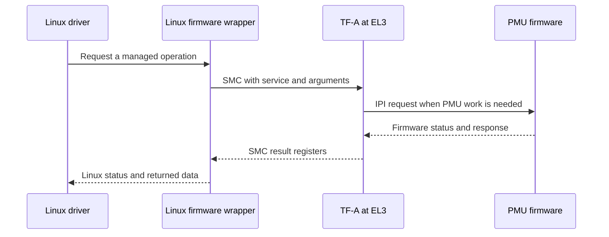

# PMU Overview

> **Applies to:** PetaLinux 2024.1 · Zynq UltraScale+ MPSoC

**[09 · PMU and PMU Firmware](README.md)** · Part IV: Boot

## A controller that stays active after boot

The **Platform Management Unit (PMU)** manages system resources and events outside the Cortex-A53 Linux execution path. Its firmware, called **PMUFW**, runs on the PMU MicroBlaze processor. It is not an A53 kernel module, and rebuilding Linux does not rebuild the firmware that is already loaded into the PMU.

The reference `pmufw.elf` was inspected with host `readelf -h`. It reports `ELF32`, little-endian data, machine `Xilinx MicroBlaze`, and entry address `0xFFDD12A0`. That entry belongs to this BSP artifact. It is not a general address to copy into a different firmware build.

The PMU includes ROM behavior and can run downloaded PMU firmware. Keep the ROM and firmware roles separate when explaining reset. In the reference boot package, the `pmufw_image` BIF attribute provides PMU firmware through the special boot-header path. It is not simply another A53 executable partition.

## Why Linux cannot own every system register

A system resource can serve more than one processor. A clock can feed multiple devices. A power island can contain several blocks. A reset can destroy state that another processor still needs. If every operating system changes those controls directly, each one sees only part of the system's needs.

Platform-management services give clients a common interface for resource requests and transitions. Firmware can check the caller, resource identity, permitted operations and other users before applying a change. This turns “write this bit” into “request this state under the system policy.”

A request can therefore fail even when the CPU could theoretically address the register. That failure can be correct policy enforcement. Bypassing the firmware with a raw write may make one test pass while breaking another processor's operation or later suspend behavior.

## Follow one service across processors

For the ordinary Non-secure Linux flow, a driver calls a kernel firmware wrapper. The ZynqMP firmware driver uses a Secure Monitor Call (SMC) to reach Trusted Firmware-A (TF-A). The EL3 service handles the request or forwards the required platform operation through an inter-processor interrupt (IPI) path to PMUFW.

PMUFW receives the request, selects the registered module handler, checks the operation and produces a response. The result travels back to the caller. The caller sees a Linux return value, which may be a translation of a firmware status rather than the original number.

Not every SMC has to become an IPI. Some services can be answered in TF-A, and feature checks can reject a call before the hardware operation begins. Trace the actual service rather than assuming one fixed path for all firmware functions.

## Resource lifetime is wider than a driver call

Consider two software clients that need one shared resource. The first requests it, then the second requests it. When the first releases its requirement, the second still needs the resource. A correct management model retains the required state until the remaining client's requirement changes.

A failed request must not be followed by normal device access as though the request succeeded. A successful request also creates a lifetime obligation: error paths, removal and shutdown must release or update the requirement through the owning subsystem.

The exact available operations depend on the firmware build and platform configuration. A power-management feature present in the Linux source does not prove that the running PMUFW enables its matching implementation.

## Boot evidence and runtime evidence answer different questions

A PMU firmware banner proves that execution reached its print path. A reported API version proves that a version request received a response. Neither proves that all power transitions, watchdog paths or custom services work.

The saved Linux boot evidence includes PSCI discovery, but **Power State Coordination Interface (PSCI)** is the standard CPU-power interface presented by TF-A. It is not a full test report for every PMU management function. Keep PSCI, the ZynqMP management API and the PMU firmware build version as separate identities.

A useful product record stores FSBL, PMUFW, BL31, U-Boot and Linux identities together. A late failure during suspend may be caused by a firmware combination that looked acceptable during the first boot.

## What a PMU failure looks like above it

A blocked management request can appear as a clock error, an unpowered device, a CPU-start failure or a failed reset operation. The visible driver is often only the requester. Preserve the return value and trace where it first changes from success to failure.

If all firmware calls fail before initialization, inspect the Linux firmware driver's device-tree node and conduit selection. If version queries work but one operation fails, inspect support, arguments and access policy for that operation. If a request never completes, inspect the IPI path and firmware progress, including whether a custom handler blocks other work.

> [!NOTE]
> **Not run on the reference setup:** physical power-island transitions, shared-resource arbitration across A53 and R5 clients, and PMU fault recovery. The processor identity was checked from the supplied ELF; the service model was checked in pinned source.

## References

- [2024.1 PMU firmware source](https://github.com/Xilinx/embeddedsw/tree/xilinx_v2024.1/lib/sw_apps/zynqmp_pmufw/src), especially `xpfw_main.c`, `xpfw_core.c` and `pm_core.c`.
- `linux-xlnx@xilinx-v2024.1:drivers/firmware/xilinx/zynqmp.c`.
- `arm-trusted-firmware@xilinx-v2024.1:plat/xilinx/common/pm_service/pm_svc_main.c` and `pm_api_sys.c`.
- Reference `pre-built/linux/images/{pmufw.elf,bootgen.bif}`.

---

[Chapter index](README.md) · [PMU Firmware Architecture and Source](02-pmufw-architecture-and-source.md) →
