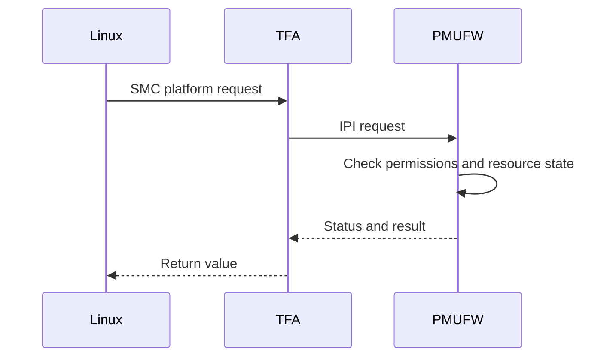

# EEMI and Platform Management

> **Applies to:** PetaLinux 2024.1 · Zynq UltraScale+ MPSoC

**[09 · PMU and PMU Firmware](README.md)** · Part IV: Boot

## Resource requests

The **Embedded Energy Management Interface (EEMI)** describes platform resource requests. Nodes represent managed resources; requirements and capabilities describe what a caller needs. Resource ownership and power state are policy decisions, not just register values.

A common Linux request follows this path:

Some operations are handled at another point in the stack; the diagram shows the management path, not a rule that every SMC reaches PMUFW.

## Configuration object

Platform-management configuration describes subsystem permissions and resource policy. The reference image directory includes `pmu-conf.bin`. Its presence alone does not prove when or how a particular launch flow supplies it; inspect the generated boot and initialization path.

Clock, reset, suspend and power-domain operations must respect shared users. Powering down a domain used by another subsystem can break that subsystem even if the requesting Linux driver is idle.

## Diagnosis

Distinguish unsupported API, invalid argument, denied permission and wrong resource state. Retrying the same denied request does not fix its configuration.

## References

- AMD UG1137 (2024.1), platform management
- `linux-xlnx@xilinx-v2024.1:drivers/firmware/xilinx/zynqmp.c`
- `embeddedsw@xilinx_v2024.1:lib/sw_apps/zynqmp_pmufw/src/pm_core.c`

---

← [PMU Firmware Architecture and Source](02-pmufw-architecture-and-source.md) · [Chapter index](README.md) · [Communicating With the PMU](04-communicating-with-the-pmu.md) →
