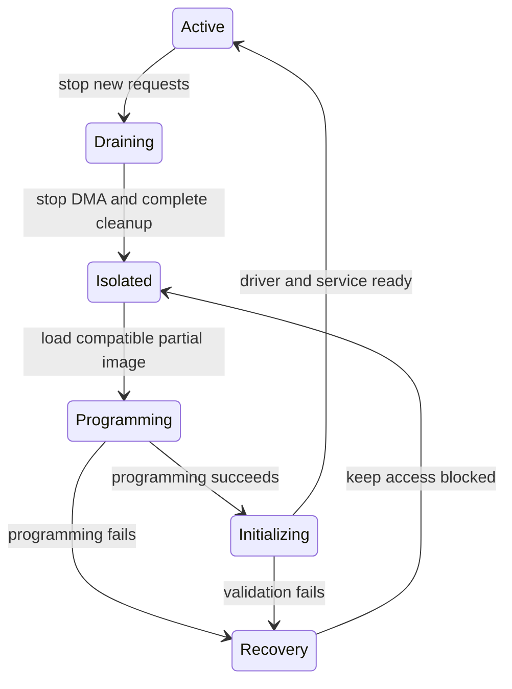

# DFX: Dynamic Function eXchange

> **Applies to:** PetaLinux 2024.1 · Zynq UltraScale+ MPSoC

**[17 · PL Integration, FPGA Manager and DFX](README.md)** · Part VIII: Programmable Logic and Acceleration

## Static and reconfigurable logic

**Dynamic Function eXchange (DFX)** changes a reconfigurable region while a compatible static design remains loaded. A reconfigurable module must match the partition interface and implementation constraints of that static design.

The software sequence must prevent transactions crossing an unstable boundary. Stop clients, drain transfers, isolate or decouple the region, apply required resets and load the matching partial bitstream. Restore communication only after the hardware and software state are ready.

## Design outputs

Vivado's DFX flow produces related static and partial artifacts. Package their compatibility information with overlays and application metadata. Two partial bitstreams for different static builds are not interchangeable even if they use the same region name.

## Failure testing

Test load failure, interrupted application shutdown and repeated module changes. Recovery must leave the system in a known state rather than exposing half-configured devices. Review clocks and reset behavior across each transition.

> [!NOTE]
> **Not run on the reference setup:** physical partial reconfiguration and interruption tests.

## Partial configuration preserves a specific static design

Dynamic Function eXchange (DFX) replaces a reconfigurable region while a compatible static design remains present. The partial image depends on that static implementation, its region boundaries and interface contract. It is not a portable plugin that can be loaded into any FPGA with enough free logic.

The static design normally owns paths that must remain stable: clocks, interconnect, isolation controls and interfaces to the rest of the system. The reconfigurable module must obey the boundary's signal, timing and protocol rules. Software packaging cannot repair a hardware partition that violates those rules.

Compatibility therefore includes more than a device ID. Track the parent static design, target region/slot, interface version and partial artifact. A partial image intended for another slot can have the same accelerator function and still be incompatible.

## Treat replacement as a transaction

A useful design state machine is shown below. It is an engineering model, not a trace captured from the reference board.

The transition from draining to isolated is critical. Every old transaction must have a defined outcome. A timeout is not proof that the bus master stopped. The hardware/software design needs a way to stop, reset or otherwise make further access impossible before buffers are reused.

The transition to active also needs a clear success condition. Programming done, driver bound and application ready are separate events. Publish the accelerator to clients only after the full required chain succeeds.

## Outstanding transactions can cross the boundary

An AXI master can have requests in flight when software asks to isolate a region. Simply blocking new requests at one interface may leave responses or downstream work outstanding. The static design's decoupling and shutdown protocol must account for those paths.

A streaming interface can also contain partial packets or frames. Replacing the producer or consumer in the middle of a frame can leave the other side waiting for an end marker. Define whether the transaction is drained, discarded or reset at replacement.

Shared infrastructure complicates cancellation. Resetting one DMA engine can affect channels used by other clients. A per-slot replacement design should avoid silently resetting shared resources unless all owners participate in the transaction.

## Device-tree overlays have their own lifetime

An overlay changes the live device tree and can create platform devices. Removing it removes that description and can trigger driver unbind. The pinned overlay implementation forbids removing an overlay that another stacked overlay still depends on.

Pointers into overlay data cannot be retained after removal. Drivers and notifiers must obey that lifetime even if the underlying memory address happens to remain readable temporarily. A stale pointer can fail much later, making the problem look unrelated to DFX.

Removing a node does not guarantee that every userspace file descriptor or mapping has disappeared. The driver must handle disconnected operations, references and asynchronous work. A userspace mmap of disappearing MMIO needs an explicit restriction or revocation design.

## A worked accelerator replacement

Suppose slot 0 runs a filter and will be replaced by a compressor. The service first rejects new filter requests and records which accepted requests are still active. It waits for normal completion or invokes a documented cancellation path. It then releases buffers only after the engine cannot access them.

The management layer removes the old device/software instance and isolates the region through the design's supported mechanism. It validates that the compressor image belongs to the current static shell and slot. After programming, it applies the matching description, allows driver initialization and checks the new interface identity.

Only then does the application publish the compressor service. Existing filter handles must not silently become compressor handles, even if both use the same address. Clients need a generation change or reconnect boundary.

## Recovery must assume partial change

A load failure can leave neither the old nor the new function usable. The safest generic state is isolated and unavailable, followed by a known recovery image or reboot policy. Whether the old function can be restored without a full reconfiguration depends on the hardware design and failure stage.

Record the attempted artifact hashes, slot, static-shell identity and last successful state. This evidence separates incompatible image selection from firmware rejection and driver probe failure.

> [!NOTE]
> **Not run on the reference setup:** partial reconfiguration under load, isolation verification and rollback. These require a real DFX design; the supplied general BSP inspection does not establish one.

## References

- [linux-xlnx@xilinx-v2024.1:Documentation/devicetree/overlay-notes.rst](https://github.com/Xilinx/linux-xlnx/blob/xilinx-v2024.1/Documentation/devicetree/overlay-notes.rst).
- [Pinned FPGA region framework](https://github.com/Xilinx/linux-xlnx/blob/xilinx-v2024.1/Documentation/driver-api/fpga/fpga-region.rst).
- [dfx-mgr@ec70363 README](https://github.com/Xilinx/dfx-mgr/blob/ec70363a2a878737057995f922a9460d18aafa26/README.md), parent/child identity and slot-specific package structure.

- AMD UG909, Dynamic Function eXchange, release matching Vivado 2024.1
- Linux FPGA-region/bridge documentation

---

← [Linux FPGA Manager](03-fpga-manager.md) · [Chapter index](README.md) · [dfx-mgr and Accelerator Packages](05-dfx-mgr.md) →
