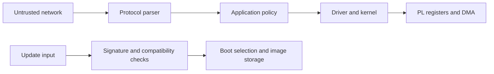

# Security Principles and Threat Modeling

> **Applies to:** PetaLinux 2024.1 · Zynq UltraScale+ MPSoC

**[25 · Security Fundamentals and Cryptography](README.md)** · Part XIV: Security

## Start with assets and trust boundaries

Security protects specific assets against specific threats. List firmware, device identity, user data, control outputs and service availability. Then identify who can reach network ports, storage, update interfaces, debug connectors and physical devices.

| Property | Question |
| --- | --- |
| Confidentiality | Who can read the data? |
| Integrity | Who can change it without detection? |
| Availability | Can the required service continue? |
| Authenticity | Can the source or identity be verified? |
| Accountability | Can an action be traced reliably? |

A signature can support accountability, but technical signing alone does not settle legal non-repudiation.

## Threat modeling

STRIDE groups threats as spoofing, tampering, repudiation, information disclosure, denial of service and elevation of privilege. Apply it at each boundary: network-to-service, application-to-driver and updater-to-bootloader.

Use several controls with different failure modes. Secure boot checks software origin; least privilege limits runtime damage; signed updates support maintenance. None replaces the others.

Document assumptions and test negative cases, such as a modified image, expired credential or full storage. Defaults should be safe before an operator changes configuration.

## Build a model of a real data path

Consider an original teaching product: a ZynqMP measurement device receives configuration over Ethernet, controls a PL acquisition engine, stores results on eMMC and accepts software updates. Its assets include measurement accuracy, actuator limits, device identity, customer data and the ability to recover after a failed update. This example is a design exercise, not a description of the reference BSP's product features.

Start with data movement. An incoming request crosses from an untrusted network into a parser. Parsed fields cross into application policy. An ioctl or another driver interface crosses into kernel authority. DMA then moves data between hardware and memory. The updater crosses another boundary when it turns downloaded bytes into future executable code.

For each arrow, identify the sender, receiver, data format, maximum size and acceptance rule. A network request authenticated by TLS can still contain an out-of-range sample count. A privileged local caller can still pass a malformed ioctl structure. Identity checks and input validation remain separate controls.

## Write attacker capabilities as testable assumptions

“An attacker has network access” is incomplete. Can the attacker reach the maintenance VLAN, submit authenticated requests, replace an SD card, access JTAG, read an update bundle or interrupt power? Each capability changes the design.

A remote attacker without credentials mainly reaches exposed parsers and authentication flows. A stolen maintenance credential reaches authorized operations and their limits. A physical attacker may replace storage or observe buses. A compromised build worker may influence the code submitted for signing. Do not silently assume that one control covers all these cases.

Record exclusions as carefully as inclusions. If invasive silicon attacks are outside the product's threat model, say so. Do not describe secure boot as proof against every physical attack merely because the initial key is stored on chip.

## Turn threats into concrete requirements

| Boundary | Threat in the teaching product | Requirement | Discriminating test |
| --- | --- | --- | --- |
| Network to parser | Large or malformed request | Bounded parsing and resource limits | Reject invalid lengths without service failure |
| Application to driver | Invalid DMA buffer or command | Validate sizes, ownership and allowed operations | Reject an invalid request without programming hardware |
| Update to boot storage | Modified or wrong-board bundle | Authenticate content and signed compatibility metadata | Reject tampered and incompatible candidates |
| Boot to application | Old but valid vulnerable image | Explicit rollback policy | Reject a forbidden version despite a valid signature |
| Service to filesystem | Compromised daemon modifies system files | Dedicated identity and restricted writable paths | Required work succeeds; unrelated writes fail |

A useful requirement states what is protected, from whom, at which boundary and how failure is handled. “Use encryption” lacks these details. An encrypted update can still be unauthorized or incompatible.

## Trusted computing base and least privilege

The **trusted computing base (TCB)** is the collection of components whose correct behavior the security property depends on. For verified boot, this includes the initial verifier, trusted key/policy and every later verifier allowed to load executable code. For application data confidentiality, the TCB can also include the kernel, driver and key-handling service.

Reducing this set makes review more manageable. A large network parser should not run with raw device-memory access merely because the application eventually controls hardware. A narrow service or driver interface can validate the specific operations required.

Least privilege must include resources, not only user IDs. A process may have limited filesystem access yet hold a device descriptor that permits arbitrary DMA. A container may isolate names while still sharing the host kernel. Review the authority granted through every file descriptor, capability and device node.

## Failure behavior is part of the security design

A verifier should reject invalid input before trusting it. However, rejection alone is not a complete product behavior. Decide whether the device retries, enters recovery, preserves the previous image or disables an affected function. A restart loop can satisfy an integrity check while destroying availability.

Keep diagnostic information useful without exposing secrets. Log the artifact identity, failed validation stage and relevant public key identifier. Do not log private keys, decrypted credentials or full sensitive requests to make debugging convenient.

For control products, define the hardware output state during failures. A crashed userspace process does not automatically put a PL state machine or external actuator into a safe state. This needs a separate system-level design and test.

## Keep the model connected to development

Store the threat model with the architecture and update it when a new interface, processor role or maintenance path is added. Link each significant threat to a mitigation owner and a verification result. A source revision or configuration change can invalidate an earlier test even if the diagram is unchanged.

Review residual risk explicitly. For example, signed updates protect distribution but cannot prevent an authorized signer from approving defective software. Independent review, release tests and restricted signing authority address that remaining path.

The table and device scenario above are original engineering examples. Their negative tests are proposed acceptance criteria. They have not been executed against physical ZynqMP hardware.

## References

- Microsoft STRIDE threat-modeling documentation
- NIST SP 800-160, systems security engineering

---

[Chapter index](README.md) · [Cryptography Primer](02-cryptography-primer.md) →
