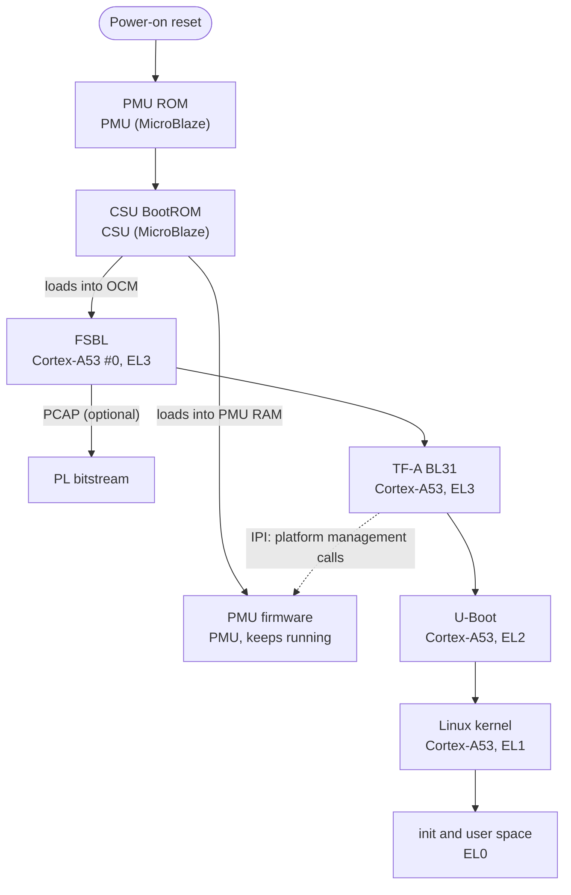

# Zynq UltraScale+ MPSoC Embedded Linux Guide

A source-referenced engineering guide to building, booting, customizing and securing embedded Linux on AMD (formerly Xilinx) **Zynq UltraScale+ MPSoC** devices, anchored to **PetaLinux 2024.1** and the matching AMD open-source repositories.

> [!NOTE]
> All 180 sections have initial drafts. An advanced-depth revision is in progress: chapters 04–07 have been expanded, while chapters 08–27 and the appendices still need that revision. The [roadmap](ROADMAP.md) tracks depth and validation separately. English stays at B1–B2 level, with technical terms explained in context.

## Why this guide

ZynqMP documentation is usually one of two things: vendor reference manuals that are complete but spread over dozens of user guides, or tutorials that are easy to follow but shallow. This guide sits between them. It explains **how things actually work**, down to load addresses, register fields and source files, and shows **how to change them** in a real PetaLinux 2024.1 project.

- **Pinned to a release.** Everything targets the 2024.1 tools and the matching source tags. Differences between releases are called out explicitly.
- **Source references.** Hardware values and release behavior point to AMD documents, pinned source trees or inspected BSP artifacts. Validation limits are stated explicitly.
- **Real artifacts.** Recorded output comes from actual BSP files and captured sessions. Teaching examples are labeled and are not presented as board measurements.
- **Practical guidance.** Sections explain inspection, configuration and failure diagnosis. Commands recorded as executed are distinguished from workflows that still need target validation.

## Who it is for

- Embedded and Linux engineers starting on ZynqMP
- FPGA engineers who need to own the software side of their designs
- BSP and bring-up engineers who customize the FSBL, PMU firmware, TF-A, U-Boot and the kernel
- Teams taking a product to production: secure boot, updates, compliance

Readers new to Linux should start at Part I. Beyond that, the guide only assumes you are comfortable with a shell and with C.

## Reference platform

| Component | Version and source |
| --- | --- |
| Devices | Zynq UltraScale+ MPSoC: CG, EG and EV variants |
| Reference boards | ZCU102, ZCU104, ZCU106, Kria K26 SOM |
| AMD tools | Vivado, Vitis and PetaLinux 2024.1 |
| Yocto Project | 4.1.4 "Langdale" (as shipped with PetaLinux 2024.1) |
| Linux kernel | 6.6.10: [`linux-xlnx`](https://github.com/Xilinx/linux-xlnx), branch `xlnx_rebase_v6.6_LTS`, tag `xilinx-v2024.1` |
| U-Boot | v2024.01: [`u-boot-xlnx`](https://github.com/Xilinx/u-boot-xlnx), branch `xlnx_rebase_v2024.01`, tag `xilinx-v2024.1` |
| Trusted Firmware-A | v2.10: [`arm-trusted-firmware`](https://github.com/Xilinx/arm-trusted-firmware), branch `xlnx_rebase_v2.10`, tag `xilinx-v2024.1` |
| FSBL and PMU firmware | [`embeddedsw`](https://github.com/Xilinx/embeddedsw), tag `xilinx_v2024.1` |
| Device tree generator | [`device-tree-xlnx`](https://github.com/Xilinx/device-tree-xlnx), tag `xilinx_v2024.1` |
| Yocto layers | [`meta-xilinx`](https://github.com/Xilinx/meta-xilinx), [`meta-xilinx-tools`](https://github.com/Xilinx/meta-xilinx-tools), [`meta-petalinux`](https://github.com/Xilinx/meta-petalinux): branch `rel-v2024.1` |
| Host used for examples | Ubuntu 22.04 LTS |

Most of the content applies to other releases as well. Where behaviour differs between releases, the text says so.

## The big picture

The boot chain is the backbone of the guide. Every stage below has its own chapter.



| Stage | Covered in |
| --- | --- |
| Boot modes, PMU ROM, CSU BootROM, boot image format | [06 · Boot Sequence](06-boot-sequence/README.md), [07 · Boot Images, BIF and Bootgen](07-boot-images-and-bootgen/README.md) |
| FSBL | [08 · First Stage Boot Loader](08-fsbl/README.md) |
| PMU firmware | [09 · PMU and PMU Firmware](09-pmu-firmware/README.md) |
| TF-A BL31 | [10 · Trusted Firmware-A](10-trusted-firmware-a/README.md) |
| U-Boot | [11 · U-Boot](11-u-boot/README.md) |
| Device tree | [12 · Device Tree](12-device-tree/README.md) |
| Linux kernel | [13 · The Linux Kernel](13-linux-kernel/README.md), [14 · Kernel Modules and Device Drivers](14-kernel-modules-and-drivers/README.md) |
| Root filesystem and init | [15 · Root Filesystem and Init](15-root-filesystem-and-init/README.md) |

## Learning paths

The chapters are numbered in reading order, but you do not have to read them all.

| If you are... | Suggested path |
| --- | --- |
| New to embedded Linux | Parts I to IV in order, then V to VII |
| A Linux developer new to ZynqMP | 03 → 05 → 06 → 07 → 12 → 13 |
| An FPGA engineer who owns the software side | 03 → 05 → 12 → 17 → 14 → 18 |
| A BSP or bring-up engineer | 06 → 07 → 08 → 09 → 10 → 11 → 24 |
| A multimedia developer | 12 → 14 → 19 → 20 |
| Taking a product to production | 23 → 25 → 26 → 27 |

## Contents

### Part I · Foundations

| Ch. | Chapter | What it covers |
| ---: | --- | --- |
| 01 | [Linux Fundamentals](01-linux-fundamentals/README.md) | What Linux is, the distribution landscape, package managers, the filesystem hierarchy, and the console, SSH and network tools used every day with a target board. |
| 02 | [Embedded Linux Concepts](02-embedded-linux-concepts/README.md) | The building blocks of every embedded Linux system, plus the toolchains, build systems and workflows that produce and deploy them. |

<details>
<summary>Sections in Part I</summary>

- **01 · Linux Fundamentals**
  - [What Is Linux?](01-linux-fundamentals/01-what-is-linux.md)
  - [Linux Distributions and Linux-Based Operating Systems](01-linux-fundamentals/02-linux-distributions.md)
  - [Package Management: apt, dpkg, dnf, rpm and opkg](01-linux-fundamentals/03-package-management.md)
  - [Filesystem Hierarchy, Processes and Permissions](01-linux-fundamentals/04-filesystem-hierarchy-and-processes.md)
  - [Shell and Essential Tools for Embedded Work](01-linux-fundamentals/05-shell-and-essential-tools.md)
  - [Serial Console](01-linux-fundamentals/06-serial-console.md)
  - [SSH: Secure Shell](01-linux-fundamentals/07-ssh.md)
  - [Networking for Development](01-linux-fundamentals/08-networking-for-development.md)
- **02 · Embedded Linux Concepts**
  - [Anatomy of an Embedded Linux System](02-embedded-linux-concepts/01-anatomy-of-an-embedded-linux-system.md)
  - [Cross-Compilation and Toolchains](02-embedded-linux-concepts/02-cross-compilation-and-toolchains.md)
  - [Build Systems Landscape](02-embedded-linux-concepts/03-build-systems-landscape.md)
  - [Development Workflow](02-embedded-linux-concepts/04-development-workflow.md)

</details>

### Part II · Zynq UltraScale+ MPSoC Hardware

| Ch. | Chapter | What it covers |
| ---: | --- | --- |
| 03 | [Zynq UltraScale+ MPSoC Architecture](03-zynqmp-architecture/README.md) | PS and PL, the processing units, the full address map, on-chip memories, interconnect and coherency, clocks, power, reset, interrupts and exception levels: the hardware knowledge every BSP engineer needs. |

<details>
<summary>Sections in Part II</summary>

- **03 · Zynq UltraScale+ MPSoC Architecture**
  - [Device Family Overview](03-zynqmp-architecture/01-device-family-overview.md)
  - [Processing System (PS) and Programmable Logic (PL)](03-zynqmp-architecture/02-ps-and-pl.md)
  - [Processing Units: APU, RPU, PMU, CSU, GPU and VCU](03-zynqmp-architecture/03-processing-units.md)
  - [System Address Map](03-zynqmp-architecture/04-memory-map.md)
  - [On-Chip Memories: OCM, TCM and Friends](03-zynqmp-architecture/05-on-chip-memories.md)
  - [Interconnect, Cache Coherency and the SMMU](03-zynqmp-architecture/06-interconnect-coherency-and-smmu.md)
  - [Clocks, Power Domains and Reset](03-zynqmp-architecture/07-clocks-power-and-reset.md)
  - [Interrupts and the GIC](03-zynqmp-architecture/08-interrupts-and-gic.md)
  - [Peripherals, MIO and EMIO](03-zynqmp-architecture/09-peripherals-mio-emio.md)
  - [Exception Levels and TrustZone](03-zynqmp-architecture/10-exception-levels-and-trustzone.md)

</details>

### Part III · Build Systems

| Ch. | Chapter | What it covers |
| ---: | --- | --- |
| 04 | [The Yocto Project](04-yocto-project/README.md) | OpenEmbedded, BitBake, layers, recipes, tasks, images and packagegroups: the machinery underneath PetaLinux. |
| 05 | [PetaLinux 2024.1](05-petalinux/README.md) | PetaLinux tools in depth, dissected on a real 2024.1 project: file hierarchy, commands, configuration, every output file and how to customize the system. |

<details>
<summary>Sections in Part III</summary>

- **04 · The Yocto Project**
  - [Yocto Project, OpenEmbedded, Poky and BitBake](04-yocto-project/01-yocto-openembedded-bitbake.md)
  - [Layers and the Layer Model](04-yocto-project/02-layers.md)
  - [Recipes and Metadata Syntax](04-yocto-project/03-recipes-and-metadata-syntax.md)
  - [BitBake Tasks and the Build Process](04-yocto-project/04-bitbake-tasks-and-build-process.md)
  - [Images, Packagegroups and Features](04-yocto-project/05-images-packagegroups-and-features.md)
  - [Machine and Distro Configuration](04-yocto-project/06-machine-and-distro-configuration.md)
  - [devtool Workflow](04-yocto-project/07-devtool-workflow.md)
  - [SDK and Extensible SDK](04-yocto-project/08-sdk-and-esdk.md)
- **05 · PetaLinux 2024.1**
  - [What Is PetaLinux?](05-petalinux/01-what-is-petalinux.md)
  - [Installation and Host Setup](05-petalinux/02-installation-and-host-setup.md)
  - [Project Structure: A Real 2024.1 Project Dissected](05-petalinux/03-project-structure.md)
  - [Commands and Workflow](05-petalinux/04-commands-and-workflow.md)
  - [The Configuration System](05-petalinux/05-configuration-system.md)
  - [Output Files in images/linux](05-petalinux/06-images-linux-output-files.md)
  - [Customizing Through meta-user](05-petalinux/07-meta-user-customization.md)
  - [Adding Applications and Libraries](05-petalinux/08-adding-applications-and-libraries.md)
  - [Hardware Updates and XSA Re-Import](05-petalinux/09-hardware-updates.md)
  - [BSP Packaging and Reproducible Builds](05-petalinux/10-bsp-packaging-and-reproducible-builds.md)
  - [Yocto Without PetaLinux](05-petalinux/11-yocto-without-petalinux.md)

</details>

### Part IV · Boot

| Ch. | Chapter | What it covers |
| ---: | --- | --- |
| 06 | [Boot Sequence](06-boot-sequence/README.md) | From power-on reset to the login prompt, step by step, with every processor, exception level, load address and handoff. |
| 07 | [Boot Images, BIF and Bootgen](07-boot-images-and-bootgen/README.md) | How BOOT.BIN is described in a BIF, built with Bootgen, inspected, combined with bitstreams and written to flash. |
| 08 | [First Stage Boot Loader (FSBL)](08-fsbl/README.md) | The ZynqMP FSBL from embeddedsw xilinx_v2024.1: source walkthrough, build flows, hooks, customization and debugging. |
| 09 | [PMU and PMU Firmware](09-pmu-firmware/README.md) | The platform management unit: power, reset and error management, the EEMI interface, how to send requests to the PMU and how to extend its firmware. |
| 10 | [Trusted Firmware-A (BL31)](10-trusted-firmware-a/README.md) | TF-A (formerly ATF) on ZynqMP: the EL3 runtime that provides PSCI, forwards platform management calls and hosts secure services. |
| 11 | [U-Boot](11-u-boot/README.md) | U-Boot on ZynqMP: essential commands, environment, boot.scr and uEnv.txt, FIT images, exactly how it loads and starts Linux, and how to customize it. |

<details>
<summary>Sections in Part IV</summary>

- **06 · Boot Sequence**
  - [Boot Flow at a Glance](06-boot-sequence/01-boot-overview.md)
  - [Boot Modes](06-boot-sequence/02-boot-modes.md)
  - [Power-On Reset and the PMU ROM](06-boot-sequence/03-power-on-reset-and-pmu-rom.md)
  - [CSU BootROM](06-boot-sequence/04-csu-bootrom.md)
  - [Boot Image Format](06-boot-sequence/05-boot-image-format.md)
  - [FSBL Stage](06-boot-sequence/06-fsbl-stage.md)
  - [PMU Firmware at Boot](06-boot-sequence/07-pmufw-stage.md)
  - [TF-A BL31 Stage](06-boot-sequence/08-tfa-bl31-stage.md)
  - [U-Boot Stage](06-boot-sequence/09-u-boot-stage.md)
  - [Linux Kernel Boot](06-boot-sequence/10-linux-kernel-boot.md)
  - [User-Space Startup](06-boot-sequence/11-user-space-startup.md)
  - [Boot Memory Map: Who Loads What, Where](06-boot-sequence/12-boot-address-map.md)
  - [Multiboot, Fallback and Golden Images](06-boot-sequence/13-multiboot-and-fallback.md)
  - [JTAG Boot](06-boot-sequence/14-jtag-boot.md)
  - [Boot Troubleshooting](06-boot-sequence/15-boot-troubleshooting.md)
- **07 · Boot Images, BIF and Bootgen**
  - [The BIF File Format](07-boot-images-and-bootgen/01-bif-file-format.md)
  - [Bootgen](07-boot-images-and-bootgen/02-bootgen.md)
  - [BOOT.BIN Anatomy](07-boot-images-and-bootgen/03-boot-bin-anatomy.md)
  - [Bitstreams: .bit and .bin](07-boot-images-and-bootgen/04-bitstreams.md)
  - [Generating Boot Images With PetaLinux](07-boot-images-and-bootgen/05-petalinux-package-boot.md)
  - [Flash Layouts and Programming](07-boot-images-and-bootgen/06-flash-layouts-and-programming.md)
- **08 · First Stage Boot Loader (FSBL)**
  - [FSBL Overview](08-fsbl/01-fsbl-overview.md)
  - [FSBL Source Walkthrough](08-fsbl/02-fsbl-source-walkthrough.md)
  - [Building the FSBL](08-fsbl/03-building-the-fsbl.md)
  - [Customizing the FSBL](08-fsbl/04-fsbl-customization.md)
  - [FSBL Debugging](08-fsbl/05-fsbl-debugging.md)
- **09 · PMU and PMU Firmware**
  - [PMU Overview](09-pmu-firmware/01-pmu-overview.md)
  - [PMU Firmware Architecture and Source](09-pmu-firmware/02-pmufw-architecture-and-source.md)
  - [EEMI and Platform Management](09-pmu-firmware/03-eemi-and-platform-management.md)
  - [Communicating With the PMU](09-pmu-firmware/04-communicating-with-the-pmu.md)
  - [Customizing PMU Firmware](09-pmu-firmware/05-pmufw-customization.md)
  - [Error Management, Recovery and Watchdogs](09-pmu-firmware/06-error-management-and-watchdogs.md)
- **10 · Trusted Firmware-A (BL31)**
  - [TF-A Overview](10-trusted-firmware-a/01-tfa-overview.md)
  - [BL31 on ZynqMP](10-trusted-firmware-a/02-bl31-on-zynqmp.md)
  - [Building and Customizing TF-A](10-trusted-firmware-a/03-tfa-customization.md)
  - [BL32 and OP-TEE (Overview)](10-trusted-firmware-a/04-op-tee-overview.md)
- **11 · U-Boot**
  - [U-Boot Overview](11-u-boot/01-u-boot-overview.md)
  - [Essential U-Boot Commands](11-u-boot/02-essential-commands.md)
  - [Environment, boot.scr and uEnv.txt](11-u-boot/03-environment-and-boot-scripts.md)
  - [FIT Images and image.ub](11-u-boot/04-fit-images.md)
  - [How U-Boot Boots the Linux Kernel](11-u-boot/05-how-u-boot-boots-linux.md)
  - [Customizing U-Boot](11-u-boot/06-u-boot-customization.md)

</details>

### Part V · Device Tree

| Ch. | Chapter | What it covers |
| ---: | --- | --- |
| 12 | [Device Tree](12-device-tree/README.md) | Describing hardware to software: DTS syntax, bindings, the Xilinx Device Tree Generator, System Device Tree, overlays (DTBO) and debugging. |

<details>
<summary>Sections in Part V</summary>

- **12 · Device Tree**
  - [Device Tree Fundamentals](12-device-tree/01-device-tree-fundamentals.md)
  - [Bindings and Driver Matching](12-device-tree/02-bindings-and-driver-matching.md)
  - [Xilinx Device Tree Generator (DTG)](12-device-tree/03-xilinx-device-tree-generator.md)
  - [System Device Tree and Lopper](12-device-tree/04-system-device-tree-and-lopper.md)
  - [Device Tree Overlays (DTBO)](12-device-tree/05-device-tree-overlays.md)
  - [Device Tree Debugging](12-device-tree/06-device-tree-debugging.md)

</details>

### Part VI · Linux Kernel and Drivers

| Ch. | Chapter | What it covers |
| ---: | --- | --- |
| 13 | [The Linux Kernel](13-linux-kernel/README.md) | Kernel fundamentals, linux-xlnx, kernel image formats (Image, Image.gz, image.ub), configuration, building, debugging and real-time Linux. |
| 14 | [Kernel Modules and Device Drivers](14-kernel-modules-and-drivers/README.md) | Built-in (static) vs. loadable (dynamic) modules, in-tree vs. out-of-tree, kernel headers, adding modules to PetaLinux, the driver model, user-space hardware access and DMA. |

<details>
<summary>Sections in Part VI</summary>

- **13 · The Linux Kernel**
  - [Kernel Fundamentals](13-linux-kernel/01-kernel-fundamentals.md)
  - [linux-xlnx and Kernel Versions](13-linux-kernel/02-linux-xlnx-and-kernel-versions.md)
  - [Kernel Image Formats](13-linux-kernel/03-kernel-image-formats.md)
  - [Configuring and Building the Kernel](13-linux-kernel/04-configuring-and-building.md)
  - [Kernel Debugging](13-linux-kernel/05-kernel-debugging.md)
  - [Real-Time Linux](13-linux-kernel/06-real-time-linux.md)
- **14 · Kernel Modules and Device Drivers**
  - [Kernel Modules](14-kernel-modules-and-drivers/01-kernel-modules.md)
  - [Kernel Headers and Building Modules](14-kernel-modules-and-drivers/02-kernel-headers-and-module-builds.md)
  - [Adding Modules to a PetaLinux Project](14-kernel-modules-and-drivers/03-modules-in-petalinux.md)
  - [The Linux Device Driver Model](14-kernel-modules-and-drivers/04-linux-device-driver-model.md)
  - [Accessing Hardware From User Space](14-kernel-modules-and-drivers/05-user-space-hardware-access.md)
  - [DMA, CMA and Memory Management](14-kernel-modules-and-drivers/06-dma-and-memory-management.md)

</details>

### Part VII · Root Filesystem and User Space

| Ch. | Chapter | What it covers |
| ---: | --- | --- |
| 15 | [Root Filesystem and Init](15-root-filesystem-and-init/README.md) | What a root filesystem is, initrd vs. initramfs, filesystem types (ext4, UBIFS, JFFS2, ...), rootfs configuration and packagegroups, init systems and BusyBox. |
| 16 | [Application Development](16-application-development/README.md) | Cross-compiling, debugging and profiling applications, and integrating them into the system as proper services. |

<details>
<summary>Sections in Part VII</summary>

- **15 · Root Filesystem and Init**
  - [Root Filesystem Fundamentals](15-root-filesystem-and-init/01-rootfs-fundamentals.md)
  - [initrd vs. initramfs](15-root-filesystem-and-init/02-initrd-and-initramfs.md)
  - [Filesystem Types for Embedded Systems](15-root-filesystem-and-init/03-filesystem-types.md)
  - [Root Filesystem Boot Options in PetaLinux](15-root-filesystem-and-init/04-rootfs-boot-options.md)
  - [Rootfs Configuration and Packagegroups](15-root-filesystem-and-init/05-rootfs-configuration-and-packagegroups.md)
  - [Init Systems: SysVinit, systemd and BusyBox init](15-root-filesystem-and-init/06-init-systems.md)
  - [BusyBox](15-root-filesystem-and-init/07-busybox.md)
  - [Device Management: devtmpfs, udev and mdev](15-root-filesystem-and-init/08-device-management-and-udev.md)
  - [Users, Passwords and Login](15-root-filesystem-and-init/09-users-and-login.md)
- **16 · Application Development**
  - [Cross-Compiling Applications](16-application-development/01-cross-compiling-applications.md)
  - [Debugging Applications](16-application-development/02-debugging-applications.md)
  - [Profiling and Performance](16-application-development/03-profiling-and-performance.md)
  - [System Services and Logging](16-application-development/04-system-services-and-logging.md)
  - [Python and High-Level Frameworks](16-application-development/05-python-and-high-level-frameworks.md)
  - [Containers on ZynqMP](16-application-development/06-containers.md)

</details>

### Part VIII · Programmable Logic and Acceleration

| Ch. | Chapter | What it covers |
| ---: | --- | --- |
| 17 | [PL Integration, FPGA Manager and DFX](17-pl-integration-and-dfx/README.md) | Using the programmable logic from Linux: hardware handoff, PL peripherals, the FPGA manager, Dynamic Function eXchange (partial reconfiguration), dfx-mgr and PS-PL DMA. |
| 18 | [XRT and Hardware Acceleration](18-xrt-and-acceleration/README.md) | The Xilinx Runtime on embedded platforms: zocl, xclbin, Vitis acceleration platforms and AI inference with the DPU. |

<details>
<summary>Sections in Part VIII</summary>

- **17 · PL Integration, FPGA Manager and DFX**
  - [Hardware Handoff: From Vivado to Linux](17-pl-integration-and-dfx/01-hardware-handoff.md)
  - [Accessing PL Peripherals From Linux](17-pl-integration-and-dfx/02-accessing-pl-peripherals.md)
  - [Linux FPGA Manager](17-pl-integration-and-dfx/03-fpga-manager.md)
  - [DFX: Dynamic Function eXchange](17-pl-integration-and-dfx/04-dfx-dynamic-function-exchange.md)
  - [dfx-mgr and Accelerator Packages](17-pl-integration-and-dfx/05-dfx-mgr.md)
  - [DMA Between PS and PL](17-pl-integration-and-dfx/06-dma-between-ps-and-pl.md)
- **18 · XRT and Hardware Acceleration**
  - [XRT Overview](18-xrt-and-acceleration/01-xrt-overview.md)
  - [Embedded Platforms for Acceleration](18-xrt-and-acceleration/02-embedded-platforms-for-acceleration.md)
  - [Running Accelerated Applications](18-xrt-and-acceleration/03-running-accelerated-applications.md)
  - [Vitis AI and the DPU (Overview)](18-xrt-and-acceleration/04-vitis-ai-and-dpu.md)

</details>

### Part IX · Graphics and Multimedia

| Ch. | Chapter | What it covers |
| ---: | --- | --- |
| 19 | [Graphics and Display](19-graphics-and-display/README.md) | The DisplayPort subsystem, DRM/KMS and the Arm Mali-400 MP2 GPU, from kernel drivers to Wayland and Qt. |
| 20 | [Video and Multimedia](20-video-and-multimedia/README.md) | V4L2, the media controller, media-ctl and v4l2-ctl, GStreamer and the VCU: building camera and video pipelines. |

<details>
<summary>Sections in Part IX</summary>

- **19 · Graphics and Display**
  - [Display Subsystem and DRM/KMS](19-graphics-and-display/01-display-subsystem-and-drm-kms.md)
  - [Arm Mali-400 MP2 GPU](19-graphics-and-display/02-mali-gpu.md)
  - [Windowing Systems and UI Frameworks](19-graphics-and-display/03-windowing-systems-and-ui-frameworks.md)
- **20 · Video and Multimedia**
  - [V4L2 Fundamentals](20-video-and-multimedia/01-v4l2-fundamentals.md)
  - [Media Controller and Tools: media-ctl, v4l2-ctl, yavta](20-video-and-multimedia/02-media-controller-and-tools.md)
  - [GStreamer](20-video-and-multimedia/03-gstreamer.md)
  - [VCU: Video Codec Unit](20-video-and-multimedia/04-vcu-video-codec-unit.md)
  - [Audio (Overview)](20-video-and-multimedia/05-audio.md)

</details>

### Part X · Heterogeneous Multiprocessing

| Ch. | Chapter | What it covers |
| ---: | --- | --- |
| 21 | [RPU and OpenAMP](21-rpu-and-openamp/README.md) | Asymmetric multiprocessing with the Cortex-R5F cluster: firmware on the RPU, remoteproc, RPMsg, libmetal, IPI and shared memory. |

<details>
<summary>Sections in Part X</summary>

- **21 · RPU and OpenAMP**
  - [AMP vs. SMP Concepts](21-rpu-and-openamp/01-amp-concepts.md)
  - [Programming the RPU](21-rpu-and-openamp/02-rpu-programming.md)
  - [remoteproc and RPMsg](21-rpu-and-openamp/03-remoteproc-and-rpmsg.md)
  - [OpenAMP in PetaLinux](21-rpu-and-openamp/04-openamp-in-petalinux.md)
  - [IPI and Shared Memory Patterns](21-rpu-and-openamp/05-ipi-and-shared-memory.md)
  - [Xen Hypervisor (Overview)](21-rpu-and-openamp/06-xen-hypervisor.md)

</details>

### Part XI · Networking and Peripherals

| Ch. | Chapter | What it covers |
| ---: | --- | --- |
| 22 | [Networking and Peripherals](22-networking-and-peripherals/README.md) | Ethernet, network configuration, USB, PCIe, low-speed buses and time synchronization: device tree, drivers and user-space tools. |

<details>
<summary>Sections in Part XI</summary>

- **22 · Networking and Peripherals**
  - [Ethernet (GEM)](22-networking-and-peripherals/01-ethernet.md)
  - [Network Configuration on the Target](22-networking-and-peripherals/02-network-configuration.md)
  - [USB Host and Gadget](22-networking-and-peripherals/03-usb.md)
  - [PCIe](22-networking-and-peripherals/04-pcie.md)
  - [I2C, SPI, UART, CAN and GPIO](22-networking-and-peripherals/05-low-speed-buses.md)
  - [Time Synchronization: PTP and TSN](22-networking-and-peripherals/06-time-sync-ptp-tsn.md)

</details>

### Part XII · Production

| Ch. | Chapter | What it covers |
| ---: | --- | --- |
| 23 | [Storage, Updates and Production](23-storage-updates-and-production/README.md) | Flash management (MTD, UBI/UBIFS, SD/eMMC), software update strategies, boot-time optimization, reliability, licensing and CI. |

<details>
<summary>Sections in Part XII</summary>

- **23 · Storage, Updates and Production**
  - [MTD and Flash Memory](23-storage-updates-and-production/01-mtd-and-flash.md)
  - [UBI and UBIFS in Practice](23-storage-updates-and-production/02-ubi-and-ubifs.md)
  - [SD and eMMC](23-storage-updates-and-production/03-sd-and-emmc.md)
  - [Software Update Strategies](23-storage-updates-and-production/04-software-update-strategies.md)
  - [Boot-Time Optimization](23-storage-updates-and-production/05-boot-time-optimization.md)
  - [Reliability and Field Diagnostics](23-storage-updates-and-production/06-reliability-and-field-diagnostics.md)
  - [Licensing and Compliance](23-storage-updates-and-production/07-licensing-and-compliance.md)
  - [CI and Reproducible Builds](23-storage-updates-and-production/08-ci-and-reproducible-builds.md)

</details>

### Part XIII · Debugging and Bring-Up

| Ch. | Chapter | What it covers |
| ---: | --- | --- |
| 24 | [Debugging and Board Bring-Up](24-debugging-and-bring-up/README.md) | JTAG, XSDB/XSCT, QEMU, DDR bring-up and a systematic approach to bringing up a custom board. |

<details>
<summary>Sections in Part XIII</summary>

- **24 · Debugging and Board Bring-Up**
  - [JTAG, XSDB and XSCT](24-debugging-and-bring-up/01-jtag-xsdb-and-xsct.md)
  - [QEMU Emulation](24-debugging-and-bring-up/02-qemu-emulation.md)
  - [Custom Board Bring-Up](24-debugging-and-bring-up/03-custom-board-bring-up.md)
  - [DDR Bring-Up and Memory Testing](24-debugging-and-bring-up/04-ddr-bring-up.md)
  - [Common Failures and Fixes](24-debugging-and-bring-up/05-common-failures.md)

</details>

### Part XIV · Security

| Ch. | Chapter | What it covers |
| ---: | --- | --- |
| 25 | [Security Fundamentals and Cryptography](25-security-fundamentals-and-cryptography/README.md) | Security principles, threat modeling and the cryptography needed to design secure embedded products. No prior security experience is assumed. |
| 26 | [ZynqMP Hardware Security and Secure Boot](26-zynqmp-hardware-security-and-secure-boot/README.md) | The root of trust, boot image authentication and encryption, eFUSE/BBRAM, and an end-to-end chain of trust from the BootROM to the root filesystem. |
| 27 | [Linux and Network Security](27-linux-and-network-security/README.md) | Hardening the operating system and its network exposure: SSH in depth, firewalls, TLS, VPNs, secure updates and vulnerability management. |

<details>
<summary>Sections in Part XIV</summary>

- **25 · Security Fundamentals and Cryptography**
  - [Security Principles and Threat Modeling](25-security-fundamentals-and-cryptography/01-security-principles-and-threat-modeling.md)
  - [Cryptography Primer](25-security-fundamentals-and-cryptography/02-cryptography-primer.md)
  - [PKI and Certificates](25-security-fundamentals-and-cryptography/03-pki-and-certificates.md)
  - [Key Management](25-security-fundamentals-and-cryptography/04-key-management.md)
- **26 · ZynqMP Hardware Security and Secure Boot**
  - [Hardware Security Features](26-zynqmp-hardware-security-and-secure-boot/01-hardware-security-features.md)
  - [Chain of Trust](26-zynqmp-hardware-security-and-secure-boot/02-chain-of-trust.md)
  - [Boot Image Authentication (RSA)](26-zynqmp-hardware-security-and-secure-boot/03-authentication.md)
  - [Boot Image Encryption (AES-GCM)](26-zynqmp-hardware-security-and-secure-boot/04-encryption.md)
  - [eFUSE and BBRAM Programming](26-zynqmp-hardware-security-and-secure-boot/05-efuse-and-bbram-programming.md)
  - [Secure Boot With PetaLinux](26-zynqmp-hardware-security-and-secure-boot/06-secure-boot-in-petalinux.md)
  - [Verified Boot Beyond U-Boot](26-zynqmp-hardware-security-and-secure-boot/07-verified-boot-beyond-u-boot.md)
  - [TrustZone and OP-TEE](26-zynqmp-hardware-security-and-secure-boot/08-trustzone-and-op-tee.md)
- **27 · Linux and Network Security**
  - [Linux System Hardening](27-linux-and-network-security/01-linux-hardening.md)
  - [SSH in Depth and Hardening](27-linux-and-network-security/02-ssh-in-depth-and-hardening.md)
  - [Network Security](27-linux-and-network-security/03-network-security.md)
  - [Secure Software Updates](27-linux-and-network-security/04-secure-updates.md)
  - [Vulnerability Management](27-linux-and-network-security/05-vulnerability-management.md)

</details>

### Appendices

[Glossary](appendices/01-glossary.md) · [Command Cheat Sheets](appendices/02-command-cheatsheets.md) · [Register Quick Reference](appendices/03-register-quick-reference.md) · [References and Sources](appendices/04-references.md)


## Repository layout

```text
.
├── README.md                      ← you are here
├── ROADMAP.md                     ← work packages, status, coverage map
├── CONTRIBUTING.md                ← writing rules and section template
├── 01-linux-fundamentals/
│   ├── README.md                  ← chapter index
│   ├── 01-what-is-linux.md
│   └── ...
├── 02-embedded-linux-concepts/
├── 03-zynqmp-architecture/
├── 04-yocto-project/
├── 05-petalinux/
├── 06-boot-sequence/
├── 07-boot-images-and-bootgen/
├── 08-fsbl/
├── 09-pmu-firmware/
├── 10-trusted-firmware-a/
├── 11-u-boot/
├── 12-device-tree/
├── 13-linux-kernel/
├── 14-kernel-modules-and-drivers/
├── 15-root-filesystem-and-init/
├── 16-application-development/
├── 17-pl-integration-and-dfx/
├── 18-xrt-and-acceleration/
├── 19-graphics-and-display/
├── 20-video-and-multimedia/
├── 21-rpu-and-openamp/
├── 22-networking-and-peripherals/
├── 23-storage-updates-and-production/
├── 24-debugging-and-bring-up/
├── 25-security-fundamentals-and-cryptography/
├── 26-zynqmp-hardware-security-and-secure-boot/
├── 27-linux-and-network-security/
└── appendices/
```

Every chapter folder has a `README.md` index and one Markdown file per section, numbered in reading order.

## Conventions

| Notation | Meaning |
| --- | --- |
| `$ command` | Run on the development host as a normal user |
| `target$ command` | Run on the target as a normal user |
| `target# command` | Run on the target as root |
| `ZynqMP> command` | Run at the U-Boot prompt |
| `xsdb% command` | Run in XSDB |
| `<plnx-proj>` | Placeholder: substitute your own value |
| `0xFFFC0000` | Addresses and register values: hexadecimal, `0x` prefix, no separators |
| `repo@tag:path` | Source reference, for example `embeddedsw@xilinx_v2024.1:lib/sw_apps/zynqmp_fsbl/src/xfsbl_main.c` |

Examples were captured on the [reference setup](CONTRIBUTING.md#reference-setup): an Ubuntu 22.04 host and the prebuilt ZCU106 2024.1 image running in QEMU. [CONTRIBUTING.md](CONTRIBUTING.md) has the full writing rules and the section template.

## Primary sources

**AMD documentation** (always use the 2024.1 revision, or the latest one that applies):

| Document | Title |
| --- | --- |
| UG1085 | Zynq UltraScale+ Device Technical Reference Manual |
| UG1087 | Zynq UltraScale+ Devices Register Reference |
| UG1137 | Zynq UltraScale+ MPSoC Software Developer Guide |
| UG1144 | PetaLinux Tools Documentation: Reference Guide |
| UG1283 | Bootgen User Guide |

The full list, including the documents for DFX, OpenAMP, VCU, QEMU and security, is in [appendices/04-references.md](appendices/04-references.md) and in the sources of each work package in the [roadmap](ROADMAP.md).

**Source code** is listed in the [reference platform](#reference-platform) table above. When a section quotes or explains code, it gives the repository, the tag and the path.

## Contributing

Read [CONTRIBUTING.md](CONTRIBUTING.md) before writing or changing a section. Work is planned and tracked in [ROADMAP.md](ROADMAP.md).

## Disclaimer

This is an independent guide. It is not affiliated with or endorsed by AMD. AMD, Xilinx, Zynq, Kria, Vivado, Vitis and PetaLinux are trademarks of Advanced Micro Devices, Inc. Arm, Cortex, Mali and TrustZone are trademarks of Arm Limited. Always check the official documentation before acting on anything here, and especially before an irreversible operation such as eFUSE programming.
